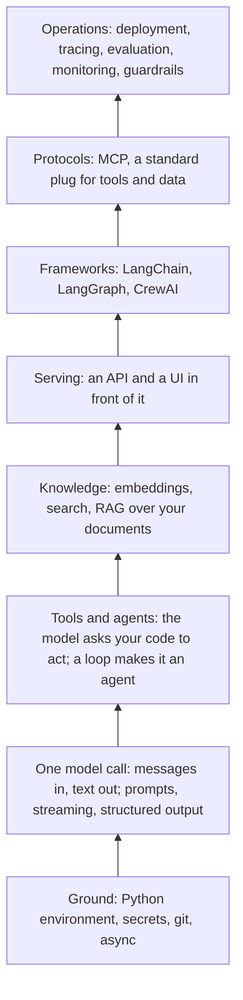

# 00.1 · The AI engineering landscape and this repo

**Module:** [00 · Setup and Python for AI work](../README.md) · **Time:** 45-60 minutes · **Model needs:** none

## What you will learn

- What "AI engineering" covers: the layers between a single model call and a monitored
  system in production, and how each layer builds on the one below.
- Where the names you hear (RAG, agents, MCP, LangChain, LangGraph, CrewAI, guardrails) sit
  in that stack.
- Why this course builds each idea by hand before showing the framework that does it for you.
- How this repo is laid out, and the handful of `./run` commands you will use every day.

## The idea

AI engineering is the work of turning a language model into a dependable part of a
software system. The model itself is somebody else's product: you reach it over HTTP. Your
job is everything around it: what you send, what you do with the reply, what the model is
allowed to touch, and how you know it is working.

That work stacks up in layers. Each one only makes sense once the layer below is solid.



A short tour of the vocabulary, bottom to top:

| Term | What it is, in one line |
|---|---|
| **LLM call** | One HTTP request: a list of messages goes out, one reply comes back. Everything else is built from this. |
| **Prompt** | The text you send, including the `system` message that gives the model its job and rules. Prompt engineering is writing that text on purpose. |
| **Structured output** | Asking for JSON that matches a schema, so your code can read the reply instead of a human. |
| **Tools** (function calling) | You describe functions to the model; it replies "please call `reset_password(user='aiko')`"; your code runs it and sends back the result. The model never runs anything itself. |
| **Agent** | A loop around tool calling: call the model, run the tools it asks for, feed results back, repeat until it is done. |
| **RAG** (retrieval-augmented generation) | Look up relevant passages from your documents, put them in the prompt, ask the model to answer from them. The model learns nothing; you just show it the right page. |
| **MCP** (Model Context Protocol) | A standard way to expose tools and data to any model client, so one ticket-system server works with many assistants. |
| **LangChain, LangGraph, CrewAI** | Frameworks. LangChain packages common patterns (prompts, chains, retrievers), LangGraph models an app as a graph of steps with state, CrewAI organises several agents into a team. |
| **Serving** | Putting your code behind an HTTP API (FastAPI) or a quick UI (Streamlit, Gradio) so people can use it. |
| **Deployment** | Packaging it (containers) and running it somewhere other than your laptop. |
| **Monitoring and evaluation** | Recording every call (tracing), measuring answer quality on a fixed test set, watching cost and latency. |
| **Guardrails** | Checks before and after the model: block prompt injection, strip personal data, refuse out-of-scope requests. |

### Why by hand first

Every framework in the list above is a convenience layer over the same few things: a
message list, a model call, a tool loop, a retrieval step. If you have only ever used the
framework, a strange error deep inside it is a wall. If you have built the loop yourself in
thirty lines, you know what the framework is doing and where to look. So module 02 builds
an agent with plain Python, module 04 builds RAG by hand, and only then do modules 06-09
show LangChain and LangGraph doing the same thing with less code.

### This repo

```
ai-engg-training/
  README.md          setup and everyday commands
  CURRICULUM.md      every module and lesson, with status (generated)
  curriculum.toml    the single list of modules and lessons
  .env.example       template for your settings; copy to .env
  .env               YOUR endpoint, key and model (never committed)
  pyproject.toml     what the project depends on
  uv.lock            the exact versions everyone installs
  run / run.cmd      the launcher (macOS/Linux / Windows)
  modules/
    00-setup/
      01-the-ai-engineering-landscape-and-this-repo/
        README.md      this file
        01_where_am_i.py
        02_course_map.py
    01-foundations/ ...
  src/labkit/        shared plumbing: client, printing, logs, launcher, doctor
  tests/             checks that every ready lesson still runs
  logs/              one log file per lesson run (created on first run)
```

Lessons do not depend on each other's code: each folder is self-contained. Lesson scripts
call the model SDK (`openai`) directly so you read the real API; `labkit` only handles
printing, logging and friendly error messages.

### The commands

On macOS, Linux and WSL type `./run`; on Windows type `run` (no `./`).

| Command | What it does |
|---|---|
| `./run` | Menu: pick a module, then a lesson |
| `./run list` | Every lesson, its status, and whether your model can run it |
| `./run 01.1` | Run every script of lesson 01.1, in order |
| `./run 00.1/2` | Run only the second script of lesson 00.1 |
| `./run 01.1 --raw` | Also print the HTTP requests and responses on the wire |
| `./run doctor` | Check your machine, settings, endpoint and model capabilities |
| `./run doctor --report` | Same, and write `doctor-report.txt` (no secrets) to send to your instructor |

Every script is also an ordinary Python file you can run with `uv run python <path>`.

## Scripts

Run both in order with `./run 00.1` (Windows: `run 00.1`), or one at a time.

### 1. `01_where_am_i.py`: the machine, the repo and the endpoint

```
./run 00.1/1
```

Prints which Python is running, where the repo lives, which of the important files are
present, and your model settings with the key masked. If an endpoint is configured it ends
with one "hello" call to prove the whole chain works; if not, it stops there and tells you
what to fill in. Either outcome is fine for this lesson.

**Expected output** (paths, versions and the reply will differ):

```
─────────────────────────────── 00.1/1  Where am I? ───────────────────────────────

Step 1: The machine and the Python running this script ────────────────────────────
Environment
{
  "operating system": "Darwin 25.5.0 (arm64)",
  "python version": "3.12.10",
  "python executable": "/path/to/ai-engg-training/.venv/bin/python"
}
The executable should live inside this repo's .venv folder. Lesson 00.2 explains why.

Step 2: The repo: what lives where ────────────────────────────────────────────────
Repo root: /path/to/ai-engg-training
  found    README.md        start here: setup and everyday commands
  found    CURRICULUM.md    the whole journey: every module and lesson, with status
  found    curriculum.toml  the list CURRICULUM.md is generated from
  found    .env             YOUR settings: endpoint, key, model (never committed)
  found    .env.example     the template .env is copied from
  found    modules          the lessons: one folder per module, one folder per lesson
  found    src/labkit       shared plumbing: client, printing, logs, launcher, doctor
  found    tests            checks that every ready lesson still runs
  found    logs             a record of every lesson run (created on first run)
'missing' is normal for .env before setup and for logs before your first run.

Step 3: The model endpoint ────────────────────────────────────────────────────────
Settings (the key is masked, never printed)
{
  "LLM_BASE_URL": "https://your-provider.example/v1",
  "LLM_MODEL": "your-model-name",
  "LLM_API_KEY": "sk-...xy (51 chars)"
}

Step 4: One hello to the model ────────────────────────────────────────────────────
This is the call the whole course is built on. Lesson 01.1 takes it apart.
Messages sent to the model
     user | Say hello to a new AI engineering student in one short sentence.
Reply from the model
assistant | Welcome to the exciting world of AI engineering—your journey starts now!
finish_reason: stop
tokens: 13 in + 18 out = 31

Run summary: 1 model call(s), 13 in + 18 out = 31 tokens, 1.6s
Log: logs/20260101T100000Z-00.1-1.jsonl
```

Without a `.env`, Step 3 shows `(not set)` values and the script ends with
`No endpoint configured yet: ...` and a pointer to `./run doctor`. No call is made.

### 2. `02_course_map.py`: the course as a stack

```
./run 00.1/2
```

Reads `curriculum.toml` (the same file the launcher and `CURRICULUM.md` are built from) and
prints the stack from the diagram above, the modules that teach each layer, how many
lessons are ready, and what the helpdesk assistant gains at each layer. No model calls.

**Expected output** (the "ready" counts grow as lessons are published):

```
────────────────────────────── 00.1/2  The course map ─────────────────────────────

Step 1: The stack, bottom to top ──────────────────────────────────────────────────
Each layer builds on the one before it. The course follows the same order.

GROUND: A working environment, secrets, git, async Python.
    00  Setup and Python for AI work

ONE MODEL CALL: Messages in, text out. Prompts, streaming, tokens, structured output.
    01  Foundations: talking to an LLM

TOOLS AND AGENTS: The model asks your code to do things; a loop turns that into an agent.
    02  Tools and agents by hand
...
OPERATIONS: Tracing, evaluation, containers, monitoring, guardrails, automation.
    10  Tracing, evaluation and testing
    16  Containers and deployment
    ...

Step 2: What is ready today ───────────────────────────────────────────────────────
  00  [..........] 0/5  Setup and Python for AI work
  01  [#.........] 1/7  Foundations: talking to an LLM
  02  [..........] 0/5  Tools and agents by hand
  ...
1 of 99 lessons ready across 21 modules. 'planned' lessons are outlined in CURRICULUM.md.

Step 3: The running scenario: IT helpdesk assistant ───────────────────────────────
Every lesson ends by applying its idea to the same assistant, at an invented company, Larkspur Labs.
  after One model call    it answers a single ticket in one shot
  after Tools and agents  it looks up tickets and resets passwords itself
  after Knowledge         it answers from the company knowledge base and cites it
  ...
  after Operations        it is monitored, guarded and deployed

Step 4: Where to go next ──────────────────────────────────────────────────────────
New to Python environments?  ./run 00.2
Ready for the model?         ./run 01.1
Browse everything:           ./run

Run summary: no model calls, 0.0s
Log: logs/20260101T100000Z-00.1-2.jsonl
```

## Try this

1. **Use the menu.** Run `./run` with no arguments and find this lesson by browsing. Then
   run `./run list` and look at the "Your setup" column: which lessons can your endpoint run?
2. **Run the doctor.** `./run doctor` checks everything `01_where_am_i.py` checked, plus a
   real call and a probe of what your model supports (streaming, tools, JSON). Compare.
3. **See the wire.** Run `./run 00.1/1 --raw` with an endpoint configured. Find the URL,
   the headers (the key is masked) and the JSON body. That is the whole API.
4. **Read a log.** Open the newest file in `logs/`. Every step and call of the run is there,
   one JSON object per line.
5. **Change the map.** In `02_course_map.py`, add a gain of your own to `HELPDESK_GAINS`
   (for example after "Knowledge" it "answers in the employee's language") and rerun.
6. **Place a buzzword.** Pick a term you have heard at work (vector database, fine-tuning,
   function calling, LLM-as-judge) and decide which layer of the diagram it belongs to.
   Check your guess against `CURRICULUM.md`.

## If it does not work

- `./run: Permission denied` on macOS or Linux: run `chmod +x run setup.sh` once.
- `This repo is not set up yet`: run `./setup.sh` (Windows: `setup`), then try again.
- `missing  .env` in Step 2: copy `.env.example` to `.env` and fill in the three `LLM_`
  values. This lesson works without it; module 01 does not.
- The hello call fails: run `./run doctor`. It names the problem (wrong key, wrong model
  name, endpoint unreachable) and the fix. If you are still stuck, `./run doctor --report`
  writes a file you can send to your instructor; it contains no secrets.

## In the running scenario

The course follows one system from start to finish: an IT helpdesk assistant at the
invented company Larkspur Labs. The course map shows what it gains at each layer: first it
answers a single ticket, then it uses tools to look tickets up, then it answers from the
company knowledge base, and by the end it is served, monitored and guarded. Before any of
that, it needs solid ground: a reproducible environment, safe secrets, clean version
control and the ability to handle many tickets at once. That is the rest of module 00.

**Next:** 00.2 · Environments and dependencies: uv, venv, pip, pyenv, conda
