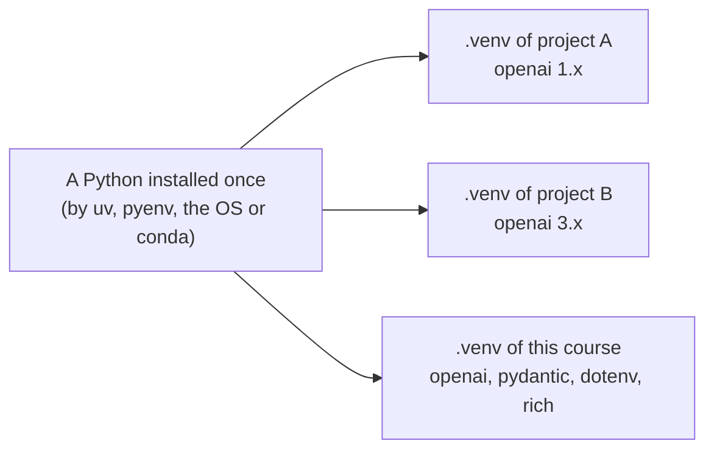
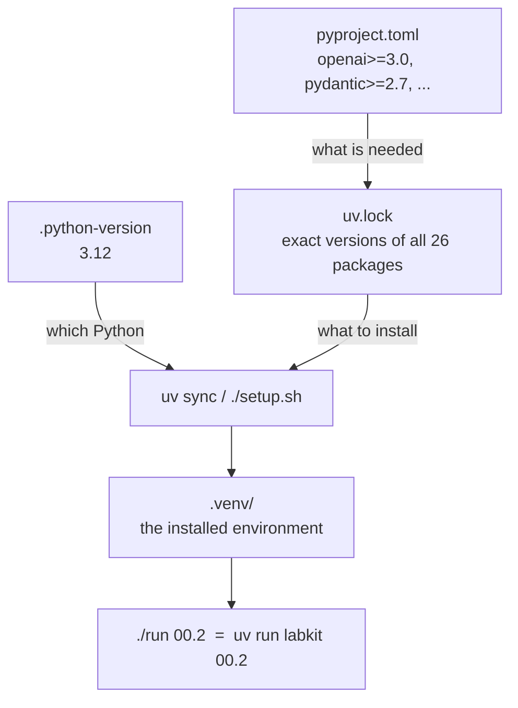

# 00.2 · Environments and dependencies: uv, venv, pip, pyenv, conda

**Module:** [00 · Setup and Python for AI work](../README.md) · **Time:** 45-60 minutes · **Model needs:** none

## What you will learn

- What a **virtual environment** is, and why every Python project gets its own.
- What uv, venv, pip, pyenv and conda each do, and when you will meet each one at work.
- The difference between a dependency **range** (`openai>=3.0`) and a **pinned** version
  (`openai==3.60.0`), and why a **lockfile** (`uv.lock`) exists.
- How this repo's `pyproject.toml`, `uv.lock` and `.python-version` fit together.
- A typical folder structure for a small AI application.

## The idea

When you type `pip install openai`, the package goes into a folder that belongs to one
particular Python. If that Python is shared by every project on your machine, project A
needing `openai` 1.x and project B needing 3.x is a conflict you cannot win. Upgrading for
one breaks the other.

A **virtual environment** is the fix. It is just a folder (here, `.venv/`) containing its
own `site-packages` for installed libraries and a small `python` launcher that borrows an
interpreter installed elsewhere. Packages installed into it stay there. Delete the folder
and the environment is gone, with nothing else affected. You never commit it: it is large,
machine-specific, and can be rebuilt in seconds from the files below.



"Activating" an environment (`source .venv/bin/activate`) only puts its `python` first on
your `PATH`. Nothing else. `./run` and `uv run` skip that step and always use this repo's
`.venv` directly, which is why they work whether or not you activated anything.

### The tools

| Tool | What it does | When you meet it |
|---|---|---|
| **venv** | Built into Python (`python -m venv .venv`). Creates a virtual environment. Nothing more. | Everywhere; it is the baseline every other tool builds on or imitates. |
| **pip** | Installs packages into whichever environment's Python runs it (`python -m pip install openai`). Resolves versions, but keeps no lockfile by default. | Older projects with `requirements.txt`; quick experiments; Docker images. |
| **pyenv** | Installs and switches between several Python *versions* (3.11, 3.12, 3.13). Does not manage packages. | Teams that need a specific Python per project, often together with venv + pip. |
| **conda** | A separate ecosystem: installs Python itself, Python packages *and* non-Python libraries (CUDA, MKL), into named environments. | Data science and GPU work; corporate laptops with Anaconda preinstalled. |
| **uv** | One fast tool that does all of the above for pure-Python projects: installs Python versions, creates `.venv`, resolves and locks dependencies, runs commands. | Newer projects, including this one. Commands: `uv sync`, `uv add`, `uv run`. |

You do not have to pick one forever. The concepts are the same in all of them:
*which Python*, *which environment*, *which exact packages*.

### Ranges, pins and lockfiles

`pyproject.toml` states what the project *needs*, as ranges: `openai>=3.0` means "3.0 or
anything newer". Two people installing a month apart can get different versions, and one
of them gets a bug the other cannot reproduce.

A **pin** is an exact version (`openai==3.60.0`). Pinning only your direct dependencies is
not enough, because `openai` itself depends on `anyio`, `pydantic` and others, each with
their own ranges.

A **lockfile** records the exact version of *every* package in the tree, direct and
indirect, with hashes. `uv.lock` is that file. `uv sync` installs exactly what it lists, so
everyone on the course has the same 26 packages. You commit the lockfile; you never edit it
by hand. When you add or upgrade something (`uv add httpx`, `uv lock --upgrade`), uv
rewrites it and you commit the change.

### How this repo fits together



- `.python-version` tells uv which Python to use (3.12). uv downloads it if needed.
- `pyproject.toml` lists the direct dependencies and declares the `labkit` package in
  `src/`. `requires-python = ">=3.11"` is the minimum; `.python-version` is the choice.
- `uv.lock` is the resolved, exact list. Committed.
- `.venv/` is the result. Not committed (it is in `.gitignore`).

The setup script runs `uv sync`. If uv cannot be installed, the README's fallback is
`python -m venv .venv` and `pip install -e .`, which works but ignores the lockfile.

### A typical AI app layout

```
helpdesk-assistant/
  pyproject.toml        dependencies and project metadata
  uv.lock               exact versions (committed)
  .python-version       the Python version
  .env.example          the settings it needs, with placeholder values (committed)
  .env                  real settings and keys (ignored)
  .gitignore
  src/helpdesk/
    __init__.py
    config.py           reads and validates settings (lesson 00.3)
    llm.py              the one place that talks to the model
    prompts.py          system prompts and templates
    tools.py            functions the model may call
    app.py              the API or UI entry point
  tests/
  data/                 sample documents (large or private data stays out of git)
```

The pattern that matters: settings in one place, model calls in one place, prompts kept
as data you can read and review, and tests that do not need a real key.

## Scripts

Run both in order with `./run 00.2` (Windows: `run 00.2`), or one at a time.

### 1. `01_which_python.py`: which Python is this?

```
./run 00.2/1
```

Asks the running interpreter where it lives, compares `sys.prefix` with `sys.base_prefix`
to decide whether it is a virtual environment, checks whether it is *this* repo's `.venv`,
and lists `sys.path`, the folders `import` searches in order. No model calls.

**Expected output** (paths will differ):

```
───────────────────────────── 00.2/1  Which Python is this? ────────────────────────────

Step 1: Ask the interpreter who it is ──────────────────────────────────────────────────
The running interpreter
{
  "sys.executable": "/path/to/ai-engg-training/.venv/bin/python",
  "version": "3.12.10",
  "implementation": "CPython"
}
sys.executable is the truth. What `python` means in your terminal depends on PATH; this does not.

Step 2: Is it a virtual environment? ───────────────────────────────────────────────────
A virtual environment is a folder with its own packages that borrows a Python installed elsewhere.
Two prefixes
{
  "sys.prefix (where packages for THIS run live)": "/path/to/ai-engg-training/.venv",
  "sys.base_prefix (the Python it was created from)": "/path/to/uv/python/cpython-3.12-macos-aarch64-none",
  "different, so this is a virtual environment": true
}
They differ: packages installed here stay here and cannot break other projects.

Step 3: Is it THIS repo's environment? ─────────────────────────────────────────────────
Comparison
{
  "this repo's environment": "/path/to/ai-engg-training/.venv",
  "exists": true,
  "the running Python is inside it": true,
  "VIRTUAL_ENV variable (set when a venv is 'activated')": "/path/to/ai-engg-training/.venv"
}
Yes. ./run and `uv run` always use this environment, whether or not it is activated.

Step 4: Where Python looks for packages ────────────────────────────────────────────────
An `import` searches these folders in order. The first match wins.
  1. /path/to/ai-engg-training/modules/00-setup/02-environments-and-dependencies
  2. /path/to/uv/python/cpython-3.12-macos-aarch64-none/lib/python312.zip
  3. /path/to/uv/python/cpython-3.12-macos-aarch64-none/lib/python3.12
  4. /path/to/uv/python/cpython-3.12-macos-aarch64-none/lib/python3.12/lib-dynload
  5. /path/to/ai-engg-training/.venv/lib/python3.12/site-packages
  6. /path/to/ai-engg-training/src

Run summary: no model calls, 0.0s
Log: logs/20260101T100000Z-00.2-1.jsonl
```

On Windows the executable is `.venv\Scripts\python.exe` and the folders use backslashes.

### 2. `02_installed_packages.py`: what is installed, and why exactly that?

```
./run 00.2/2
```

Reads the three layers this lesson describes: the ranges in `pyproject.toml`, the exact
versions in `uv.lock`, and what is actually installed in `.venv`, then compares them. It
ends by showing the file each `import` really loads, including `labkit` coming from `src/`
because it is installed in editable mode. No model calls.

**Expected output** (version numbers will move as the lockfile is updated):

```
─────────────────── 00.2/2  What is installed, and why exactly that? ───────────────────

Step 1: What the project asks for: pyproject.toml ──────────────────────────────────────
[project] dependencies
[
  "openai>=3.0",
  "pydantic>=2.7",
  "python-dotenv>=1.0",
  "rich>=13.7"
]
These are ranges ('3.0 or newer'), not exact versions. Ranges alone give different people different installs.

Step 2: What was chosen: uv.lock ───────────────────────────────────────────────────────
uv.lock pins 26 packages: the 4 you asked for plus everything they need.

Step 3: What is actually installed: the environment ────────────────────────────────────
Installed compared with locked
{
  "openai": {
    "installed": "3.60.0",
    "locked": "3.60.0"
  },
  "pydantic": {
    "installed": "2.14.4",
    "locked": "2.14.4"
  },
  ...
  "labkit": {
    "installed": "0.1.0",
    "locked": "0.1.0"
  }
}
Installed versions match the lockfile: you have the same packages as everyone else on this course.

Step 4: Where an import really comes from ──────────────────────────────────────────────
The name you install and the name you import can differ (python-dotenv is imported as dotenv).
Module files
{
  "import openai": ".venv/lib/python3.12/site-packages/openai/__init__.py",
  "import pydantic": ".venv/lib/python3.12/site-packages/pydantic/__init__.py",
  "import dotenv": ".venv/lib/python3.12/site-packages/dotenv/__init__.py",
  "import rich": ".venv/lib/python3.12/site-packages/rich/__init__.py",
  "import labkit": "src/labkit/__init__.py"
}
Third-party packages live in .venv/.../site-packages. labkit is imported from src/ in this repo:
it is installed in 'editable' mode, so changes to its source take effect without reinstalling.

Run summary: no model calls, 0.0s
Log: logs/20260101T100000Z-00.2-2.jsonl
```

## Try this

1. **Run it with the wrong Python.** Run `python3 modules/00-setup/02-environments-and-dependencies/01_which_python.py`
   *without* activating `.venv`. Does it even start? If it fails with
   `ModuleNotFoundError: No module named 'labkit'`, that is the lesson: a different Python
   has different packages.
2. **Activate, then compare.** Run `source .venv/bin/activate` (Windows:
   `.venv\Scripts\activate`), then `which python` (Windows: `where python`) and
   `python modules/00-setup/02-environments-and-dependencies/01_which_python.py`. The
   `VIRTUAL_ENV` line now matches. Run `deactivate` afterwards.
3. **Read the lockfile.** Open `uv.lock` and search for `name = "openai"`. Find its exact
   version and the packages listed under its `dependencies`. Those are the "everything they
   need" from Step 2.
4. **Make a throwaway environment** in a scratch folder outside this repo:
   `python3 -m venv demo-env`, `demo-env/bin/python -m pip install rich`, then
   `demo-env/bin/python -m pip list`. Delete the folder when done. Nothing else changed.
5. **See uv do the same in one line.** In that scratch folder: `uv init demo && cd demo &&
   uv add rich`. Look at the `pyproject.toml` and `uv.lock` it created.
6. **Add a package to the `PACKAGES` dict** in `02_installed_packages.py` (try
   `"anyio": "anyio"`, an indirect dependency) and rerun. It is installed and locked even
   though `pyproject.toml` never mentions it.

## If it does not work

- **`the running Python is inside it: false`**: you ran the script with another Python.
  Use `./run 00.2/1` or `uv run python <path>`, or activate `.venv` first.
- **`Differs from the lockfile`** in script 2: run `./setup.sh` again (Windows: `setup`),
  or `uv sync`. That reinstalls exactly what `uv.lock` lists.
- **`No uv.lock found`**: you installed with the pip fallback. Things work, but your
  versions may differ from everyone else's.
- **conda is active** (your prompt starts with `(base)`): it can put its own Python first
  on `PATH`. `./run` still uses `.venv`; for plain `python` commands, run
  `conda deactivate` first.
- Anything else: `./run doctor` checks the Python version, your settings and the endpoint,
  and tells you the fix.

## In the running scenario

The Larkspur Labs helpdesk assistant will be developed by several engineers, tested in CI
and deployed to a server. All of those must run the same code against the same packages,
or "the assistant answered fine on my laptop" becomes a weekly argument. A committed
`pyproject.toml` and `uv.lock`, a pinned `.python-version` and an ignored `.venv` give the
assistant a reproducible base: anyone can rebuild its exact environment with one command.

**Next:** 00.3 · Secrets and configuration with .env (planned)
