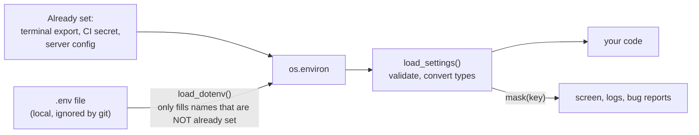

# 00.3 · Secrets and configuration with .env

**Module:** [00 · Setup and Python for AI work](../README.md) · **Time:** 45-60 minutes · **Model needs:** none

## What you will learn

- What a `.env` file is, and how `python-dotenv` turns it into environment variables.
- The precedence rule: a variable already set in the environment **wins** over the file.
- How to print configuration safely: **mask** secrets, never print them.
- Why API keys never go into code or into git, and where they go instead.
- How to **validate** configuration at startup with pydantic, so a typo fails fast and clearly.

## The idea

An AI application needs settings: which endpoint, which model, which key, how long to
wait. Some are harmless (the model name), one is dangerous (the key: anyone holding it can
spend your money). None of them belong in the code, because code is shared, copied,
pasted into chats and pushed to GitHub.

The standard answer is **environment variables**: named strings that every process
inherits from whoever started it. Your code reads `os.environ["LLM_API_KEY"]` and never
knows or cares where the value came from. On a server, the platform sets them. On your
laptop, typing `export LLM_API_KEY=...` before every session is tedious, so you put them in
a **`.env` file** instead: plain text, one `NAME=value` per line. A library,
`python-dotenv`, copies those lines into the environment when the program starts.



### Precedence: who wins

By default `load_dotenv()` does **not** overwrite a variable that already exists. That is
deliberate: the same code runs on your laptop (values from `.env`) and in CI or production
(values set by the platform), and the platform must be able to override a stray `.env`
without anyone editing it. The cost is a classic confusion: you change `.env`, nothing
happens, because an old `export` in your terminal is still winning. `override=True` flips
the rule; use it rarely and on purpose.

This course follows the same rule: `load_settings()` reads the `.env` at the repo root, and
anything already set in your terminal wins.

### Masking

Sooner or later you print your configuration to debug something, and that output lands in
a screenshot, a log file or a support ticket. So the habit is: never print a secret, print
a **mask**. This course's `mask()` shows the first three characters, the last two and the
length (`sk-...xy (51 chars)`): enough to tell *which* key is loaded, or that it was
truncated when you pasted it, and useless to anyone who sees it.

### Never commit keys

- Real values go in `.env`, which is listed in `.gitignore`.
- A **`.env.example`** with the same names and placeholder values *is* committed, so the
  next person knows which settings exist.
- In code, read from the environment. Never write `api_key = "sk-..."`, not even "just to
  test". Lesson 00.4 shows what happens when that line gets pushed.

### Validate at startup

Every environment variable is a string. `"30"` is not a number until you convert it, and
`"four"` never will be. If nothing checks, the program starts happily and fails three
hours later in front of a user with a confusing error. Better: describe your settings as a
typed object (a pydantic model), load it once at startup, and refuse to start if anything
is wrong, listing every problem by name. pydantic's `SecretStr` adds one more safeguard:
the value masks itself wherever it is printed, and code that really needs it must ask with
`.get_secret_value()`.

## Scripts

Run all three in order with `./run 00.3` (Windows: `run 00.3`), or one at a time. Scripts 1
and 3 write sample `.env` files to a temporary folder; your real `.env` is never touched.

### 1. `01_dotenv_basics.py`: what a .env file is, and who wins

```
./run 00.3/1
```

Writes a sample `.env`, reads it with `dotenv_values()` (no side effects), loads it with
`load_dotenv()`, then sets one variable first to show that the existing value wins unless
`override=True`. Ends by showing that every value is a string. No model calls.

**Expected output:**

```
─────────────────────── 00.3/1  What a .env file is, and who wins ──────────────────────

Step 1: A .env file is just text ───────────────────────────────────────────────────────
This sample was written to a temporary folder. Your real .env is not involved.
    # Lines starting with # are comments.
    DEMO_BASE_URL=https://your-provider.example/v1
    DEMO_MODEL=small-model
    DEMO_TIMEOUT=30
    DEMO_GREETING="quotes are optional, and removed"

Step 2: Read it without changing anything ──────────────────────────────────────────────
dotenv_values() parses the file into a dictionary. Every value is a string, even 30.
dotenv_values(env_file)
{
  "DEMO_BASE_URL": "https://your-provider.example/v1",
  "DEMO_MODEL": "small-model",
  "DEMO_TIMEOUT": "30",
  "DEMO_GREETING": "quotes are optional, and removed"
}

Step 3: Load it into the environment ───────────────────────────────────────────────────
Before load_dotenv()
{
  "DEMO_BASE_URL": "(not set)",
  ...
}
After load_dotenv()
{
  "DEMO_BASE_URL": "https://your-provider.example/v1",
  "DEMO_MODEL": "small-model",
  ...
}
Now any code in this process can read os.environ['DEMO_MODEL'], without knowing a file exists.

Step 4: Who wins: the file or a variable that is already set? ──────────────────────────
Variable already set, then load_dotenv(env_file):                DEMO_MODEL = set-in-the-terminal
Variable already set, then load_dotenv(env_file, override=True): DEMO_MODEL = small-model
By default the existing variable wins. That is how servers and CI override a .env without editing it,
and it is the first thing to check when 'I changed .env and nothing happened'.

Step 5: Values are strings: convert them yourself ──────────────────────────────────────
DEMO_TIMEOUT
{
  "raw value": "30",
  "type": "str",
  "after float()": 30.0
}
The temporary folder is deleted and the DEMO_ variables are removed again.

Run summary: no model calls, 0.0s
Log: logs/20260101T100000Z-00.3-1.jsonl
```

### 2. `02_masking_and_settings.py`: showing settings without leaking secrets

```
./run 00.3/2
```

Masks a few invented keys to show what a good mask looks like, labels which of the three
course settings is secret, then loads *your* real settings with `load_settings()` and
prints them with the key masked. Reports anything missing. No model calls.

**Expected output** (Step 3 shows your own endpoint and model; the key is always masked):

```
──────────────────── 00.3/2  Showing settings without leaking secrets ───────────────────

Step 1: Mask before you print ──────────────────────────────────────────────────────────
A good mask shows enough to recognise WHICH key it is, and never enough to use it.
mask(value)
{
  "a typical provider key": "sk-...Qd (50 chars)",
  "a short token": "******",
  "nothing at all": "(not set)"
}
First three characters, last two, and the length: enough to spot a wrong or truncated key.

Step 2: What is secret and what is not ─────────────────────────────────────────────────
The three settings this course needs
{
  "LLM_BASE_URL": "not secret: the address of the provider",
  "LLM_MODEL": "not secret: the model name",
  "LLM_API_KEY": "SECRET: anyone holding it can spend your money"
}

Step 3: Your real settings, safely ─────────────────────────────────────────────────────
load_settings() reads the .env at the top of the repo; variables already set in the terminal win.
load_settings()
{
  "read from": ".env file",
  "LLM_BASE_URL": "https://your-provider.example/v1",
  "LLM_MODEL": "your-model-name",
  "LLM_API_KEY": "sk-...xy (51 chars)",
  "LLM_TIMEOUT": 60.0
}

Step 4: Is anything missing? ───────────────────────────────────────────────────────────
All three required settings are present. Whether they WORK is a different question: ./run doctor asks the endpoint.

Run summary: no model calls, 0.0s
Log: logs/20260101T100000Z-00.3-2.jsonl
```

Values of eight characters or fewer (`"a short token"`) are fully hidden: showing five
characters of a six-character secret would give most of it away. Your own key in Step 3
is shown here as a placeholder; your run shows its real first and last characters. If
your `.env` still has the placeholder values from `.env.example`, Step 4 lists them as not set.

### 3. `03_helpdesk_config.py`: typed configuration for the helpdesk assistant

```
./run 00.3/3
```

Gives the helpdesk assistant a pydantic `HelpdeskConfig` with types and rules, loads a
correct `.env` into it (strings become `int` and `bool`, the token becomes a `SecretStr`),
then loads a broken one and shows every problem reported at once, by setting name. No
model calls.

**Expected output:**

```
───────────────── 00.3/3  Typed configuration for the helpdesk assistant ─────────────────

Step 1: Load a correct .env into a typed object ────────────────────────────────────────
HelpdeskConfig
{
  "company": "Larkspur Labs",
  "max_reply_sentences": "4 (int)",
  "escalation_email": "it-escalations@larkspur.example",
  "office_hours_only": "True (bool)",
  "ticket_system_token": "**********"
}
'4' became the integer 4 and 'true' became True. The token is a SecretStr: it masks itself when printed.
The code that needs the real token asks for it on purpose: config.ticket_system_token.get_secret_value()

Step 2: Load a broken .env ─────────────────────────────────────────────────────────────
Three mistakes: 'four' is not a number, the email has no @, and the token line is missing.
Rejected at startup with 3 problem(s):
  HELPDESK_MAX_REPLY_SENTENCES: Input should be a valid integer, unable to parse string as an integer
  HELPDESK_ESCALATION_EMAIL: String should match pattern '^[^@\s]+@[^@\s]+\.[^@\s]+$'
  HELPDESK_TICKET_SYSTEM_TOKEN: Field required

Step 3: Why this matters for the assistant ─────────────────────────────────────────────
Every problem is reported at once, by setting name, before a single ticket is answered.
Without validation the assistant would start, then fail in front of an employee.

Run summary: no model calls, 0.0s
Log: logs/20260101T100000Z-00.3-3.jsonl
```

## Try this

1. **Watch precedence happen for real.** In your terminal run `export LLM_MODEL=from-the-terminal`
   (PowerShell: `$env:LLM_MODEL="from-the-terminal"`), then `./run 00.3/2`. Which model is
   shown? Run `unset LLM_MODEL` (PowerShell: `Remove-Item Env:LLM_MODEL`) and run it again.
2. **Break the sample file.** In `01_dotenv_basics.py`, add a line `DEMO_SPACES = padded value `
   with spaces around `=` and at the end. What does `dotenv_values()` return for it?
3. **Remove the default.** In `03_helpdesk_config.py`, delete the line
   `HELPDESK_OFFICE_HOURS_ONLY=true` from `GOOD_ENV`. It still loads. Why? (Look at the field
   definition.) Then add `HELPDESK_OFFICE_HOURS_ONLY=maybe` and see what pydantic says.
4. **Add a rule.** Add `timeout_seconds: float = Field(gt=0, le=120)` to `HelpdeskConfig`
   and `HELPDESK_TIMEOUT_SECONDS=300` to `GOOD_ENV`. Read the error.
5. **Try to leak the token.** In script 3, add `ctx.note(repr(config))` after loading the
   good file. Is the token visible? Now print `config.ticket_system_token.get_secret_value()`
   and notice that it took a deliberate, searchable call to reveal it.
6. **Compare with `.env.example`.** Open `.env.example` (not `.env`) and check that every
   name `load_settings()` uses is documented there.

## If it does not work

- **"I changed .env and nothing happened"**: a variable of the same name is already set in
  your terminal and wins. Check with `echo $LLM_MODEL` (PowerShell: `echo $env:LLM_MODEL`),
  then `unset` it or open a new terminal.
- **`read from: environment variables only (no .env file)`**: there is no `.env` at the repo
  root. Copy `.env.example` to `.env` and fill it in.
- **A value is still listed as not set**: placeholders copied unchanged from `.env.example`
  count as not set. Replace them with real values.
- **A key that looks wrong when masked** (wrong prefix, odd length): it was probably pasted
  with a missing character or a trailing space. Copy it again from your provider.
- `./run doctor` checks every setting, makes a real call, and tells you exactly what to fix.

## In the running scenario

The Larkspur Labs helpdesk assistant needs a model key, and later a ticket-system token,
an escalation address and limits on how long its replies may be. Every one of those comes
from the environment, never from the code; the secrets are masked in every log line, and
the assistant validates its whole configuration before it answers its first ticket. A
misconfigured deployment refuses to start with a clear list of what is wrong, instead of
sending an employee a stack trace.

**Next:** 00.4 · Git and GitHub essentials for AI projects (planned)
