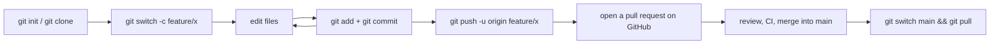
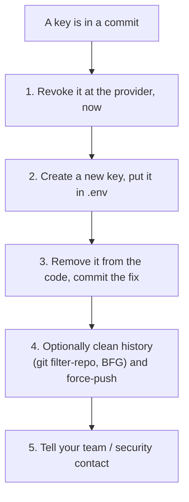

# 00.4 · Git and GitHub essentials for AI projects

**Module:** [00 · Setup and Python for AI work](../README.md) · **Time:** 45-60 minutes · **Model needs:** none

## What you will learn

- The everyday git loop: `init` or `clone`, `branch`, `commit`, `push`, and a **pull request**.
- What an AI project must keep **out** of git (`.env`, `.venv`, logs, data, model files,
  notebook checkpoints) and how `.gitignore` does it.
- Why `.gitignore` does not help with a file that is already tracked.
- How secret scanners find keys, and what to do, in which order, if a key is committed.

## The idea

Git records snapshots of a folder (**commits**) and lets several people work on separate
lines of change (**branches**) that are later merged. GitHub hosts a copy of the
repository so a team can share it and review changes as **pull requests** before they
reach the main branch.

For an AI project the dangerous part is not git itself but what you accidentally hand it.
A single `git add .` can commit your API key, gigabytes of downloaded models, or logs full
of employees' questions. Once pushed, assume it has been copied.

> **Practise in your own repo.** The commands below are for a scratch practice repository
> you create yourself (for example `~/git-practice`). Do not run commands that change
> history, branches or remotes inside this course repo; the scripts in this lesson only
> *read* it.

### The everyday loop



Try it in your practice folder:

```
mkdir git-practice && cd git-practice
git init                                  # start a new repository here
# or, to copy an existing one:  git clone https://github.com/<you>/<repo>.git

git status                                # what changed, what is staged
git switch -c feature/greeting            # a new branch for one piece of work
echo 'print("hello")' > hello.py
git add hello.py                          # stage exactly the files you mean
git commit -m "Add greeting script"       # a snapshot with a message

git remote add origin https://github.com/<you>/git-practice.git
git push -u origin feature/greeting       # publish the branch
```

Then on GitHub, open a **pull request** from `feature/greeting` into `main`. The PR shows
the diff, lets teammates comment, and runs automated checks (CI) before anyone clicks
merge. After merging, update your local copy with `git switch main` and `git pull`.

Two habits save most AI-project accidents: run `git status` before every commit, and
`git add <file>` by name instead of `git add .` until your `.gitignore` is trustworthy.

### A .gitignore for AI projects

```
# secrets
.env
.env.*
!.env.example

# environments and caches
.venv/
__pycache__/
*.pyc
.pytest_cache/

# produced at run time: may contain prompts, replies and personal data
logs/
*.log

# data and models: large, often private, rebuilt or downloaded
data/raw/
*.csv
*.parquet
models/
*.gguf
*.safetensors
*.bin
*.pt

# notebooks
.ipynb_checkpoints/

# editors and OS
.DS_Store
.idea/
.vscode/
```

Adjust the data lines to your project: small sample data that tests need can be committed;
customer data and model weights never are. Large files that must be versioned belong in
dedicated storage (object storage, Git LFS, a model registry), not in ordinary git.

### Ignored is not the same as untracked

`.gitignore` only stops git from **adding new** files. If `.env` was committed once, it
stays tracked and every later change to it is committed too. `git ls-files` shows what is
tracked; `git rm --cached .env` stops tracking it while leaving your local copy alone. Any
key that was in it must still be treated as leaked.

### If a key is committed



Order matters. **Revoking is the only step that makes you safe.** Bots scan public GitHub
for new keys within minutes; forks, clones, CI caches and the PR view may already hold the
commit. Rewriting history afterwards keeps the key out of future clones, but it is
cleanup, not protection.

GitHub helps: **secret scanning** recognises keys from many providers in public
repositories (and in private ones where it is enabled) and alerts you or the provider, and
**push protection** can block a push that contains a recognised key before it lands. Local
tools (pre-commit hooks such as `gitleaks` or `detect-secrets`) catch it even earlier, on
your machine. All of them work the way script 2 shows: patterns that match the *shape* of
a key.

## Scripts

Run both in order with `./run 00.4` (Windows: `run 00.4`), or one at a time. Both only
read; neither changes anything in git.

### 1. `01_is_my_repo_safe.py`: is my repo safe to push?

```
./run 00.4/1
```

Asks git two questions about this repo: is each dangerous path (`.env`, `.venv/`, `logs/`,
`.labkit/`, `__pycache__/`) **ignored**, naming the `.gitignore` rule responsible; and is
any `.env` file already **tracked**. It also confirms the files others need (`.env.example`,
`.gitignore`, `pyproject.toml`, `uv.lock`) are tracked. No model calls.

**Expected output** (your git version and branch name will differ):

```
──────────────────────────── 00.4/1  Is my repo safe to push? ───────────────────────────

Step 1: Is git here, and is this a repository? ─────────────────────────────────────────
git version 2.39.3, on branch 'main'.

Step 2: Are the dangerous paths ignored? ───────────────────────────────────────────────
`git check-ignore -v <path>` answers yes or no, and names the .gitignore rule responsible.
  ignored      .env           by .gitignore:2:.env          (holds your API key)
  ignored      .venv/         by .gitignore:7:.venv/        (installed packages: large, and rebuilt from the lockfile)
  ignored      logs/          by .gitignore:16:logs/        (run logs: may contain prompts, replies and personal data)
  ignored      .labkit/       by .gitignore:17:.labkit/     (local cache from the doctor)
  ignored      __pycache__/   by .gitignore:8:__pycache__/  (compiled Python files)

Step 3: Is anything secret already tracked? ────────────────────────────────────────────
.gitignore only stops NEW files being added. A file committed earlier stays tracked.
  No .env file is tracked.
  .env.example     tracked
  .gitignore       tracked
  pyproject.toml   tracked
  uv.lock          tracked

Step 4: Verdict ────────────────────────────────────────────────────────────────────────
Safe to push: secrets and local clutter are ignored, and the files others need are tracked.
Run this in your own projects too: copy the script and edit the two lists at the top.

Run summary: no model calls, 0.1s
Log: logs/20260101T100000Z-00.4-1.jsonl
```

If the course was downloaded as a zip rather than cloned, Step 1 says the folder is not a
git repository and the script stops there.

### 2. `02_find_leaked_keys.py`: catching a key before it is committed

```
./run 00.4/2
```

Writes a deliberately bad `settings.py` for the helpdesk bot, full of **invented** keys, to
a temporary folder, then scans it line by line with four regular expressions, the way a
secret scanner does. Every hit is reported with the value masked. It finishes with what
the scanner cannot see and the steps to take if a key is committed. No model calls.

**Expected output** (the keys are invented for this demo, so their masked forms are shown as they appear):

```
───────────────────── 00.4/2  Catching a key before it is committed ──────────────────────

Step 1: A settings file someone is about to commit ─────────────────────────────────────
Written to a temporary folder. Every key in it is invented. Values are masked below, as a scanner would.
   1 | # settings.py for the Larkspur Labs helpdesk bot (a deliberately bad example)
   2 | import os
   3 |
   4 | COMPANY = "Larkspur Labs"
   5 | MODEL = "small-model"
   6 | API_KEY = "<sk-...m9 (50 chars)>"          # pasted in "just to test"
   7 | CLOUD_ACCESS_KEY = "<AKI...KD (20 chars)>"
   8 | TICKET_SYSTEM_HEADERS = {"Authorization": "<Bea...Jl (57 chars)>"}
   9 | password = "<hun...ur (16 chars)>"
  10 | ESCALATION_EMAIL = "it-escalations@larkspur.example"
  11 | GOOD_API_KEY = os.environ["LLM_API_KEY"]   # the right way: read it from the environment

Step 2: Scan it ────────────────────────────────────────────────────────────────────────
4 patterns, each tried on every line:
  provider API key (sk-...)    \bsk-[A-Za-z0-9_-]{20,}
  cloud access key (AKIA...)   \bAKIA[0-9A-Z]{16}\b
  bearer token                 Bearer\s+[A-Za-z0-9._-]{20,}
  hard-coded password          (?i)\b(?:password|passwd|secret)\b\s*[=:]\s*["']([^"']{6,})["']
4 finding(s)
[
  {
    "line": 6,
    "looks like": "provider API key (sk-...)",
    "value": "sk-...m9 (50 chars)"
  },
  ...
  {
    "line": 9,
    "looks like": "hard-coded password",
    "value": "hun...ur (16 chars)"
  }
]

Step 3: What the scanner did not flag, and why ─────────────────────────────────────────
Line 11 reads the key from the environment: there is no secret in the file, so nothing to find.
Line 10 is an email address: sensitive perhaps, but not a credential.
A scanner only knows shapes. A key in an unusual format walks straight past it.

Step 4: If a key does get committed ────────────────────────────────────────────────────
1. Revoke the key at the provider NOW. This is the only step that makes you safe.
2. Create a new key and put it in .env (which is ignored).
3. Remove the key from the code and commit the fix.
4. Do not rely on deleting the commit: clones, forks and caches may already hold it.

Run summary: no model calls, 0.0s
Log: logs/20260101T100000Z-00.4-2.jsonl
```

## Try this

1. **Ask git yourself.** From the repo root run the read-only commands the script uses:
   `git check-ignore -v .env`, `git check-ignore -v modules` (no output, exit code 1: not
   ignored) and `git ls-files | head`.
2. **Extend the checklist.** Add `("notebooks/.ipynb_checkpoints/", "Jupyter autosaves")`
   and `("models/", "downloaded model weights")` to `MUST_BE_IGNORED` in
   `01_is_my_repo_safe.py` and rerun. Which ones does this repo's `.gitignore` miss?
3. **Run it on your own project.** Copy `01_is_my_repo_safe.py` next to another project,
   replace the `labkit` imports with `print`, and point `cwd` at that project.
4. **Beat the scanner.** In `02_find_leaked_keys.py`, add a line to `SAMPLE_FILE` such as
   `TOKEN = "lark_live_9f8e7d6c5b4a39281706"`. It is not flagged. Write a fifth pattern that
   catches it without also matching the email on line 10.
5. **Practise the loop** in a scratch repo (not this one): `git init`, commit a file,
   create a branch, commit again, and look at `git log --oneline --graph --all`.
6. **Practise the rescue** in that scratch repo: commit a fake `.env`, add `.env` to
   `.gitignore`, and see that `git status` still shows changes to it. Fix it with
   `git rm --cached .env` and commit.

## If it does not work

- **`git is not installed`**: install it from https://git-scm.com/downloads, open a new
  terminal and rerun.
- **`This folder is not a git repository`**: you downloaded a zip. The scripts need a
  clone (`git clone <course url>`) to have something to inspect; script 2 works either way.
- **`NOT IGNORED`** in your own project: add the path to `.gitignore`. If it is also
  `TRACKED`, run `git rm --cached <file>`, commit, and revoke any key it contained.
- **`git push` asks for a password and rejects it**: GitHub no longer accepts account
  passwords over HTTPS. Use a personal access token, SSH keys, or the `gh auth login` CLI.
- For anything about your Python setup or settings, run `./run doctor`.

## In the running scenario

The Larkspur Labs helpdesk assistant will hold several credentials (a model key, a
ticket-system token) and produce logs that contain employees' questions about their
accounts and laptops. Its repository therefore starts with a `.gitignore` that excludes
`.env`, logs and data, a committed `.env.example`, and a pre-push check like script 1.
Changes arrive as pull requests with CI, so a key pasted "just to test" is caught by
review or push protection before it reaches the main branch. And if one slips through,
the team knows the order: revoke first, clean up second.

**Next:** 00.5 · Async Python: concurrent LLM calls (planned)
