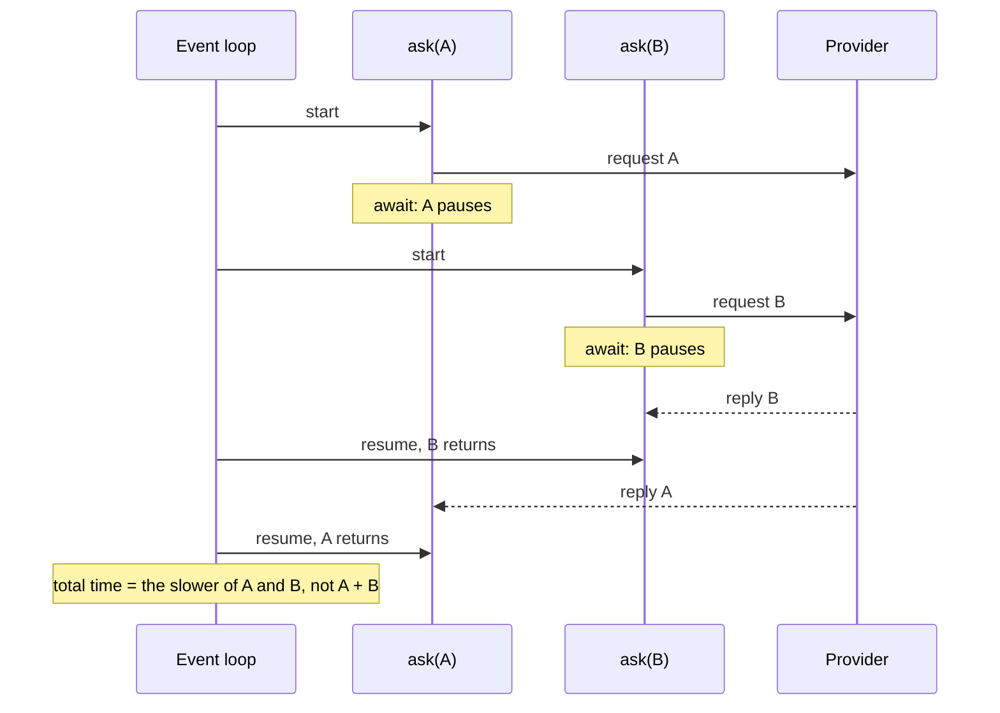

# 00.5 · Async Python: concurrent LLM calls

**Module:** [00 · Setup and Python for AI work](../README.md) · **Time:** 45-60 minutes · **Model needs:** chat

## What you will learn

- Why an LLM call is **I/O-bound**: your program spends almost all of it waiting.
- What the **event loop**, a **coroutine** and **`await`** are, in plain terms.
- How **`asyncio.gather`** runs several calls concurrently, and why the total time becomes
  the longest call instead of the sum.
- How a **semaphore** caps how many calls are in flight, so a batch stays inside the
  provider's rate limit.
- How to keep one failed call from sinking the whole batch.

## The idea

A model call is a network round trip: your program sends a request, the provider generates
a reply, and the reply comes back a second or several later. During that time your CPU
does nothing. Work like this, where the time goes into waiting for something outside the
program (network, disk, a database), is called **I/O-bound**. Work that keeps the CPU busy
(resizing images, training a model) is **CPU-bound**.

If you have ten tickets to answer and call the model for each one in turn, you wait ten
times. Nothing about the second ticket depends on the first, so the waits could overlap.
That is what `asyncio` is for.

### Event loop, coroutines, await

- A **coroutine** is a function defined with `async def`. Calling it does not run it; it
  returns a coroutine object, a piece of work that is ready to start.
- The **event loop** is the scheduler that runs coroutines. `asyncio.run(main())` starts one
  (the `@lesson` decorator does this for you when `main` is `async`).
- **`await`** means "pause me here until this finishes, and let the loop run something else
  in the meantime". Every `await` is a point where control can be handed over.
- **`asyncio.gather(a, b, c)`** starts several coroutines and waits until all of them have
  finished. Results come back in the order you passed them, not the order they completed.

It is all **one thread**. Nothing runs on several CPU cores; the loop simply never sits
idle while there is another coroutine ready to make progress. That is why asyncio helps
with model calls and does nothing for heavy computation.



### Sequential vs concurrent

```mermaid
gantt
    dateFormat X
    axisFormat %s
    section One after another
    call A :0, 6
    call B :6, 10
    call C :10, 15
    section gather
    call A :0, 6
    call B :0, 4
    call C :0, 5
```

(The bars are script 1's pretend calls, in tenths of a second.) Sequential time is the sum of the calls; concurrent time is roughly the longest one.
Concurrency changes how long **you** wait. It does not change the number of tokens or the
cost: three calls are still three calls.

### Semaphores for rate limits

Providers limit how many requests (and tokens) you may send per minute, and some limit how
many may be open at once. `gather` over 500 tickets would fire 500 requests together and
most would come back as `429 Too Many Requests`. An **`asyncio.Semaphore(n)`** is a counter
with `n` slots: `async with limit:` takes a slot or waits until one is free, and gives it
back on the way out. Everything still runs concurrently, but never more than `n` at a time.

```python
limit = asyncio.Semaphore(2)

async def answer(ticket):
    async with limit:                      # at most 2 coroutines get past this line together
        return await client.chat.completions.create(...)

results = await asyncio.gather(*(answer(t) for t in tickets), return_exceptions=True)
```

`return_exceptions=True` makes a failed call come back as an exception object in its slot
of the results list, instead of cancelling the rest. You then decide what to do with each
failure (retry, report, skip).

The async client is `openai.AsyncOpenAI`, available in lessons as `ctx.async_client`. It
has exactly the same methods as the normal client; each call is just awaited.

## Scripts

Run all three in order with `./run 00.5` (Windows: `run 00.5`), or one at a time. Script 1
makes no model calls; scripts 2 and 3 make 6 and 5 small calls.

### 1. `01_asyncio_basics.py`: waiting for several things at once

```
./run 00.5/1
```

Three pretend calls (`asyncio.sleep` for 0.6, 0.4 and 0.5 seconds) run one after another,
then together with `asyncio.gather`. Timestamps show when each was sent and answered. No
model, no cost, and the timings are almost exactly reproducible.

**Expected output:**

```
─────────────────────── 00.5/1  Waiting for several things at once ───────────────────────

Step 1: One after another ──────────────────────────────────────────────────────────────
Each `await` finishes before the next call starts. Total time = the sum of the waits.
   0.0s  call A sent
   0.6s  call A answered
   0.6s  call B sent
   1.0s  call B answered
   1.0s  call C sent
   1.5s  call C answered
Took 1.5s. Results: ['call A result', 'call B result', 'call C result']

Step 2: All at once with asyncio.gather ────────────────────────────────────────────────
gather starts every call, then waits for all of them. Total time = the longest wait.
   0.0s  call A sent
   0.0s  call B sent
   0.0s  call C sent
   0.4s  call B answered
   0.5s  call C answered
   0.6s  call A answered
Took 0.6s. Results: ['call A result', 'call B result', 'call C result']
Results come back in the order you asked, not the order they finished (B answered first).

Step 3: What just happened ─────────────────────────────────────────────────────────────
Comparison
{
  "one after another": "1.5s",
  "all at once": "0.6s",
  "speed-up": "2.5x"
}
Nothing ran in parallel on several CPU cores. One thread simply stopped waiting idly.
That is why asyncio suits model calls (waiting) and does nothing for heavy computation.

Run summary: no model calls, 2.1s
Log: logs/20260101T100000Z-00.5-1.jsonl
```

### 2. `02_sequential_vs_concurrent.py`: real model calls, timed

```
./run 00.5/2
```

The same comparison with real calls: three one-sentence questions asked one after another,
then the same three with `gather`, and the two timings compared. Six calls in total.

**Expected output** (answers, timings and token counts will differ):

```
────────────────── 00.5/2  Sequential and concurrent model calls, timed ──────────────────

Step 1: Three questions, one after another ─────────────────────────────────────────────
  Q: In one short sentence: what is an API key?
  A: An API key is a unique string of characters used to authenticate and authorize a user or application when accessing an API.
  Q: In one short sentence: what is a virtual environment?
  A: A virtual environment is an isolated directory tree that contains its own Python installation and specific package versions...
  Q: In one short sentence: what is an environment variable?
  A: An environment variable is a dynamic, named value stored by the operating system that influences how running processes behave...
Took 2.9s

Step 2: The same three questions, all at once ──────────────────────────────────────────
  Q: In one short sentence: what is an API key?
  A: An API key is a unique string of characters used to authenticate and authorize a user or application when accessing an API.
  ...
Took 0.8s

Step 3: Compare ────────────────────────────────────────────────────────────────────────
Timing for 3 calls
{
  "one after another": "2.9s",
  "all at once": "0.8s",
  "speed-up": "3.6x"
}
Concurrency changes how long YOU wait. It does not change the tokens used or the cost.
Timings vary from run to run: the provider's load is part of every measurement.

Run summary: 6 model call(s), 66 in + 154 out = 220 tokens, 3.8s
Log: logs/20260101T100000Z-00.5-2.jsonl
```

A local model on a laptop often shows little or no speed-up: it may process one request
at a time, so "concurrent" requests simply queue on the server side.

### 3. `03_helpdesk_ticket_batch.py`: the helpdesk assistant answers a batch

```
./run 00.5/3
```

Five Monday-morning tickets at Larkspur Labs, answered concurrently but never more than two
at a time (`asyncio.Semaphore(2)`). Timestamps show a new ticket starting only when a slot
frees up. `return_exceptions=True` means one failed ticket is reported as `FAILED` while
the rest are still answered. `MAX_TICKETS` caps the batch so a mistake cannot send hundreds
of calls.

**Expected output** (the replies, timings and order of completion will differ):

```
─────────────── 00.5/3  The helpdesk assistant answers a batch of tickets ────────────────

Step 1: The queue ──────────────────────────────────────────────────────────────────────
  #5001  Tomas (Sales): I forgot my password and I am locked out of email.
  #5002  Aiko (Design): The office printer on floor 2 prints blank pages.
  #5003  Priya (Finance): The VPN disconnects every few minutes when I work from home.
  #5004  Lukas (Legal): My laptop fan is very loud and the machine is slow.
  #5005  Sara (HR): I cannot open the shared drive; it says access denied.

Step 2: Answer all 5, at most 2 at a time ──────────────────────────────────────────────
Watch the timestamps: a new ticket starts only when an earlier one is answered.
   0.0s  #5001 started
   0.0s  #5002 started
   0.9s  #5002 answered
   0.9s  #5003 started
   0.9s  #5001 answered
   0.9s  #5004 started
   1.5s  #5004 answered
   1.5s  #5005 started
   1.5s  #5003 answered
   2.2s  #5005 answered

Step 3: The replies ────────────────────────────────────────────────────────────────────
  #5001 to Tomas (Sales): Please go to the Larkspur Labs password reset portal to verify your identity...
  #5002 to Aiko (Design): Please try restarting the printer by unplugging it for 30 seconds...
  #5003 to Priya (Finance): Hi Priya, please try restarting your router...
  #5004 to Lukas (Legal): Please open Task Manager and end any processes consuming high CPU...
  #5005 to Sara (HR): Please try signing out of your computer and signing back in...

Step 4: How it went ────────────────────────────────────────────────────────────────────
Batch
{
  "tickets": 5,
  "answered": 5,
  "failed": 0,
  "at most in flight": 2,
  "total time": "2.2s"
}

Run summary: 5 model call(s), 281 in + 186 out = 467 tokens, 2.2s
Log: logs/20260101T100000Z-00.5-3.jsonl
```

## Try this

1. **Change the waits.** In `01_asyncio_basics.py`, make call C take 2.0 seconds. Predict
   both totals before you run it.
2. **Block the loop.** In `pretend_call`, replace `await asyncio.sleep(seconds)` with
   `time.sleep(seconds)` (no `await`). Run it. Why is the "all at once" section now as slow
   as the sequential one? This is what happens if you use the normal, non-async client
   inside async code.
3. **Forget the await.** In `02_sequential_vs_concurrent.py`, remove the `await` in front of
   `client.chat.completions.create` inside `ask`. Read the error and the warning about a
   coroutine that was never awaited.
4. **Turn the knob.** In `03_helpdesk_ticket_batch.py`, set `MAX_AT_ONCE` to 1, then to 5.
   Compare the timestamps and the total time. Which setting would you choose for 500
   tickets on a provider that allows 60 requests per minute?
5. **Make one ticket fail.** In `answer`, add `if ticket_id == "#5003": raise RuntimeError("ticket system down")`
   as the first line. The other four are still answered. Then remove
   `return_exceptions=True` from the `gather` call and run again.
6. **Count the cost.** Run `./run 00.5/2` twice and compare the token totals in the run
   summary. Concurrency saved time; did it save tokens?

## If it does not work

- **`RuntimeError: asyncio.run() cannot be called from a running event loop`**: you are in
  a Jupyter notebook, which already runs a loop. There, use `await main()` directly instead
  of `asyncio.run(main())`.
- **Some tickets show `FAILED (RateLimitError)`**: your provider allows fewer concurrent
  requests than `MAX_AT_ONCE`. Lower it to 1 and rerun. Free tiers are often strict.
- **No speed-up at all**: common with local models and some free tiers that process one
  request at a time. The code is right; the server is serialising the requests.
- **All tickets fail**: the script re-raises the first error so the lesson can explain it
  (wrong key, wrong model, endpoint unreachable). Run `./run doctor` to check your settings
  and make a test call.

## In the running scenario

On a Monday morning the Larkspur Labs helpdesk queue holds dozens of tickets, and later in
the course the assistant will call the model, the ticket system and the knowledge base for
each one. Done one at a time, the last employee waits for everyone else's replies; done
all at once, the provider starts refusing requests. With `async` calls, `gather` and a
semaphore, the assistant works through the queue concurrently at a rate the provider
accepts, and a single failed ticket is reported instead of stopping the batch. Every
serving lesson in module 05 builds on this.

**Next:** 01.1 · Your first LLM call
