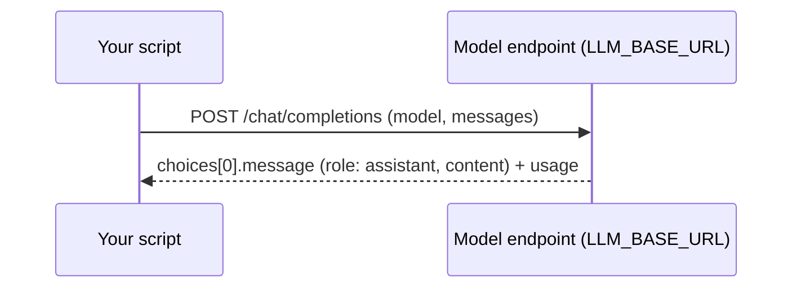
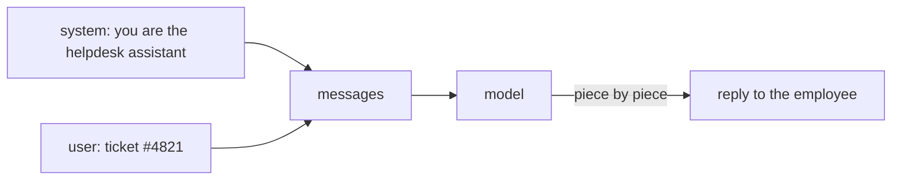

# 01.1 · Your first LLM call

**Module:** [01 · Foundations](../README.md) · **Time:** 45-60 minutes · **Model needs:** chat, streaming

## What you will learn

- A model call is one request: a list of messages goes out, and one reply comes back.
- What the reply contains, and where to find the text, the reason the model stopped and
  the token counts.
- How a system message turns a general model into an assistant with a specific job.
- What streaming is, and why chat apps use it.

## The idea

A large language model (LLM) is a program that continues text: give it the start of
something and it writes what comes next. A *chat* model puts a simple agreement on top of
that. You send a list of messages. Each message has a role (`system`, `user` or
`assistant`) and some content. The model writes the next `assistant` message.

The model remembers nothing between calls. Everything it knows about your conversation is
in the messages you send *this time*. That one fact explains most of what comes later in
the course. Memory, context windows, RAG and agents are all ways of deciding what to put in
that list.



Nearly every provider accepts this same request format. That is why this course needs only
three settings (`LLM_BASE_URL`, `LLM_API_KEY`, `LLM_MODEL`) to work with any of them.

## Scripts

Run both in order with `./run 01.1` (Windows: `run 01.1`), or one at a time.

### 1. `01_hello_llm.py`: one message out, one reply back

```
./run 01.1/1
```

This script builds a conversation with one message, sends it and prints the reply. Then it
opens up the response object to show where each part lives.

**Expected output** (the wording of the reply and the token numbers will differ):

```
──────────────────────────── 01.1/1  Hello, LLM ────────────────────────────

Step 1: Write the message ──────────────────────────────────────────────────
A chat request is a list of messages. Each message has a role and some content.
Messages sent to the model
     user | In one sentence, what is a large language model?

Step 2: Send it to the model ───────────────────────────────────────────────
Reply from the model
assistant | A large language model is a neural network trained on vast amounts of text...
finish_reason: stop
tokens: 18 in + 27 out = 45

Step 3: Look inside the response ───────────────────────────────────────────
Where things live
{
  "response.choices[0].message.role": "assistant",
  "response.choices[0].message.content": "A large language model is ...",
  "response.choices[0].finish_reason": "stop",
  ...
}

Run summary: 1 model call(s), 18 in + 27 out = 45 tokens, 1.4s
Log: logs/20260101T100000Z-01.1-1.jsonl
```

Look at the code: only one line talks to the model,
`ctx.client.chat.completions.create(model=..., messages=...)`. `ctx.client` is a standard
`openai.OpenAI` client. The `ctx.step` and `ctx.show_*` calls only print.

### 2. `02_helpdesk_first_reply.py`: the helpdesk assistant's first reply

```
./run 01.1/2
```

This script makes the same call for the course's running example, an IT helpdesk
assistant. A `system` message gives the model its job and its rules. The `user` message is
a support ticket. The reply is streamed: it arrives in small pieces as the model writes it.

**Expected output:** the two messages are printed. Then the reply appears a few words at a
time instead of all at once, followed by the token counts:

```
Step 2: Ask for the reply as a stream ──────────────────────────────────────
Reply from the model (streaming)
assistant | Hi Priya, sorry about the timing. First, turn Wi-Fi off and on again...
tokens: 96 in + 58 out = 154
```

If you see `tokens: not reported by this endpoint`, your provider does not send token
counts for streamed replies. The lesson still works.



## Try this

1. **See the wire.** Run `./run 01.1/1 --raw`. Find the request body. Is there anything in it
   besides the model name and the messages? This is the entire API.
2. **Change the question** in `01_hello_llm.py` to ask for "three bullet points". Watch
   `completion_tokens` change. You pay for tokens in both directions.
3. **Remove the system message** from `02_helpdesk_first_reply.py` and run it again. How do
   the tone and length of the reply change? What did the system message give you?
4. **Break a rule on purpose.** Add "Reply only in formal legal English" to the system
   prompt. Which instruction wins when the rules conflict?
5. **Run script 1 twice.** Is the reply identical, word for word? Remember your answer for
   lesson 01.3 (sampling parameters).
6. **Open the log file** named at the end of a run. Everything the script sent and received
   is recorded there.

## If it does not work

Run `./run doctor`. It checks your settings, makes a real call and tells you exactly what
to fix. The lesson scripts also explain the common failures (wrong key, wrong model name,
endpoint unreachable) instead of printing a stack trace.

## In the running scenario

The helpdesk assistant can now answer a single ticket in one go. It has no memory of
earlier messages, it cannot look anything up and it cannot take any action. The rest of
module 01 gets more out of a single call. Module 02 gives the assistant tools.

**Next:** 01.2 · Messages, roles and multi-turn conversation
