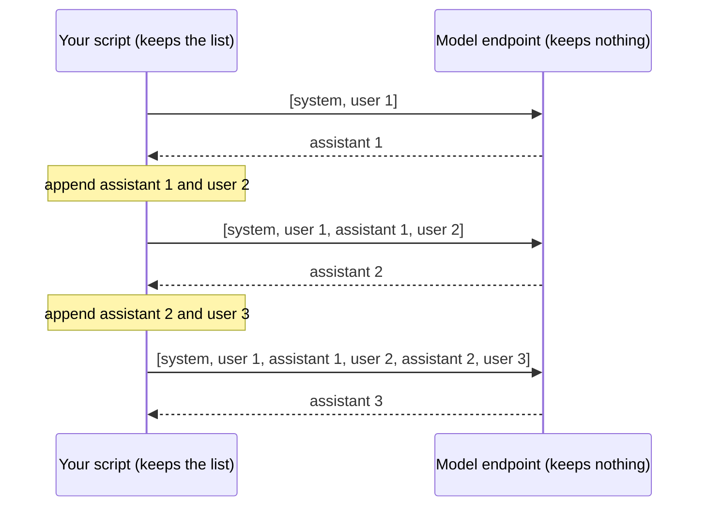
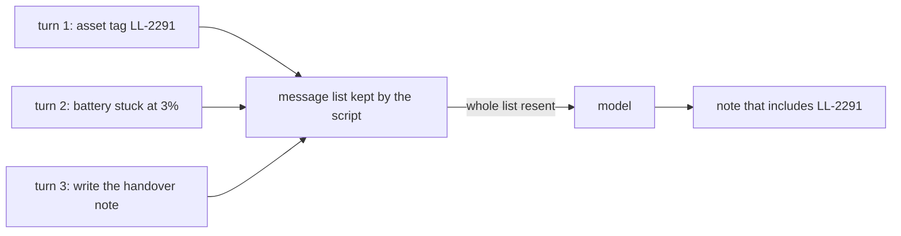

# 01.2 · Messages, roles and multi-turn conversation

**Module:** [01 · Foundations](../README.md) · **Time:** 45-60 minutes · **Model needs:** chat

## What you will learn

- A model is stateless: it remembers nothing from one call to the next.
- A "conversation" is a list of messages that *your code* keeps and sends again, in full,
  every time.
- What the three roles are for: `system` (the rules), `user` (the person) and `assistant`
  (the model's earlier replies).
- Why every turn of a conversation costs more than the one before it.

## The idea

In lesson 01.1 you sent one message and got one reply. Chat apps feel different: you ask a
follow-up question and the assistant knows what "it" refers to. Nothing changed inside the
model to make that happen. The app simply sends the **whole conversation again**, with your
new message added at the end.

Every chat app runs this loop:

1. Add the user's new message to the list.
2. Send the entire list to the model.
3. Add the model's reply to the list (role `assistant`).
4. Go back to step 1.



The roles tell the model who said what:

| Role | Written by | Purpose |
|---|---|---|
| `system` | You, the developer | The job, the rules, the tone. Usually first, usually once. |
| `user` | The person using your app | Questions and requests. |
| `assistant` | The model (stored and sent again by you) | Its earlier replies, so it can stay consistent with them. |

This has two consequences, and both come back throughout the course.

First, you control the memory. Because your code builds the list, it can change it: drop
old turns, summarise them, or add facts the user never typed. Lesson 01.4 and module 02 do
this.

Second, long conversations cost more. Turn 10 sends turns 1 to 9 again. The number of
prompt tokens (the pieces of text you send, which you pay for) grows with every turn, even
when each message is short.

## Scripts

Run all three in order with `./run 01.2` (Windows: `run 01.2`), or one at a time.

### 1. `01_the_model_forgets.py`: proof that the model is stateless

```
./run 01.2/1
```

This script makes three calls. Call 1 tells the model a fact. Call 2 asks about the fact in
a new request, and the model cannot answer. Call 3 asks the same question but sends call
1's messages again, and now the model can answer.

**Expected output** (wording and token numbers will differ):

```
Step 1: Call 1: tell the model a fact ──────────────────────────────────────
Messages sent to the model
     user | My favourite colour is teal. Reply with just the word: Noted.
Reply from the model
assistant | Noted.
tokens: 15 in + 3 out = 18

Step 2: Call 2: ask about it in a brand-new call ───────────────────────────
This request contains only the question. Nothing from call 1 is in it.
Messages sent to the model
     user | What is my favourite colour? Answer in one short sentence.
Reply from the model
assistant | I do not know your favourite colour, as I don't have access to your personal information.
tokens: 12 in + 20 out = 32

Step 3: Call 3: ask again, resending the history ───────────────────────────
Messages sent to the model
     user | My favourite colour is teal. Reply with just the word: Noted.
assistant | Noted.
     user | What is my favourite colour? Answer in one short sentence.
Reply from the model
assistant | Your favourite colour is teal.
tokens: 30 in + 6 out = 36

Run summary: 3 model call(s), 57 in + 29 out = 86 tokens, 5.7s
```

Look at the code: the only difference between call 2 and call 3 is what is in the
`messages` list. Notice that the `assistant` message in call 3 was put there by *the
script*. The model has no way to check whether it really said it.

### 2. `02_conversation_loop.py`: the loop behind every chat app

```
./run 01.2/2
```

This script runs three scripted turns through the loop (add, send, add). It prints the full
list before every call, and then the prompt tokens for each turn.

**Expected output** (shortened):

```
Step 4: Turn 3: append the user message, send everything ───────────────────
Messages sent to the model (6 messages)
   system | You are a concise, practical assistant.
     user | I'm planning a team lunch for 8 people next Friday. Suggest one type of cuisine, in one sentence.
assistant | I recommend ordering a variety of Thai curries, stir-fries, and appetizers, ...
     user | Two of us are vegetarian. Does your suggestion still work? One sentence.
assistant | Yes, Thai cuisine is highly vegetarian-friendly since most dishes can be ...
     user | Good. Remind me: how many people, and which day? One sentence.
Reply from the model
assistant | You are planning lunch for 8 people next Friday.
tokens: 120 in + 11 out = 131

Step 5: What grew ──────────────────────────────────────────────────────────
The list now holds 7 messages. Prompt tokens sent on each turn:
  turn 1: 32
  turn 2: 79
  turn 3: 120
Each turn resends all earlier turns, so every turn costs more than the one before.
```

To chat with it yourself, add `--chat`. This works in a real terminal. An empty line stops
it, and it ends by itself after 6 turns:

```
./run 01.2/2 --chat
```

### 3. `03_helpdesk_conversation.py`: a helpdesk conversation that remembers

```
./run 01.2/3
```

This is the running example over three turns. The employee gives the laptop's asset tag in
turn 1 only. In turn 3 they ask for a handover note for the on-site technician, and a
useful note has to include that tag. The script checks whether the reply contains it.

**Expected output** (shortened):

```
Step 3: Turn 3 of 3 ────────────────────────────────────────────────────────
Messages sent to the model (6 messages)
   system | You are the first-line IT helpdesk assistant at Larkspur Labs.
          | Reply in at most three short sentences. Be friendly and plain; no jargon.
     user | Hi, this is Omar from Sales. My laptop (asset tag LL-2291) shuts down by itself when I unplug the charger.
assistant | Hi Omar, thanks for reaching out. It sounds like your laptop battery may need ...
     user | The battery icon says 'plugged in, not charging' and it has been stuck at 3% for two days.
assistant | That confirms it is likely a hardware issue with the battery. ...
     user | OK, I can't fix that myself. Please write the two-line handover note for the on-site technician.
Reply from the model
assistant | Asset tag LL-2291: Laptop shuts down immediately when unplugged. Battery status is stuck at 3% and reports "plugged in, not charging."
tokens: 197 in + 35 out = 232

Step 4: Did the handover note use the detail from turn 1? ──────────────────
Asset tag LL-2291 was mentioned only in turn 1. Present in the turn-3 reply: yes
```



## Try this

1. **Break the memory.** In `02_conversation_loop.py`, comment out the line
   `messages.append({"role": "assistant", "content": reply})`. Run it. What does the model
   say in turn 3, and why can it still answer part of the question?
2. **Send only the latest message.** In `03_helpdesk_conversation.py`, change the call to
   `messages=[messages[0], messages[-1]]` (the system message plus the newest user
   message). What happens to the handover note?
3. **Put words in the model's mouth.** In `01_the_model_forgets.py`, change the `assistant`
   message in call 3 to `"Noted. Your favourite colour is orange."`. Which does the model
   believe: the user message or its own "earlier reply"?
4. **Watch the request grow.** Run `./run 01.2/2 --raw` and compare the request body of
   turn 1 with that of turn 3.
5. **Move the system message** to the end of the list in script 2. Does the model still
   follow it? (Models behave differently here, which is one reason to keep it first.)
6. **Chat until it forgets nothing.** Run `./run 01.2/2 --chat` and refer back to your
   first message in your last one. Then think about what would happen after 500 turns.
   Lesson 01.4 answers that.

## If it does not work

Run `./run doctor`. It checks your settings, makes a real call and tells you exactly what
to fix. If `--chat` does nothing, you are not in an interactive terminal (for example, the
output is being piped to another program). The script then falls back to the scripted
turns.

If the token lines say `not reported by this endpoint`, your provider does not send token
counts. The conversation still works. You just cannot see the tokens grow.

## In the running scenario

The helpdesk assistant can now hold a conversation about one ticket and use what the
employee said earlier. Its memory is exactly the message list, and that memory lasts only
while the script runs. It still cannot look anything up or take any action.

**Next:** 01.3 · Streaming and sampling parameters
