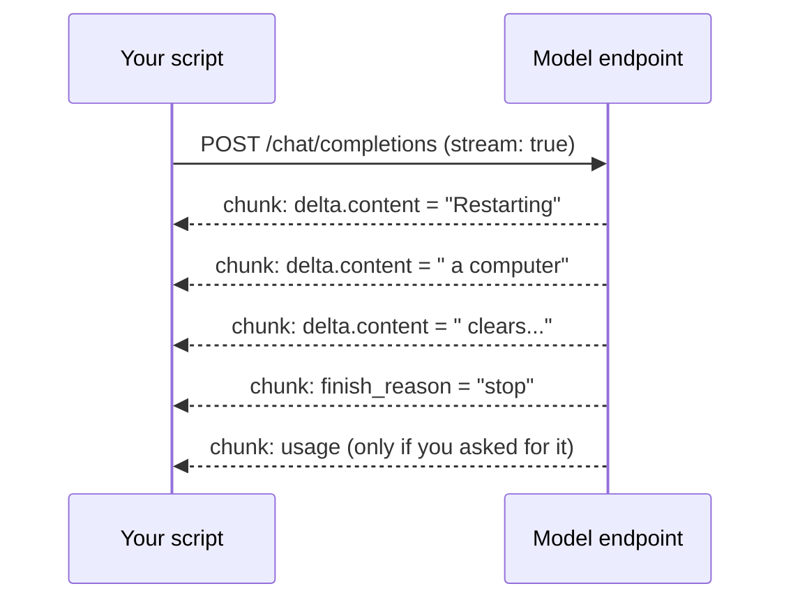
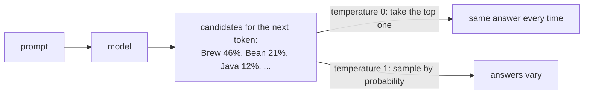

# 01.3 · Streaming and sampling parameters

**Module:** [01 · Foundations](../README.md) · **Time:** 45-60 minutes · **Model needs:** chat, streaming

## What you will learn

- How a streamed reply is built from chunks, by writing the loop yourself.
- The difference between **time to first token** and **total time**, and why it matters to users.
- What `temperature` does, and how to choose it for a task.
- The other common controls: `top_p`, `seed` and `stop`.
- That providers differ: a parameter one model accepts, another may reject.

## The idea

### Streaming

A model writes its reply one token at a time. Without streaming, the endpoint waits until
the last token is written and sends everything at once. With `stream=True`, it sends each
small piece as soon as it exists.



Each chunk has the same outline as a normal response, except that `choices[0].message` is
replaced by `choices[0].delta`: only the *new* text. Your code joins the pieces. Streaming
does not make the model faster; it shortens the wait before the reader sees *something*.

### Sampling

At every step the model has a ranked list of possible next tokens, each with a probability.
It does not always take the top one; it **samples**. The sampling parameters shape that choice.



| Parameter | What it does | Typical use |
|---|---|---|
| `temperature` | 0 = always the most likely token; higher = more willing to pick less likely ones. Range is usually 0 to 1 or 0 to 2, depending on the provider. | 0 to 0.3 for facts, extraction, classification. 0.7 to 1.0 for drafts and ideas. |
| `top_p` | Sample only from the smallest set of tokens whose probabilities add up to `top_p` (0.9 = ignore the unlikely tail). | An alternative to temperature. Change one or the other, not both. |
| `seed` | Asks the provider to make sampling repeatable. Best effort; many providers ignore it. | Reproducible tests. |
| `stop` | A list of texts; the reply ends when the model is about to write one of them. | Cutting off after one line, one item, or before a marker. |

None of these are guaranteed to exist everywhere. Some models (many "reasoning" models)
reject `temperature` entirely. Good code expects that: script 2 catches the refusal,
explains it and carries on.

## Scripts

Run all three in order with `./run 01.3` (Windows: `run 01.3`), or one at a time.

### 1. `01_streaming_by_hand.py`: write the chunk loop yourself

```
./run 01.3/1
```

Makes the same request twice: once normally, once streamed with a hand-written loop that
prints each piece as it arrives and records when the first one appeared.

**Expected output** (wording and timings will differ):

```
Step 1: Without streaming: wait, then get everything at once ───────────────
Reply from the model
assistant | Restarting a computer fixes issues primarily by clearing the Random Access Memory (RAM)...
finish_reason: stop
tokens: 30 in + 96 out = 126
You saw nothing for 2.34s, then the whole reply.

Step 2: With streaming: read the reply chunk by chunk ──────────────────────
stream=True returns an iterator. Each chunk carries a small piece of text in choices[0].delta.content.
Restarting a computer clears its volatile memory (RAM), where temporary data and active processes reside...
tokens: 30 in + 98 out = 128

Step 3: Compare ────────────────────────────────────────────────────────────
Timings
{
  "without streaming: seconds until anything appeared": 2.34,
  "with streaming: seconds until the first piece": 1.42,
  "with streaming: seconds until complete": 2.09,
  "pieces received": 6,
  "characters in the reply": 567
}
```

Read the loop in the code. Three details matter:

- `choice.delta.content` can be `None` (the first and last chunks often carry no text), so test it before using it.
- The token counts arrive in a final chunk whose `choices` list is empty, and only because
  the request asked with `stream_options={"include_usage": True}`.
- The script adds a short random "request reference" to the prompt. Some gateways store
  answers and replay them instantly for an identical request, which would make the timings meaningless.

How many pieces you get depends on the provider: some send a word at a time, others a
sentence at a time.

### 2. `02_temperature.py`: the same prompt, different settings

```
./run 01.3/2
```

Asks for a product name three times at `temperature=0.0` and three times at
`temperature=1.0`, counts the distinct answers, then shows `stop` cutting a reply short.

**Expected output** (your names will differ):

```
Step 1: The same prompt 3 times at temperature=0.0 ─────────────────────────
  run 1: Brewmaster 3000
  run 2: Brewmaster 3000
  run 3: Brewmaster 3000
  -> 1 different answer(s) in 3 run(s)

Step 2: The same prompt 3 times at temperature=1.0 ─────────────────────────
  run 1: Brewmaster 3000
  run 2: BeanStack
  run 3: The Percolator
  -> 3 different answer(s) in 3 run(s)

Step 4: A different control: stop ──────────────────────────────────────────
`stop` ends the reply as soon as the model writes a given text. The text itself is not returned.
  without stop:      one, two, three, four, five, six, seven, eight, nine, ten
  with stop=['six']: one, two, three, four, five,

Run summary: 8 model call(s), 164 in + 62 out = 226 tokens, 11.2s
```

If your model does not accept a parameter you will see a line beginning
`The provider rejected {...}` and the script continues with the next step.

### 3. `03_helpdesk_reply_styles.py`: predictable or lively?

```
./run 01.3/3
```

The running scenario has two kinds of writing. A **policy answer** must be the same for
everyone who asks, so it runs at temperature 0. An **outage announcement** should sound
human, so it runs at 1.0. Each is generated twice.

**Expected output** (shortened):

```
Step 1: Policy answer: must be consistent (temperature=0.0) ────────────────
run 1: You must change your password every 90 days, and you cannot reuse any of your last 5 passwords.
run 2: You must change your password every 90 days, and you cannot reuse any of your last 5 passwords.

Step 2: Outage announcement: may vary (temperature=1.0) ────────────────────
run 1: The 3rd-floor printers are taking a quick one-hour nap for maintenance this Thursday from 13:00 to 14:00. Please try not to start any paper-based revolutions while they're catching some Z's!
run 2: The 3rd-floor printers will be taking a quick nap for maintenance this Thursday from 13:00 to 14:00. Please plan your printing accordingly, unless you're great at drawing your own documents by hand!

Step 3: Choosing a setting ─────────────────────────────────────────────────
Two runs of each task
{
  "Policy answer: must be consistent": "identical both times",
  "Outage announcement: may vary": "different each time"
}
```

## Try this

1. **Watch the chunks.** Run `./run 01.3/1 --raw` and look at the streamed chunks. Which
   chunk carries `finish_reason`? Which carries `usage`?
2. **Remove `stream_options`** from `01_streaming_by_hand.py`. What does the token line say
   now, and why?
3. **Push the temperature.** In `02_temperature.py` set `HIGH = 1.5` (or 2.0 if your
   provider allows it). At what point do the names stop being usable? What happens if you
   go above your provider's maximum?
4. **Swap in `top_p`.** Replace `temperature=temperature` with `top_p=0.1` and then
   `top_p=1.0`. Is the effect similar?
5. **Try `seed`.** Add `seed=42` to the high-temperature calls. Do the three runs become
   identical on your provider? (Many ignore it.)
6. **Wrong setting on purpose.** In `03_helpdesk_reply_styles.py` run the policy answer at
   1.0 several times. Does any run change the facts? That is the risk you remove with a low temperature.

## If it does not work

Run `./run doctor`. The line `Capability: streaming` tells you whether your endpoint
streams at all.

- **The streamed reply appears all at once.** Your provider or a proxy in between is
  buffering the stream. The code is still correct; "time to first piece" will simply be
  close to the total time.
- **`The provider rejected {'temperature': ...}`.** Your model does not let you set it.
  The lesson still runs; to see the effect, point `LLM_MODEL` at a model that does.
- **Low-temperature answers still differ.** Normal on some providers. Temperature 0
  reduces variation; it is not a promise of identical output.

## In the running scenario

The helpdesk assistant now streams its replies so employees are not staring at a blank
screen, and it uses a low temperature when quoting policy and a higher one when writing
announcements. It still pays for every token it sends and receives, which is the subject
of the next lesson.

**Next:** 01.4 · Tokens, context windows and cost
