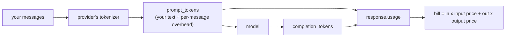
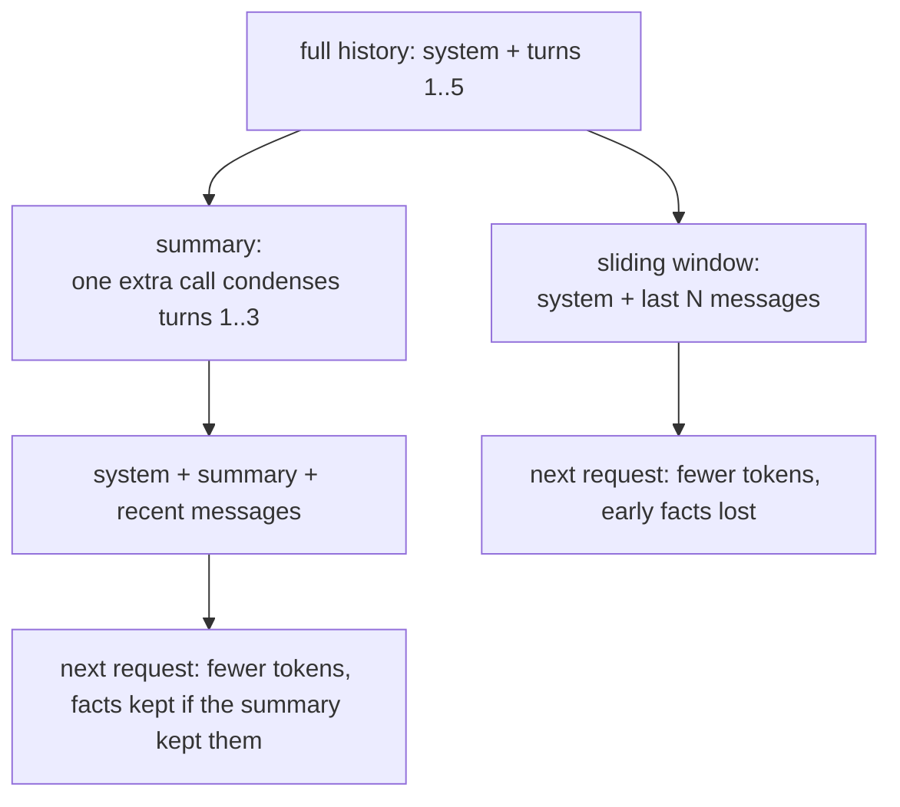

# 01.4 · Tokens, context windows and cost

**Module:** [01 · Foundations](../README.md) · **Time:** 45-60 minutes · **Model needs:** chat

## What you will learn

- What a token is, and why characters and words only roughly tell you how many tokens a
  text uses.
- Where the real count lives (`response.usage`), and what to do when an endpoint does not
  report it.
- That every request carries a small fixed overhead on top of your text.
- Why a conversation's prompt grows every turn, and what the context window limits.
- Two ways to keep a conversation small in plain Python, a sliding window and a summary of
  older turns, and what each one forgets.
- How to turn token counts into money: per ticket, per month, and per extra line of system
  prompt.

## The idea

A model does not read characters or words. Before it sees your messages, the provider cuts
the text into tokens: pieces from a fixed vocabulary. A token is often a whole common word,
and sometimes a fragment, a space plus a word, a single digit or a symbol. Each provider
uses its own tokenizer (the tool that does the cutting), so the same text can be 19 tokens
on one model and 25 on another.

Tokens are the unit behind three practical things. The first is cost: you pay per token,
with one price for input (prompt) tokens and a higher one for output (completion) tokens.
The second is the context window: a model can handle only so many tokens in one request,
prompt and reply together, and anything beyond that is refused or cut off. The third is
speed: more tokens in and out means a slower reply.

This course does not tie itself to one provider, so it uses no tokenizer library. The
number that is always right is the one the endpoint reports in `response.usage`. When you
need a guess before you call (or the endpoint reports nothing), the usual rule of thumb for
English is **characters / 4**. The scripts show both, side by side.



The model remembers nothing between calls (lesson 01.2), so a chat sends the whole
conversation again every turn. The prompt grows with each turn, and you pay again for the
early turns every time. There are two common fixes, and both are just list operations in
your code:



## Scripts

Run all three in order with `./run 01.4` (Windows: `run 01.4`), or one at a time.

### 1. `01_tokens_are_not_words.py`: count the tokens of four kinds of text

```
./run 01.4/1
```

This script first sends a short instruction on its own (the baseline). Then it sends four
texts of similar length after that same instruction: English prose, Python code, a German
sentence and a run of numbers. That is five calls. Subtracting the baseline gives the
tokens of each text. A table puts them next to the character count, the word count and the
characters / 4 estimate.

**Expected output** (trimmed; your counts depend on your provider's tokenizer):

```
Step 1: Measure the instruction on its own ─────────────────────────────────────
Messages sent to the model
     user | Reply with only the word OK. Text follows:
Reply from the model
assistant | OK
finish_reason: stop
tokens: 11 in + 1 out = 12
Baseline: 11 prompt tokens. Characters / 4 guesses 11 for the instruction text.
prompt_tokens also includes a fixed per-request overhead: role markers and the chat template
the provider wraps around every message. Some providers add several tokens per message, some
almost none (here: about 0 beyond the guess). ...

Step 6: Compare the guesses with the real count ────────────────────────────────
'text tokens' = prompt_tokens minus the baseline: the tokens of the sample text alone.
text           chars words chars/4 prompt_tokens text tokens chars/token
------------------------------------------------------------------------
English prose     88    17      22            30          19         4.6
Python code       70    17      18            41          30         2.3
Non-English       90    13      22            30          19         4.7
Numbers           68    12      17            79          68         1.0

Run summary: 5 model call(s), 191 in + 5 out = 196 tokens, 3.4s
```

Read the last column. English prose lands close to the rule of thumb. The Python snippet
needs twice as many tokens per character, because of its symbols and indentation. The
numbers are the surprise: this tokenizer splits every digit, so 68 characters became 68
tokens, four times the estimate. Words tell you nothing here: the code and the prose both
have 17 "words".

On some providers the baseline comes out a few tokens above the guess. That extra is the
chat template the provider wraps around each message, and you pay it on every call.

### 2. `02_the_context_grows.py`: watch the prompt grow, then shrink it two ways

```
./run 01.4/2
```

This script plays a five-turn helpdesk conversation with Dana from Design, whose laptop is
slow. Its asset tag, `LL-20417`, is mentioned only in turn 1, and the last question asks
for that tag. The script records the prompt tokens of each turn. Then it asks the last
question again in two ways: with a sliding window (the system message plus the last 4
messages) and with a summary of the older turns. That is eight calls.

**Expected output** (trimmed):

```
Step 2: How the prompt grew ────────────────────────────────────────────────────
  turn 1:    76 prompt tokens, reported
  turn 2:   169 prompt tokens, reported  (+93)
  turn 3:   254 prompt tokens, reported  (+85)
  turn 4:   356 prompt tokens, reported  (+102)
  turn 5:   436 prompt tokens, reported  (+80)
Total input tokens across the conversation: 1291. The early turns were paid for 5 times.
At about 90 tokens per turn, a 128,000-token window fills in roughly 1,417 more turns.

Step 3: Strategy 1: sliding window (system + last 4 messages) ──────────────────
Plain list slicing. 5 older messages are simply dropped, including turn 1 with the asset tag.
...
Reply from the model
assistant | Your asset tag is LL-4922.

Step 4: Strategy 2a: summarise the older turns (one extra call) ────────────────
...
Reply from the model
assistant | Dana (Design) reported that laptop LL-20417 is overheating and slow due to 'IndexerSvc' consuming 70% of the CPU. ...

Step 5: Strategy 2b: the summary replaces the older turns ──────────────────────
...
assistant | Your laptop's asset tag is LL-20417.

Step 6: Compare the prompt for the final question ──────────────────────────────
  strategy             prompt tokens  how        reply has LL-20417   extra cost
  full history                   436  reported   yes                  -
  sliding window (4)             211  reported   NO                   -
  summary + recent               304  reported   yes                  +267 once, for the summary call
The sliding window lost turn 1. If its reply still names a tag, the model made it up:
a confident wrong answer is the usual failure here, not 'I don't know'.
```

Look closely at the sliding window's answer. The model did not say "I don't know". It made
up a tag that looks right. Dropping context does not make a model careful. It makes it
guess. The summary kept the tag because the summarising prompt asked for "every name,
asset tag, number and decision". That one sentence matters.

If your endpoint does not report token counts, the counts say `estimated` and come from
characters / 4. The comparison still holds.

### 3. `03_helpdesk_cost.py`: what one ticket, and 10,000 tickets, cost

```
./run 01.4/3
```

This script answers one ticket and reads `response.usage`. It multiplies the counts by two
clearly labelled constants at the top of the file, `EXAMPLE_PRICE_INPUT_PER_MILLION` and
`EXAMPLE_PRICE_OUTPUT_PER_MILLION`. **These prices are invented examples. Edit them for
your provider.** Then it estimates what pasting a 10-point policy summary into the system
prompt would add, using the characters-per-token ratio it measured on the real request.

**Expected output** (trimmed):

```
Step 2: Read the usage ─────────────────────────────────────────────────────────
Input: 99 tokens. Output: 55 tokens. Source: reported by the endpoint.

Step 3: Turn tokens into money ─────────────────────────────────────────────────
Example prices (edit for your provider): $0.50 per million input tokens, $1.50 per million output tokens.
  input       99 tokens  $0.000049
  output      55 tokens  $0.000082
  one ticket              $0.000132
  10,000 tickets          $1.32
Output is 62% of this ticket's cost. Each output token costs 3x an input token,
so asking for short replies saves more per token than trimming the prompt.

Step 4: What a longer system prompt adds ───────────────────────────────────────
Suppose we paste a 990-character policy summary into the system prompt.
At 4.1 characters per token (measured on the request above), that is about 244 more input tokens.
  system prompt            input tokens   per ticket per 10,000 tickets
  as sent                            99    $0.000132              $1.32
  + policy summary                  343    $0.000254              $2.54
  + 10x that (a handbook)          2539    $0.001352             $13.52
The system prompt is sent with every ticket: the policy summary alone multiplies the cost by 1.9x.
```

The numbers are small, and that is exactly why people ignore them. Multiply by your real
prices, your real number of tickets and the growth over many turns from script 2. The
system prompt then becomes a line on the bill that someone will ask about.

## Try this

1. **Find your tokenizer's quirks.** Add a sample to `SAMPLES` in script 1: an email
   address, a URL, a line of JSON, or a sentence in a language you speak. Which one has the
   lowest characters per token?
2. **Spaces matter.** Add `"English prose (no spaces)"` with the prose sample's spaces
   removed. It has fewer characters, but does it have fewer tokens?
3. **Change the window.** Set `WINDOW = 8` in script 2. Does the sliding window now find
   the asset tag? What happens to its token count?
4. **Weaken the summary.** Remove "Keep every name, asset tag, number and decision" from
   the summary prompt in script 2 and run it two or three times. Does the tag survive?
5. **Your real bill.** Put your provider's real prices into script 3 and your team's
   number of tickets into `TICKETS_PER_MONTH`. Then measure instead of estimating: add
   `EXTRA_POLICY` to `SYSTEM_PROMPT` and compare the reported input tokens.
6. **Longer replies.** Change "at most four short sentences" to "a detailed answer" in
   script 3. How much does the cost per ticket change, compared with adding the policy
   summary?

## If it does not work

Run `./run doctor` first. It checks your settings and makes a real call.

- `tokens: not reported by this endpoint`, and the tables say `n/a` or `estimated`: your
  provider (or a local server) does not send `usage`. Every script carries on with the
  characters / 4 estimate. Check your provider's dashboard for the real numbers.
- The "text tokens" in script 1 are 0 or negative: the endpoint is reporting a count that
  does not depend on the prompt. Test stubs and some proxies do this.
- Script 2's sliding window finds the tag anyway: this can happen with a larger `WINDOW`,
  or if the model repeated the tag in a later reply that stayed inside the window. Read
  the messages it was sent.

## In the running scenario

The helpdesk assistant now has a budget. Each reply has a known token count and a price. A
long conversation has a growing one, and you have two tools to keep it in check. Script 2
also showed the risk: shrink the context carelessly and the assistant will confidently
make up an asset tag. The capstone (01.7) uses these numbers to account for a whole batch
of tickets in one call.

**Next:** 01.5 · Prompt engineering: zero-shot, few-shot, chain-of-thought
