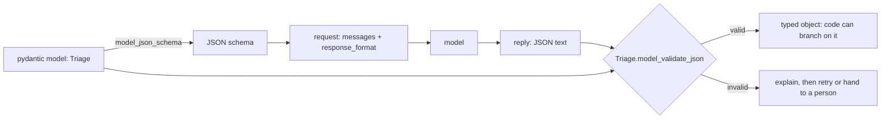

# 01.6 · Structured output: JSON mode and schemas

**Module:** [01 · Foundations](../README.md) · **Time:** 45-60 minutes · **Model needs:** chat, JSON output

## What you will learn

- Why "please reply with JSON" is not a contract, and what goes wrong when you rely on it.
- What **JSON mode** guarantees (valid syntax) and what it does not (the right keys and values).
- How to define the shape once as a **pydantic model** and use it to validate every reply.
- How **schema-enforced output** makes the provider hold the model to your schema while it writes.
- How to handle a provider that does not support schemas: detect, explain, fall back.

## The idea

So far the assistant has produced text for a person to read. Software needs something
else: a value it can branch on. `if triage.needs_human:` only works when `needs_human`
exists and is a real boolean, every time.

There are three levels of guarantee, and each script in this lesson is one of them.

| Level | How you ask | What is guaranteed | What can still go wrong |
|---|---|---|---|
| 1. Ask nicely | "Reply with JSON" in the prompt | Nothing | Code fences, chatter, invalid JSON, any keys |
| 2. JSON mode | `response_format={"type": "json_object"}` | Parseable JSON | Wrong keys, wrong types, values outside your list |
| 3. Schema | `response_format={"type": "json_schema", ...}` with `strict: True` | Parseable JSON that matches your schema | Provider may not support it; content can still be *wrong* (a real category, but the wrong one) |

Whichever level you use, **validate the reply in your own code**. The schema is defined
once, as a pydantic class, and does two jobs: it generates the JSON schema sent to the
provider, and it checks what comes back.



The running task in all three scripts is the same: read a helpdesk ticket and extract
`category`, `urgency`, `summary` and `needs_human`.

## Scripts

Run all three in order with `./run 01.6` (Windows: `run 01.6`), or one at a time.

### 1. `01_asking_nicely.py`: ask in the prompt, parse whatever comes back

```
./run 01.6/1
```

Asks for JSON in ordinary text mode, then tries `json.loads()` on the raw reply, then a
defensive parser that strips code fences and surrounding text.

**Expected output** (trimmed; your model may or may not add the code fence):

```
Reply from the model
assistant | ```json
          | {
          |   "category": "software",
          |   "urgency": "high",
          |   "summary": "The CRM application crashes immediately upon opening a customer record, ...",
          |   "needs_human": true
          | }
          | ```
tokens: 101 in + 62 out = 163

Step 2: Attempt 1: json.loads() on the raw reply ───────────────────────────
Failed: Expecting value: line 1 column 1 (char 0)
The model wrapped the JSON in something (a code fence, a sentence), or did not write JSON at all.

Step 3: Attempt 2: a defensive parser ──────────────────────────────────────
What the parser had to do: removed a ``` code fence.
Recovered object
{
  "category": "software",
  "urgency": "high",
  ...
}
Keys missing: none. Unexpected keys: none.
Type of needs_human: bool (we wanted bool).
```

The content was perfect and the program still failed at the first attempt, because of
three backticks. The defensive parser rescues it, but every line of that parser is a guess
about the next way the model will decorate its answer.

### 2. `02_json_mode.py`: JSON mode, validated with pydantic

```
./run 01.6/2
```

Sends the same ticket with `response_format={"type": "json_object"}` and a system prompt
that shows the shape as an example object. The reply is validated against the `Triage`
model. A final step validates a deliberately broken reply (no model call) to show what the
check catches.

**Expected output** (trimmed):

```
Reply from the model
assistant | {
          |   "category": "software",
          |   "urgency": "high",
          |   "summary": "The CRM application crashes immediately upon opening customer records following last night's update.",
          |   "needs_human": true
          | }
tokens: 153 in + 50 out = 203

Step 2: Validate the reply against the Triage model ────────────────────────
Model reply: valid.
Code can now branch on real values: needs_human is the bool True, urgency is 'high'.

Step 3: What validation catches (no model call) ────────────────────────────
This reply is valid JSON, so JSON mode would have let it through:
{"category": "crm", "urgency": 5, "summary": "CRM crashes.", "priority": "P1"}
Broken reply: REJECTED, 4 problem(s):
  - category: Input should be 'network', 'hardware', 'software' or 'access'
  - urgency: Input should be 'low', 'medium' or 'high'
  - needs_human: Field required
  - priority: Extra inputs are not permitted
```

No fence this time: JSON mode took care of the syntax. The four rejections in step 3 are
the part JSON mode cannot do. Note that JSON mode requires the word "JSON" and the shape
to appear in your prompt; the API knows only that you want *some* JSON object.

### 3. `03_schema_enforced.py`: the schema travels with the request

```
./run 01.6/3
```

Generates a JSON schema from the pydantic model and sends it as
`response_format={"type": "json_schema", "json_schema": {"name": ..., "schema": ..., "strict": True}}`.
The prompt no longer describes the shape at all. If the endpoint answers 400 (no schema
support), the script says so and repeats the call in JSON mode. The reply is validated
either way, then used for a routing decision.

**Expected output** (trimmed):

```
Step 1: Generate the schema from the pydantic model ────────────────────────
Triage.model_json_schema()
{
  "additionalProperties": false,
  "properties": {
    "category": {
      "enum": ["network", "hardware", "software", "access"],
      "title": "Category",
      "type": "string"
    },
    ...
  },
  "required": ["category", "urgency", "summary", "needs_human"],
  "title": "Triage",
  "type": "object"
}

Step 2: Ask with the schema attached ───────────────────────────────────────
Reply from the model
assistant | {
          |   "category": "hardware",
          |   "needs_human": true,
          |   "summary": "The front door badge reader is non-functional following a power outage, requiring manual entry for visitors.",
          |   "urgency": "high"
          | }
tokens: 223 in + 55 out = 278

Step 3: Validate anyway ────────────────────────────────────────────────────
Mode used: json_schema (strict). We still validate: ...

Step 4: Use it like any other data ─────────────────────────────────────────
Routing decision made by ordinary code: hardware / high -> on-site support
```

Two details worth reading in the code. Strict mode demands that every property is
required and that no extra keys are allowed; `model_config = ConfigDict(extra="forbid")`
is what puts `"additionalProperties": false` into the schema. And the schema is not free:
compare the input tokens here (223) with script 2 (153). The provider counts it as part of
your prompt.

If your endpoint does not support schemas you will see this instead, and the lesson
carries on:

```
The endpoint refused the schema request. This model or provider does not support json_schema.
Step 3: Fall back to JSON mode ─────────────────────────────────────────────
Mode used: json_object (fallback). We still validate: ...
```

## Try this

1. **Run script 1 five times.** Count how often the raw `json.loads()` succeeds. Would you
   ship a program that works that fraction of the time?
2. **Remove the example object** from `SYSTEM_PROMPT` in script 2 but keep JSON mode.
   What keys does the model invent? Which line of the output tells you?
3. **Add a field.** Add `affected_users: int` to `Triage` in script 3 and run it. You did
   not touch the prompt. Where did the model learn about the new field?
4. **Tighten a value.** Change `summary: str` to `summary: str = Field(max_length=60)`
   (import `Field` from pydantic) in script 2. Does the model's summary pass? Validation
   can enforce things a JSON schema sent to a provider may ignore.
5. **Send nonsense.** Replace `TICKET` in script 3 with "What is the capital of France?".
   The reply will still match the schema. Is it *right*? What field could you add so the
   model can say "this is not a ticket"?
6. **See the wire.** Run `./run 01.6/3 --raw` and find `response_format` in the request body.

## If it does not work

Run `./run doctor` and look at the line `Capability: JSON output`.

- **`WARN` on JSON output:** your model has no JSON mode. Script 1 still runs; scripts 2
  and 3 will report that the endpoint did not accept the request. Use another `LLM_MODEL`
  for this lesson.
- **Script 3 says the endpoint refused the schema request:** expected on some providers
  and most small local models. The fallback is the lesson working as designed.
- **"REJECTED" on the model's own reply:** the model returned JSON that does not fit the
  shape. Read the listed problems; that is exactly the situation validation exists for.

## In the running scenario

The helpdesk assistant can now turn a ticket into data: a category, an urgency, a
one-line summary and a flag for whether a person is needed. For the first time ordinary
code can act on what the model said: route the ticket, set a priority, count categories.
The capstone puts this together with the prompt from lesson 01.5.

**Next:** 01.7 · Capstone: helpdesk ticket triage with one call
