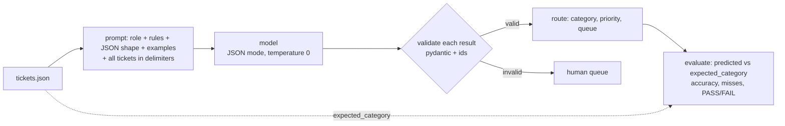

# 01.7 · Capstone: helpdesk ticket triage with one call

**Module:** [01 · Foundations](../README.md) · **Time:** 45-60 minutes · **Model needs:** chat, json

## What you will learn

- How the pieces of module 01 fit together into one small, real component: a ticket triager.
- How to write a **system prompt in layers** (role, rules, JSON shape, few-shot examples) for a classification task.
- How to make a model call **deterministic enough to test**: `temperature=0`, JSON mode, validation.
- How to **retry once with the validation errors** fed back, and what to do when that fails too.
- Why a **batch in one call** beats one call per ticket, and how to validate a list item by item.
- How to **evaluate a prompt** against a labelled test set: accuracy, misses, an acceptance bar.

## The idea

This lesson is a capstone: there is no new API feature. You build something that works
end to end from what you already know.

**The brief.** The Larkspur Labs helpdesk receives tickets as free text. Before anyone
reads them, every ticket needs four fields so that ordinary code can route it:

| Field | Type | Meaning |
|---|---|---|
| `category` | one of `network`, `hardware`, `software`, `access`, `other` | which team owns it |
| `urgency` | integer 1-4 | 1 = can wait days ... 4 = many people affected or a security risk |
| `summary` | one sentence | what the on-call person reads first |
| `needs_human` | boolean | must a person act (visit, repair, approval, unlock)? |

**Acceptance criteria.**

1. One ticket in, one validated `Triage` object out (pydantic, `extra="forbid"`).
2. An invalid reply gets **one** retry with the errors fed back; after two failed attempts
   the ticket goes to the human queue. The program never crashes on bad model output.
3. The eight tickets in [`tickets.json`](tickets.json) are triaged in **one** model call,
   never one call per ticket. Every ticket gets exactly one result or is flagged.
4. Calls use `temperature=0` and report their token usage (or say it was not reported).
5. Category accuracy on `tickets.json` is **at least 7 of 8 (87.5%)**, measured by script 3.



The `expected_category` in `tickets.json` is the answer key. It is never sent to the
model; only script 3 reads it.

## Scripts

Run all three in order with `./run 01.7` (Windows: `run 01.7`), or one at a time.

### 1. `01_triage_one_ticket.py`: one ticket, end to end

```
./run 01.7/1
```

Loads ticket `LL-1003` (a locked account that mentions Outlook: a classic misfile as
"software"), sends it with the layered system prompt in JSON mode at temperature 0, and
validates the reply into a `Triage` model. If validation fails, the errors go back to the
model as a new user message and it gets one more attempt. Then ordinary code routes it.

**Expected output** (trimmed):

```
Step 1: Load the ticket ────────────────────────────────────────────────────────
From tickets.json: LL-1003. Expected category (kept for lesson 01.7/3): access.
Messages sent to the model
   system | You triage IT helpdesk tickets for Larkspur Labs.
          | ...
     user | <ticket id="LL-1003" from="Mei (Reception)">
          | Outlook keeps telling me my password is wrong. I changed it yesterday ...
          | </ticket>

Step 2: Attempt 1 of 2: ask in JSON mode, temperature 0 ────────────────────────
Reply from the model
assistant | {"category": "access", "urgency": 3, "summary": "User is unable to access Outlook and visitor system due to a suspected account lockout.", "needs_human": true}
finish_reason: stop
tokens: 466 in + 40 out = 506
Valid on attempt 1.

Step 3: Act on the result ──────────────────────────────────────────────────────
...
Routing by ordinary code: access / P2 -> human queue
The predicted category matches the expected one (access).
```

When a reply is rejected you see the retry instead. This run is from "Try this" 2 below
(the model was tightened to `le=3` while the prompt still says 1-4, ticket `LL-1001`):

```
Step 2: Attempt 1 of 2: ask in JSON mode, temperature 0 ────────────────────────
Reply from the model
assistant | {"category": "network", "urgency": 4, "summary": "Intermittent Wi-Fi connectivity in meeting room 3B affecting multiple users.", "needs_human": true}
finish_reason: stop
tokens: 469 in + 40 out = 509
REJECTED, 1 problem(s):
  - urgency: Input should be less than or equal to 3
Feeding the errors back so the model can correct its own reply.
Correction sent back
     user | Your reply did not pass validation:
          | - urgency: Input should be less than or equal to 3
          | Reply again with only the corrected JSON object.

Step 3: Attempt 2 of 2: ask in JSON mode, temperature 0 ────────────────────────
Reply from the model
assistant | {"category": "network", "urgency": 3, "summary": "Intermittent Wi-Fi connectivity in meeting room 3B affecting multiple users.", "needs_human": true}
finish_reason: stop
tokens: 540 in + 40 out = 580
Valid on attempt 2.
```

The retry is not free: attempt 2 resends the whole conversation plus the error (540 input
tokens instead of 469). That is why the limit is two attempts, not "until it works".

### 2. `02_triage_the_batch.py`: all eight tickets in one call

```
./run 01.7/2
```

Puts all eight tickets into one user message, each inside its own `<ticket>` delimiters,
and asks for `{"results": [...]}` in JSON mode. Each result is validated on its own, so one
bad entry does not discard the other seven; ids that are missing, duplicated or invented
are reported. Prints the triaged table and what the batch saved in tokens.

**Expected output** (trimmed):

```
Step 3: Validate every result, then the batch as a whole ───────────────────────
Valid results: 8 of 8.

Step 4: The triaged batch ──────────────────────────────────────────────────────
id       category  urg  human  summary
------------------------------------------------------------------------------
LL-1001  network     3  yes    Wi-Fi in meeting room 3B is unstable and dropping connections for all users.
LL-1002  hardware    2  yes    Laptop screen is cracked and flickering after being dropped.
LL-1003  access      3  yes    User is locked out of email and visitor system due to password issues.
LL-1004  software    3  no     Spreadsheet application crashes when opening files containing macros.
LL-1005  access      1  yes    Request for access to the shared Recruiting folder.
LL-1006  network     3  yes    VPN is connected but internal systems are timing out.
LL-1007  other       1  no     Coffee machine error report, not an IT issue.
LL-1008  hardware    2  yes    Fourth-floor printer is producing blank pages for all users.

Step 5: What the batch cost ────────────────────────────────────────────────────
Batch: 948 in + 505 out (reported), about 182 tokens per ticket.
About 487 of those input tokens are the instructions and examples, sent once here.
One call per ticket would send them 8 times: roughly 3409 extra input tokens,
and 8 round trips instead of one. The trade-off: one bad reply can affect the whole batch.
```

Look at LL-1001: the rules say urgency 4 means "many people affected", and a whole meeting
room is affected, yet the model chose 3. Validation cannot catch that: 3 is a perfectly
valid value. Only an evaluation can, which is the point of script 3.

### 3. `03_evaluate_the_prompt.py`: prompts are tested like code

```
./run 01.7/3
```

Runs the same batch request, then compares each predicted category with the
`expected_category` from `tickets.json`. Prints a results table, the accuracy, every miss
with its ticket text, and PASS or FAIL against the acceptance bar.

**Expected output** (trimmed; your model may miss one or two):

```
Step 2: Run the prompt under test (one call, temperature 0) ────────────────────
Same request as 01.7/2. temperature=0 keeps re-runs comparable.
tokens: 948 in + 505 out = 1453
Parsed 8 valid result(s) for tickets in the test set.

Step 3: Compare predicted with expected ────────────────────────────────────────
id       expected  predicted  result
----------------------------------------
LL-1001  network   network    ok
LL-1002  hardware  hardware   ok
LL-1003  access    access     ok
...
LL-1008  hardware  hardware   ok

Step 4: Score ──────────────────────────────────────────────────────────────────
Accuracy: 8 / 8 = 100%
No misses on this run.
Acceptance bar: 87.5% -> PASS.
In a real project this check runs in CI, and a prompt change that drops below the bar is not merged.
```

When there are misses, each one is printed as `LL-1008 (predicted software, expected
hardware)` followed by the ticket text, so you can decide whether the prompt or the label
is wrong.

A perfect score is good news and a warning. In our test runs a capable model also scored
8 / 8 with the access rule removed, and even with no category definitions and no examples
at all. A test set that every prompt passes cannot tell a good prompt from a bad one. Real
evaluation sets are built from the tickets that actually got misfiled.

## Try this

1. **Break the prompt on purpose.** Delete the category definitions, the access rule and
   the examples from `SYSTEM_PROMPT` in script 3, leaving only the list of category names.
   Does the score drop on your model? If it does not, the test set is too easy (see the
   note under script 3), which brings you to experiment 3.
2. **Make the retry happen.** In script 1, change `le=4` to `le=3` in the `Triage` model
   but leave the prompt saying 1-4. Try ticket `LL-1001` (`TICKET_ID`). Does the model
   correct itself when it is shown the error?
3. **Add hard tickets.** Add tickets to `tickets.json` that a person could argue about (a
   phone that will not install the company app: hardware, software or access? a shared
   mailbox request? a smart TV in a meeting room?). Run script 3 with the full prompt and
   with the stripped one from experiment 1. Now do the scores differ? When it misses, is
   the prompt wrong or is your label?
4. **Evaluate urgency too.** Add `expected_urgency` to each ticket and extend script 3 to
   score it. Is urgency harder to get right than category? Why might that be?
5. **Swap the model.** Change `LLM_MODEL` in `.env` to a smaller or cheaper model and run
   script 3. Does it still pass the bar? Now you can choose a model with evidence.
6. **Batch size.** Duplicate the tickets to 40 with new ids. Does the batch still return
   one result per ticket? Watch for missing ids: long lists are where batches break.

## Stretch goals

- **Schema-enforced batch.** Generate a schema for `{"results": list[TicketTriage]}` and
  send it with `response_format={"type": "json_schema", ...}` (lesson 01.6/3), falling back
  to JSON mode when the endpoint refuses.
- **Retry only the failures.** In script 2, send the tickets that had no valid result back
  in a second, smaller batch call.
- **A cost line in the report.** Use the example prices from lesson 01.4/3 to print the
  cost of the batch and of 10,000 tickets.
- **A confusion table.** Count expected vs predicted pairs (`hardware -> software: 1`) to
  see which categories the prompt confuses.

## If it does not work

Run `./run doctor` and look at the line `Capability: JSON output`.

- **The endpoint refuses `response_format`:** your model has no JSON mode. Choose another
  `LLM_MODEL` for this lesson.
- **The endpoint refuses `temperature`:** some reasoning models accept only the default.
  Remove the `temperature=0` line; results will vary more between runs.
- **`No valid answer for: ...` in script 2:** the model skipped or renamed ticket ids.
  Read the raw reply above the table; the batch is still usable for the rest.
- **Accuracy changes between runs:** `temperature=0` reduces variation but not every
  provider guarantees identical output. Run script 3 two or three times before trusting
  one score.

## In the running scenario

The helpdesk assistant is now a component another program can rely on: tickets in,
validated triage records out, in one call per batch, with a known token cost and a test
that says whether a prompt change made it better or worse. It can still only *read*
tickets. Module 02 lets it act: look up an asset, check a service, open a ticket in
another system.

**Next:** 02.1 · Function calling (planned)
