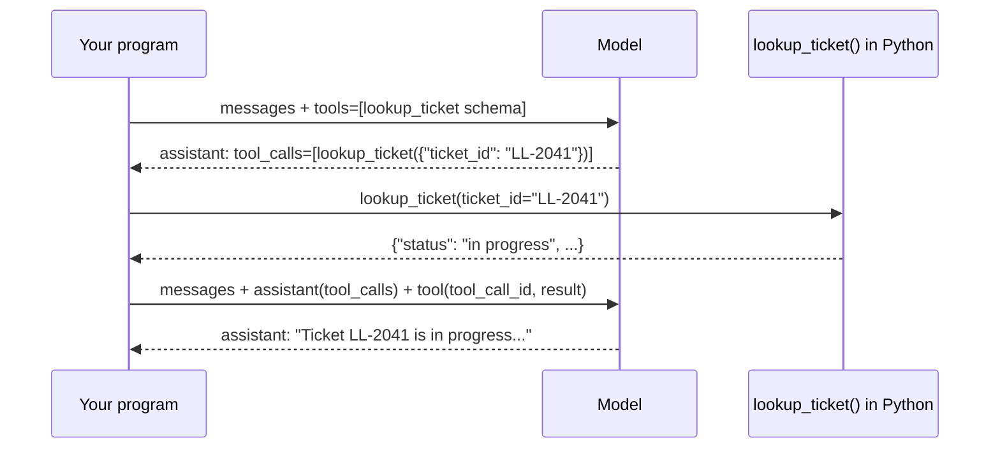

# 02.1 · Function calling: letting the model ask for a tool

**Module:** [02 · Tools and agents by hand](../README.md) · **Time:** 45-60 minutes · **Model needs:** chat, tools

## What you will learn

- How to describe a Python function to a model as a **JSON schema** and send it with `tools=[...]`.
- What a **tool call** looks like: `message.tool_calls`, each with an `id`, a function name and arguments as a JSON string.
- How to complete the **round trip by hand**: run the function, append the assistant message and a
  `role: "tool"` message with the matching `tool_call_id`, then call the model again.
- What **parallel tool calls** and `tool_choice` are.
- Why the model **never runs code**: it only asks. Your program decides what runs, and keeps the record.

## The idea

A model can only produce text. Function calling (also called *tool calling*) is a convention
on top of that: you tell the model which functions exist, and instead of an answer it may
reply with a structured request, "please call `lookup_ticket` with `{"ticket_id": "LL-2041"}`".
Your program reads the request, runs the real function, and sends the result back as a new
message. Then the model writes the answer, now grounded in data it could not see before.



The model sees only the **schema**: name, description, parameters. It never sees your code,
your database or your credentials. That is the safety boundary of every agent: anything that
actually happens, happens in your program, where you can validate arguments, check
permissions, log, or ask a human first.

## Scripts

Run all three in order with `./run 02.1` (Windows: `run 02.1`), or one at a time.

### 1. `01_one_tool_schema.py`: describe a tool, see the model ask for it

```
./run 02.1/1
```

Defines `lookup_ticket` as a JSON schema, sends a question with `tools=[...]`, and opens up
the reply: `content` is empty, `finish_reason` is `tool_calls`, and `function.arguments` is a
string of JSON you must parse yourself. No function runs.

**Expected output** (trimmed; the call id and token numbers will differ):

```
Step 2: Ask a question the tool can answer ──────────────────────────────────
Messages sent to the model
   system | You are the Larkspur Labs IT helpdesk assistant. Use the tools when they help.
     user | What is the status of ticket LL-2041?
Reply from the model
assistant | wants tool lookup_ticket({"ticket_id": "LL-2041"})
finish_reason: tool_calls
tokens: 88 in + 23 out = 111

Step 3: Read the tool call ──────────────────────────────────────────────────
finish_reason is 'tool_calls' and content is None: no answer yet, a request.
One entry of message.tool_calls
{
  "id": "call_0_01a21b9568c770b7b47e10aa527cff6c",
  "type": "function",
  "function.name": "lookup_ticket",
  "function.arguments": "{\"ticket_id\": \"LL-2041\"}"
}
function.arguments is a STRING of JSON, written by the model. Parse it before you trust it:
json.loads(function.arguments)
{
  "ticket_id": "LL-2041"
}
```

### 2. `02_complete_the_round_trip.py`: the round trip by hand

```
./run 02.1/2
```

Asks about two tickets. Many models request both lookups in one reply: **parallel tool
calls**. The script runs each one through a name-to-function table, appends the assistant
message (with its `tool_calls`, unchanged) and one `role: "tool"` message per result, prints
the complete message list, and calls the model a second time for the answer. It ends with
the `tool_choice` options: `"auto"` (default), `"none"`, `"required"`, or one named function,
and `parallel_tool_calls=False`.

**Expected output** (trimmed):

```
Reply from the model
assistant | wants tool lookup_ticket({"ticket_id": "LL-2041"})
assistant | wants tool lookup_ticket({"ticket_id": "LL-2044"})
finish_reason: tool_calls
The model asked for 2 tool call(s) in one reply.
Several calls in one reply are 'parallel tool calls'. Run them all, then answer them all.

Step 2: Your program runs the functions ─────────────────────────────────────
tool call | lookup_ticket({"ticket_id": "LL-2041"})
   result | {"ticket_id": "LL-2041", "status": "in progress", "owner": "Tomas (Desktop support)", ...}
tool call | lookup_ticket({"ticket_id": "LL-2044"})
   result | {"ticket_id": "LL-2044", "status": "waiting on employee", "owner": "Aisha (Network)", ...}

Step 3: Call 2: the same conversation plus the results ──────────────────────
Messages sent to the model
   system | You are the Larkspur Labs IT helpdesk assistant. ...
     user | Can you tell me where tickets LL-2041 and LL-2044 are up to?
assistant | wants tool lookup_ticket({"ticket_id": "LL-2041"})
assistant | wants tool lookup_ticket({"ticket_id": "LL-2044"})
     tool | {"ticket_id": "LL-2041", "status": "in progress", ...}
     tool | {"ticket_id": "LL-2044", "status": "waiting on employee", ...}
Reply from the model
assistant | Ticket LL-2041 is currently in progress with Tomas, who has ordered a replacement
          | charger that is expected this Thursday. Ticket LL-2044 is waiting on you to provide
          | a photo of the VPN error message for Aisha in the Network department.
finish_reason: stop

Run summary: 2 model call(s), 359 in + 99 out = 458 tokens, 4.9s
```

### 3. `03_helpdesk_with_two_tools.py`: the helpdesk assistant with two tools

```
./run 02.1/3
```

Two tools over an invented ticket table: `lookup_ticket(ticket_id)` and
`reset_password(username)`, which **only pretends** (it changes nothing). The round trip now
runs in a loop, capped at 4 model calls, because the model needs one tool, then the other,
then the answer. Finally the script compares the answer with the list of functions that
really ran.

**Expected output** (trimmed):

```
Step 2: Model call 1 of at most 4 ───────────────────────────────────────────
assistant | wants tool lookup_ticket({"ticket_id": "LL-2051"})
Your program, not the model, runs each requested function:
tool call | lookup_ticket({"ticket_id": "LL-2051"})
   result | {"ticket_id": "LL-2051", "from": "dmorgan", "subject": "Locked out after holiday", ...}

Step 3: Model call 2 of at most 4 ───────────────────────────────────────────
assistant | wants tool reset_password({"username": "dmorgan"})
tool call | reset_password({"username": "dmorgan"})
   result | {"username": "dmorgan", "result": "reset link sent to the registered phone (simulated, nothing changed)"}

Step 4: Model call 3 of at most 4 ───────────────────────────────────────────
assistant | I found that dmorgan was locked out of their account due to multiple failed sign-in
          | attempts. I have triggered a password reset link to be sent to their registered phone number.
finish_reason: stop

Step 6: Check the answer against what really ran ────────────────────────────
Functions your program actually ran
[
  "lookup_ticket({\"ticket_id\": \"LL-2051\"})",
  "reset_password({\"username\": \"dmorgan\"})"
]
reset_password really ran (in simulation), so the answer matches the record.
```

**A failure you may see.** In one of our runs the model did not request `reset_password` at
all; it *wrote* `[Assistant called tool reset_password ...]` into its text and said it had
reset the password. Nothing ran. The last step catches this and prints a WARNING. The lesson:
report actions from your program's record, never from the model's words.

## Try this

1. **Delete the `description`** of `reset_password` (or make it vague). Does the model still
   find the right moment to use it? Descriptions are prompts.
2. **Force a tool** in script 1 with `tool_choice={"type": "function", "function": {"name": "lookup_ticket"}}`
   and ask "What is the capital of France?". What arguments does the model invent?
3. **Break the result.** In script 2, change the `tool_call_id` of one tool message to
   `"wrong"`. Most providers reject the request (400): every tool call must be answered.
4. **Ask for an unknown ticket** (`LL-9999`) in script 3. The function returns an `error`
   field. How does the model explain that to the engineer?
5. **Lower the cap** to `MAX_ITERATIONS = 1` and watch the cap message.
6. Run script 2 with `--raw` and find `tools`, `tool_calls` and `tool_call_id` in the HTTP bodies.

## If it does not work

Run `./run doctor`: it checks whether your model supports **tools**. A model without tool
support either answers in plain text (the scripts say so and stop cleanly) or the provider
returns a 400 error, which the lesson explains. If that happens, set a different `LLM_MODEL`
in `.env`. No extra packages are needed for this lesson.

## In the running scenario

The helpdesk assistant can now **look things up and act**: it reads a ticket and, when the
account is locked, starts a (simulated) password reset. Your program stays in charge of
every action and keeps the record of what really happened. Next, that loop gets a proper
name and structure: the agent loop.

**Next:** 02.2 · The agent loop: reason, act, observe (planned)
