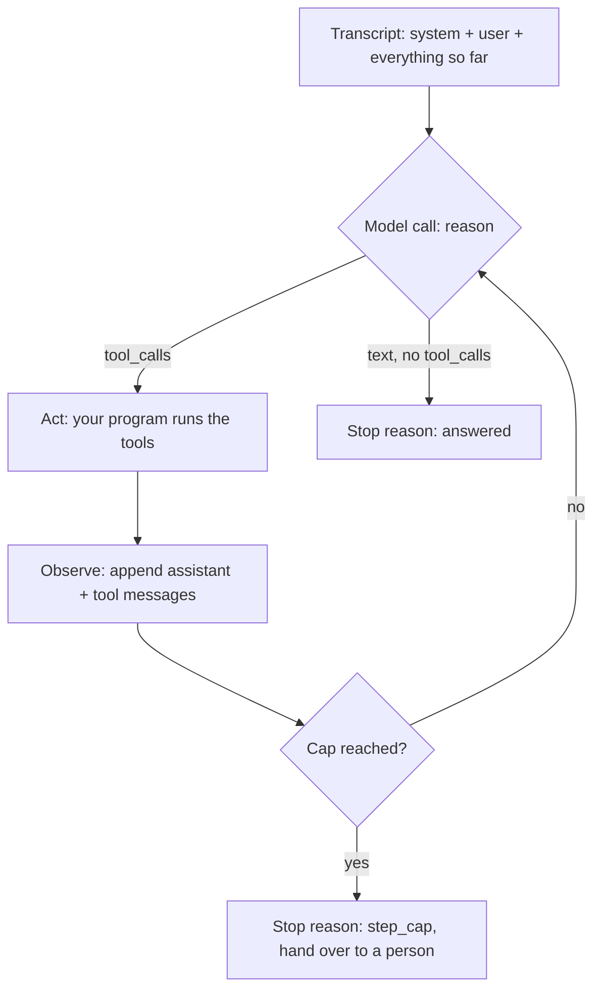

# 02.2 · The agent loop: reason, act, observe

**Module:** [02 · Tools and agents by hand](../README.md) · **Time:** 45-60 minutes · **Model needs:** chat, tools

## What you will learn

- That an **agent is a `while` loop** around the tool round trip from 02.1, not a new kind of model.
- The three beats of the loop: **reason** (the model decides), **act** (your program runs a tool), **observe** (the result joins the transcript).
- Why every loop needs a **hard iteration cap** and how to report a **named stop reason**.
- How to return a **step trace** (a data structure) instead of only printing, so the run can be inspected and tested.
- Why cost **grows every turn**: the whole transcript is re-sent each time.

## The idea

**What is new since 02.1:** there, you ran the round trip once, then a loop of a few calls with a cap.
Now the loop is the subject. The transcript (the message list) is the agent's only state. Each
turn the model reads it, and either asks for a tool or answers. Nothing else carries over.



Two things make this safe to ship. First, the **cap**: a confused model may ask for tools
forever, so the loop must end on its own and say why. Second, the **record**: if the loop returns
a trace of what happened, you can print it, log it, and write tests against it.

## Scripts

Run all three with `./run 02.2` (Windows: `run 02.2`), or one at a time.

### 1. `01_the_loop.py`: the loop in about twenty lines

```
./run 02.2/1
```

Two tools (`lookup_ticket`, `search_kb`) and a question that needs both, in order: the KB query
depends on what the ticket says. The script prints each turn's decision and tool call, and ends
with the whole transcript.

**Expected output** (trimmed):

```
Step 2: Loop turn 1: reason ────────────────────
Decision: act. The model asked for lookup_ticket.
Step 3: Loop turn 1: act and observe ───────────
tool call | lookup_ticket({"ticket_id": "LL-2061"})
   result | {"ticket_id": "LL-2061", "from": "ofarrell", "subject": "Cannot join the VPN from home", "status": "in progress"}
Step 5: Loop turn 2: act and observe ───────────
tool call | search_kb({"query": "VPN issues from home"})
   result | {"articles": ["VPN fails to connect: check the date and time on the laptop, then reinstall the VPN profile ..."]}
Step 6: Loop turn 3: reason ────────────────────
assistant | The subject of your ticket is "Cannot join the VPN from home." Please check the date and time settings ...
Stop reason: the model answered in text after 3 model call(s).
The loop kept no other memory: 6 messages. Each turn re-sends all of them, so the cost grows every turn.
Run summary: 3 model call(s), 573 in + 83 out = 656 tokens, 6.2s
```

### 2. `02_the_trace.py`: a step trace and named stop reasons

```
./run 02.2/2
```

The loop becomes `run_agent(...)`, returning an `AgentResult` (`stop_reason`, `answer`, a list of
`Step`s). The script runs it twice: normally (`answered`), then with `max_steps=1`, which cannot
finish (`step_cap`).

**Expected output** (trimmed):

```
step 1: 1.8s, 2 tool call(s), text: (none)
tool call | lookup_ticket({"ticket_id": "LL-2062"})
tool call | lookup_ticket({"ticket_id": "LL-2063"})
step 2: 3.0s, 0 tool call(s), text: Here are the summaries of the tickets you requested:
stop_reason = 'answered' after 2 step(s)
Same task with max_steps=1: one model call cannot both ask for tools and answer.
stop_reason = 'step_cap'. The caller can now decide: retry with a higher cap, or hand over to a person.
```

### 3. `03_helpdesk_agent_loop.py`: the agent chooses its own route

```
./run 02.2/3
```

An open-ended task ("what is still open for dmorgan, and how do we fix it?"). The number of
turns is not known up front: it depends on what `list_tickets` returns. The script then prints the
prompt tokens sent on each call.

**Expected output** (trimmed):

```
tool call | list_tickets({"username": "dmorgan"})
   result | {"tickets": [{"ticket_id": "LL-2070", ... "status": "open"}, {"ticket_id": "LL-2071", ... "status": "closed"}]}
tool call | search_kb({"query": "VPN drops"})
assistant | VPN drops every ten minutes: Switch the VPN protocol to TCP in the client settings and update to the latest client.
Prompt tokens sent on each model call
[ 121, 207, 256 ]
The numbers climb because every turn re-sends the whole transcript. 02.3 is about keeping that under control.
```

## Try this

1. Set `MAX_STEPS = 2` in script 1. What does the cap message say, and what did the agent manage to do?
2. In script 1, change the system prompt to drop "Read the ticket first". Does the model still call `lookup_ticket` first, or guess a KB query?
3. In script 2, add a tool that always returns `{"error": "try again"}` and see whether the model loops until the cap.
4. In script 3, ask about a username with no tickets. How many turns does the agent take?
5. Print `len(json.dumps(messages))` each turn in script 3: that is the quantity that grows.
6. Run script 1 with `--raw` and find the growing `messages` array in each request body.

## If it does not work

Run `./run doctor`: it checks that your model supports **tools**. A model without tool support
answers in text on turn 1 (the loop then stops with "answered" and no tool runs). If the loop hits
the cap every time, raise `MAX_STEPS` or tighten the system prompt. No extra packages are needed.

## In the running scenario

The helpdesk agent now has a proper skeleton: read a ticket, search the KB, answer, with a visible
trace and a ceiling on how long it may wander. Left alone, though, the transcript keeps growing.
Next: what to keep, trim or summarise.

**Next:** 02.3 · Conversation memory and context management (planned)
