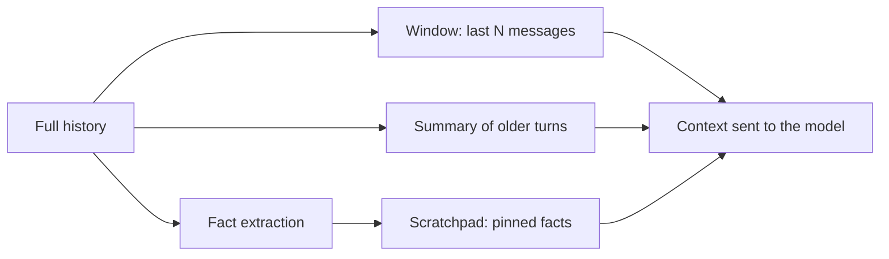

# 02.3 · Conversation memory and context management

**Module:** [02 · Tools and agents by hand](../README.md) · **Time:** 45-60 minutes · **Model needs:** chat

## What you will learn

- That a chat model is **stateless**: "memory" is your program re-sending messages.
- The **sliding window**: cheap, predictable, and it forgets silently.
- **Summary memory**: compress old turns with one model call, keep recent turns verbatim.
- A **scratchpad**: pin extracted facts (asset tag, username) outside the history, so they survive trimming and summarising.
- A rough way to **count tokens** (characters / 4) when you only need an estimate.

## The idea

**What is new since 02.2:** the agent loop's transcript grows every turn, and every call re-sends it
all. Left alone, it gets slow, expensive and finally too long for the model's context window. Context
management is the set of choices about what to keep.



| Strategy | Cost | Risk |
|---|---|---|
| Send everything | grows every turn | hits the context limit |
| Sliding window | fixed | forgets old facts silently |
| Summary | one extra call, then small | lossy: details can vanish |
| Scratchpad | one small call per turn | extraction can miss a fact |

Real systems combine them: a window for the flow of conversation, a summary for the middle, a
scratchpad for facts that must never be lost. All of it is ordinary Python state you can print and test.

## Scripts

Run all three with `./run 02.3` (Windows: `run 02.3`), or one at a time. No tools are used in this lesson.

### 1. `01_window_memory.py`: no memory, full history, a window

```
./run 02.3/1
```

The asset tag is mentioned only in the first turn. The script asks about it three ways: no history,
full history, and a window of the last four messages.

**Expected output** (trimmed):

```
assistant | I do not have access to your previous conversation history, so please provide the asset tag again.
tokens: 28 in + 19 out = 47
...
Step 3: 3. Full history: the question is answerable
assistant | You provided asset tag LL-L-0412.
tokens: 87 in + 13 out = 100
Step 4: 4. A sliding window ...
assistant | You have not yet provided an asset tag for this device.
tokens: 53 in + 12 out = 65
The tag is gone: it was in turn 1, which fell out of the window. A window is cheap and predictable, and it forgets silently.
```

### 2. `02_summary_memory.py`: summarise old turns

```
./run 02.3/2
```

A seven-message conversation: everything except the last two messages is summarised by the model
into three bullets, identifiers kept. The compact context is `system + summary + last two`.

**Expected output** (trimmed):

```
assistant | * User reported that laptop LL-L-0412 will not charge.
          | * Testing with a colleague's charger resulted in no charging light.
          | * The laptop shuts down after one minute while plugged in, ...
Before: ~130 tokens. After: ~114 tokens. The saving grows with the length of the conversation.
assistant | Your asset tag is LL-L-0412, and you will be in the Leeds office this Thursday.
  '0412': kept
  'Thursday': kept
```

The saving here is small because the conversation is short; it is the shape that matters.

### 3. `03_scratchpad_memory.py`: pin the facts

```
./run 02.3/3
```

A small extraction call (JSON mode, allow-listed keys, string values only) fills a `scratchpad` dict
from turns 1 and 4. The final context is `system prompt + pinned facts + a window of two messages`.

**Expected output** (trimmed):

```
Turn 1: extracted {'username': 'dmorgan', 'asset_tag': 'LL-L-0412'}
Turn 4: extracted {'office': 'Leeds', 'available_day': 'Thursday'}
...
assistant | Your username is dmorgan, your asset tag is LL-L-0412, and you are available on Thursday.
  asset_tag = 'LL-L-0412': in the answer
```

## Try this

1. In script 1 set the window to 6 messages. At what size does the asset tag come back?
2. In script 2 remove "Keep every identifier" from the summary prompt. Are the asset tag and day still there?
3. In script 2 raise `KEEP_LAST` to 4 and compare the token estimates.
4. In script 3 extract from every turn (not just 1 and 4). What does it cost, and does the scratchpad change?
5. Add a key the model should not set (`password`) to the model's JSON by hand and watch the allow-list drop it.
6. Run script 3 with `--raw` and read the `response_format` field in the extraction request.

## If it does not work

Run `./run doctor`. Script 3 uses JSON mode; if a model rejects `response_format`, the lesson prints the
provider error: switch `LLM_MODEL` or delete that argument and parse the JSON from the text. No extra packages.

## In the running scenario

The helpdesk agent can now hold a long conversation with an engineer or an employee without dragging the
whole transcript along, and without forgetting the asset tag. Next: what happens when a tool call fails.

**Next:** 02.4 · Tool failures, retries and iteration limits (planned)
