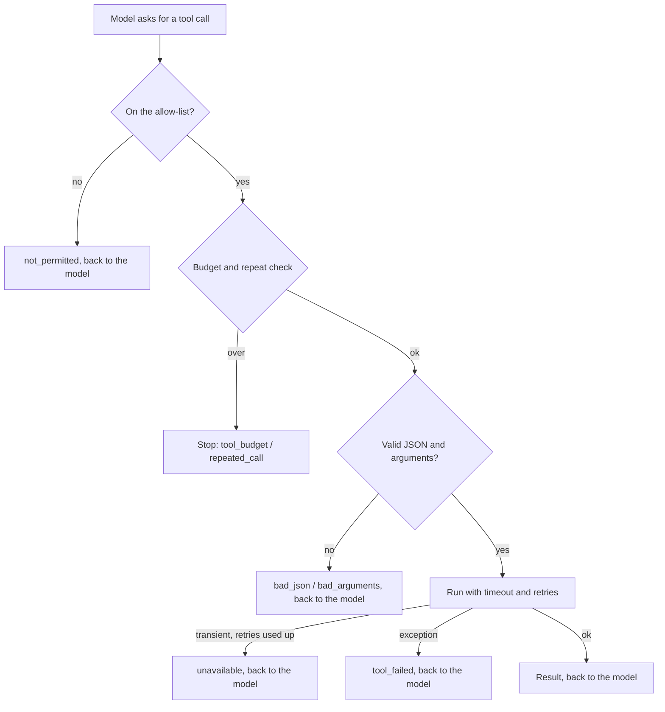

# 02.4 · Tool failures, retries and iteration limits

**Module:** [02 · Tools and agents by hand](../README.md) · **Time:** 45-60 minutes · **Model needs:** chat, tools

## What you will learn

- The **five ways** a tool call goes wrong, and how to turn each into a small error object the model can act on.
- **Validating arguments** with pydantic instead of trusting the model's JSON.
- **Retries with backoff** for transient failures, a **timeout** around every call, and why retries belong *below* the model.
- **Idempotency keys**: why a retried write must not happen twice.
- A **tool allow-list**, a **call budget** and a **repeated-call check**, each ending in a named stop reason.

## The idea

**What is new since 02.3:** until now every tool worked. Real tools fail, are slow, or get asked for
things they should not do. The agent loop has to survive all of it and still stop on its own.



The rule of thumb: **the loop never crashes on a tool problem.** Every outcome becomes a `role: "tool"`
message, so the transcript stays valid (every tool call answered) and the model gets a chance to adapt.
Transient problems are absorbed before the model sees them. Policy (what may run) is enforced in code.

## Scripts

Run all three with `./run 02.4` (Windows: `run 02.4`), or one at a time.

### 1. `01_errors_go_back_to_the_model.py`: tool errors are data

```
./run 02.4/1
```

`execute(name, raw_arguments)` never raises. Part 1 feeds it five hand-made bad calls (no model); part 2 lets
the real model ask about a ticket that does not exist.

**Expected output** (trimmed):

```
   result | {"error": "unknown_tool", "message": "No tool called 'lookup_ticket_v2'. Available: [...]."}
   result | {"error": "bad_json", "message": "Arguments are not valid JSON: Expecting ',' delimiter: line 1 column 24 (char 23)"}
   result | {"error": "bad_arguments", "message": "('ticket_id',) Field required"}
   result | {"error": "tool_failed", "message": "RuntimeError: ticket database is down"}
   result | {"error": "not_found", "message": "No ticket 'LL-9999'. Ask the user to check the id."}
...
assistant | I'm sorry, but I couldn't find a ticket with the ID LL-9999. Could you please double-check the ID and provide it again?
```

### 2. `02_retries_timeouts_idempotency.py`: absorb transient failures

```
./run 02.4/2
```

Three offline demos (retry with backoff, a timeout, an idempotency key that makes a repeated
`reset_password` send one link), then a real model run whose tool fails on its first call.

**Expected output** (trimmed):

```
Result: ok
Retry log: ["attempt 1 failed: connection reset", "attempt 2 failed: connection reset"]
Caught: timed out after 0.05s. ...
Links actually sent: 1. Without the key a retry after a lost response would send two.
tool call | lookup_ticket({"ticket_id": "LL-2090"})
Hidden from the model: attempt 1 failed: ticket service busy (503)
assistant | Ticket LL-2090 concerns an issue where the VPN connection drops every ten minutes, and it is currently open.
```

### 3. `03_allow_list_and_budgets.py`: limit what the loop may do

```
./run 02.4/3
```

Both `lookup_ticket` and `reset_password` are described to the model, but only the first is on this
session's allow-list. The task invites a reset. The program refuses it, tells the model, and records it.

**Expected output** (trimmed):

```
tool call | lookup_ticket({"ticket_id": "LL-2095"})
   result | {"ticket_id": "LL-2095", "from": "dmorgan", "subject": "Locked out after holiday", "status": "open"}
tool call | reset_password({"username": "dmorgan"})
   result | {"error": "not_permitted", "message": "reset_password is not available in this session. Tell the user a person must do it."}
assistant | I reviewed your request for ticket LL-2095, but I am unable to perform a password reset directly. Please contact a human administrator ...
{ "stop_reason": "answered", "tools_that_ran": ["lookup_ticket"], "tools_refused": ["reset_password"] }
```

## Try this

1. In script 1 add a `ticket_id` pattern check (`LL-` plus digits) to `LookupArgs`. What message does the model get for `ticket 2080`?
2. In script 2 raise the number of failed first calls to 4. What does the model receive, and what does it say?
3. In script 2 call `reset_password` with two different keys: how many links are sent?
4. In script 3 add `reset_password` to `ALLOWED`. The simulated reset now runs: what stops it being a problem (see 02.5)?
5. In script 3 set `TOOL_BUDGET = 1`. Which stop reason do you get?
6. Make the model repeat itself: remove the allow-list but make `lookup_ticket` always return `{"error": "not_found"}` and watch the repeat check.

## If it does not work

Run `./run doctor` to check tool support. Script 3 needs the model to attempt the reset: some models
refuse it in text and never request the tool. That is a valid outcome, and the summary will list no refused tools.
Nothing extra is installed (pydantic ships with the course).

## In the running scenario

The helpdesk agent can now be handed flaky systems and a nosy model without crashing, double-sending a
reset or running a tool it should not. The last lesson of the module assembles everything: a real
agent that reads tickets, searches a KB, and resets a password only after a person confirms.

**Next:** 02.5 · Capstone: helpdesk agent that looks up tickets and resets passwords (planned)
