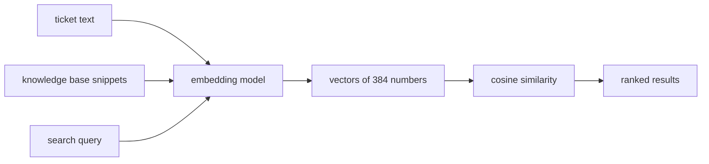

# 03.1 · What embeddings are: similarity by hand

**Module:** [03 · Embeddings and semantic search](../README.md) · **Time:** 45-60 minutes · **Model needs:** embeddings (no chat model) · **Packages:** `rag` extra

## What you will learn

- An **embedding** turns a piece of text into a list of numbers (a vector) so that texts with similar meaning get similar vectors.
- How to measure "similar" with **cosine similarity**, first in plain Python, then in numpy.
- Why semantic search finds an answer that shares **no words** with the question, and where keyword search fails.
- How to use nearest-neighbour search to route a new helpdesk ticket, with no vector database.

## The idea

A chat model writes text. An **embedding model** does something simpler: it reads text and
returns a fixed-length vector (384 numbers for the local model used here). Nobody designed
the individual numbers; what matters is the geometry. Texts that mean similar things point
in similar directions, so "I cannot get onto the wireless network" lands near "My laptop will
not connect to the Wi-Fi" even though they share almost no words.

**Cosine similarity** compares two vectors by the angle between them: `dot(a, b) / (|a| * |b|)`.
1.0 means the same direction; values near 0 mean unrelated.



**Where embeddings come from.** By default this course runs a small open model on your own
machine (`fastembed`, `BAAI/bge-small-en-v1.5`), because many OpenAI-compatible providers
have no embedding models. It downloads about 70 MB the first time. If your provider has one,
set `EMBEDDING_MODEL` and the same `ctx.embed(...)` call goes to your endpoint instead; the
request is the standard
`client.embeddings.create(model="your-embedding-model", input=["text one", "text two"])`.

## Scripts

Run all three with `./run 03.1` (Windows: `run 03.1`), or one at a time.

### 1. `01_embed_and_compare.py`: vectors and cosine similarity

```
./run 03.1/1
```

Embeds four sentences, prints the vector length and first numbers, computes cosine
similarity by hand with `math` and `zip`, checks it against numpy, and prints a full
similarity matrix.

**Expected output** (trimmed; exact numbers depend on the embedding model):

```
Step 1: Embed a handful of sentences
384 numbers: [-0.020, -0.013, +0.034, -0.074, +0.004, ...]  <-  My laptop will not connect to the office Wi-Fi.
...
Step 2: Cosine similarity by hand
0.774  'My laptop will not connect to the office Wi-Fi.' vs 'I cannot get onto the wireless network at work.'
0.545  'My laptop will not connect to the office Wi-Fi.' vs 'How do I reset my email password?'
0.530  'My laptop will not connect to the office Wi-Fi.' vs 'The printer on floor 3 is out of paper.'

Step 3: The same thing in numpy
plain Python: 0.774336    numpy: 0.774336

Step 4: A similarity matrix
        s0    s1    s2    s3
  s0   1.00  0.77  0.54  0.53
  s1   0.77  1.00  0.54  0.51
  s2   0.54  0.54  1.00  0.35
  s3   0.53  0.51  0.35  1.00
Closest pair: s0 and s1 (0.77). They share almost no words, only meaning.
```

Note that "unrelated" sentences still score around 0.4-0.5 with this model. Scores are only
meaningful relative to each other.

### 2. `02_semantic_vs_keyword.py`: meaning beats word overlap

```
./run 03.1/2
```

Ten invented knowledge-base snippets, three queries chosen to share no words with the
right snippet. A simple keyword counter finds nothing; embeddings rank the right snippet first.

**Expected output** (trimmed):

```
Step 2: Query: I cannot remember my login details
Keyword search: no snippet shares a single word with this query. Nothing found.
Semantic #1 (0.67): To reset your password, open the self-service portal and choose Forgot password.
Semantic #2 (0.56): Connect to the VPN with the Larkspur client before opening internal tools from home.
...
Step 4: Query: someone took my handset on the train
Keyword search: no snippet shares a single word with this query. Nothing found.
Semantic #1 (0.66): Report a lost or stolen phone to IT immediately so it can be wiped remotely.
```

### 3. `03_route_new_ticket.py`: route a ticket to the most similar past ticket

```
./run 03.1/3
```

The helpdesk scenario: seven past resolved tickets, three new ones. Each new ticket is
embedded and matched to its nearest neighbour, which suggests the team and the fix.

**Expected output** (trimmed):

```
New ticket: My computer display keeps going dark randomly
{
  "most similar": "T-1003 (score 0.81): Laptop screen flickers and then goes black.",
  "route to": "Hardware",
  "past fix": "Swapped the display cable; replaced the unit when it recurred.",
  "runner-up": "T-1001 (0.64) Network"
}
```

## Try this

1. **Add a sentence** to script 1 that is the opposite of s0 ("My laptop connects to Wi-Fi fine."). Is it close or far? What does that tell you about what embeddings capture?
2. **Print the whole vector** of one sentence and check its length with `numpy.linalg.norm`. Why is it 1.0?
3. **Write your own query** for script 2 that *should* match a snippet. Then one about something not in the knowledge base (the weather). What are the top scores?
4. **Compare scores across topics.** Which is bigger: the best match for an unrelated query, or the worst match for a good one? Why is a fixed "cutoff" tricky?
5. **Add a past ticket** to script 3 and a new ticket that matches it. Check the margin between #1 and #2.
6. **Try another language** or heavy typos in a query. How robust is the match?

## If it does not work

Run `./run doctor`; it checks the `rag` extra and the embedding backend. Install the extra
with `uv sync --extra rag` (or the install command shown by `./run doctor`). The first run
downloads the local embedding model, so it needs internet once and a minute of patience.

## In the running scenario

The helpdesk assistant can now compare meaning, not just words: a vague ticket can be matched
to similar past tickets or to a knowledge-base article. We are still searching a Python list;
03.2 covers how to cut long documents into good chunks, and 03.3 stores vectors in a real
vector store.

**Next:** 03.2 · Chunking strategies (planned)
