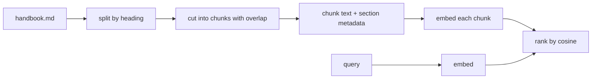

# 03.2 · Chunking strategies

**Module:** [03 · Embeddings and semantic search](../README.md) · **Time:** 45-60 minutes · **Model needs:** embeddings (no chat model) · **Packages:** `rag` extra

## What you will learn

- Why documents are cut into **chunks** before they are embedded.
- Three strategies: **fixed size** (with overlap), **sentence** grouping and **recursive** splitting.
- How chunk size changes what a search returns, and how to measure it on your own questions.
- How to keep a heading as **metadata** so every result says where it came from.

## The idea

**What is new since 03.1:** there we searched short, ready-made snippets. Real documents are long, and one
vector for a whole handbook is a blurry average of everything in it. So we cut the text into pieces,
embed each piece and search the pieces.

Chunking is a trade-off. Small chunks are precise but may lose the context that makes them
understandable. Big chunks carry context but dilute the meaning and cost more to read later.



- **Fixed size**: every N characters. Predictable, but cuts mid-sentence. **Overlap** repeats a little text at each boundary.
- **Sentence**: group whole sentences. Clean edges, uneven sizes.
- **Recursive**: try the biggest separator (blank line), then lines, then sentences, then words, only splitting what is still too long. This is what most libraries call a recursive character splitter.

The data file `handbook.md` is an invented Larkspur Labs IT handbook (about 3,000 characters).

## Scripts

Run all three with `./run 03.2` (Windows: `run 03.2`), or one at a time. None calls a chat model.

### 1. `01_three_chunkers.py`: three ways to cut

```
./run 03.2/1
```

Cuts the handbook with each strategy and prints chunk counts, sizes, two sample chunks and how
many chunks end cleanly at a sentence end. No embeddings needed.

**Expected output** (trimmed):

```
fixed: 12 chunks, length min 231 / avg 294 / max 300
  chunks that end at a sentence end: 1 of 12
sentence: 12 chunks, length min 171 / avg 246 / max 349
  chunks that end at a sentence end: 12 of 12
recursive: 11 chunks, length min 141 / avg 268 / max 382
  chunks that end at a sentence end: 8 of 11
```

### 2. `02_chunk_size_and_retrieval.py`: chunk size changes what you find

```
./run 03.2/2
```

Embeds the handbook at five sizes and, for five questions, checks whether the top chunk contains
the phrase that answers it.

**Expected output** (trimmed; scores depend on the embedding model):

```
 size  chunks   hits  avg top score  avg top chunk chars
  100      38   5/5          0.790                   92
  200      21   4/5          0.735                  150
  400      11   4/5          0.720                  265
  800       5   4/5          0.691                  649
 1600       2   5/5          0.630                 1486
```

Read it carefully: the score falls as chunks grow (a bigger chunk is a blurrier average), and the
1600-character "hit" is easy because there are only two chunks; it returns 1,486 characters to
find one sentence. With only five questions the hit counts are rough; use more of your own.

### 3. `03_chunk_the_handbook.py`: headings, overlap, metadata

```
./run 03.2/3
```

Splits by `##` heading, packs sentences up to 350 characters with one sentence of overlap, stores
`section` and `part` next to each chunk, and searches with four new tickets.

**Expected output** (trimmed):

```
14 chunks from 5 sections
Ticket: I got a new phone and the login codes stopped working
  #1 (0.71) [Passwords and accounts / part 3] If you get a new phone, re-enrol the app before wiping the old one, ...
Ticket: VPN says connected but the wiki will not load
  #1 (0.72) [Network and VPN / part 3] To work from home, install the Larkspur VPN client from the software portal ...
Ticket: the screen on my laptop keeps going black
  #1 (0.70) [Laptops and devices / part 1] Laptops are replaced every four years. Ask your manager ...
```

The black-screen ticket shows a limit: the best chunk is the one that mentions laptops and the
hardware catalogue, because that section is the closest the handbook gets.

## Try this

1. In script 1 change `size` and `overlap` for the fixed chunker. How many chunks end at a sentence end now?
2. Set `overlap` to 0 in script 3. Does the "new phone" ticket still find the right part?
3. Add five questions of your own to script 2 with a phrase that proves the answer. Which size wins?
4. In script 3 remove the heading from the embedded text (`f"{r['section']}: ..."`). Do the scores change?
5. Add a sixth `##` section to `handbook.md` about expenses and search for it.
6. Change `MAX_CHARS` to 150 and read the chunks. Which are no longer self-explanatory?

## If it does not work

Run `./run doctor`; it checks the `rag` extra and the embedding backend. Install the extra with
`uv sync --extra rag` (or the command `./run doctor` shows). Script 1 needs nothing installed.

## In the running scenario

The helpdesk knowledge base is rarely a list of tidy snippets; it is handbooks and runbooks. Chunked
by heading with overlap and source metadata, each answer can point to a section. Next we store
those chunks somewhere searchable at scale.

**Next:** 03.3 · Vector stores: ChromaDB and FAISS (planned)
