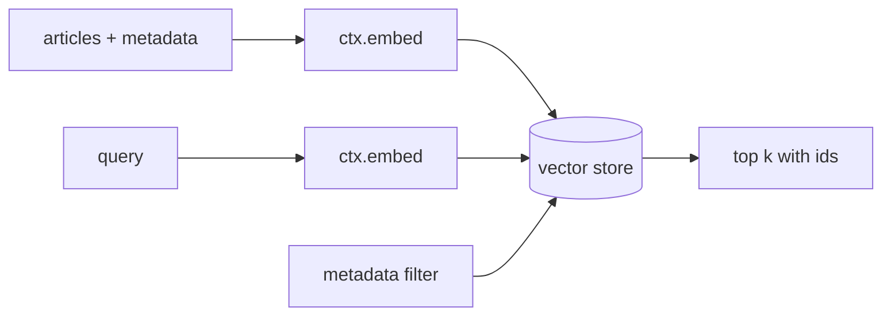

# 03.3 · Vector stores: ChromaDB and FAISS

**Module:** [03 · Embeddings and semantic search](../README.md) · **Time:** 45-60 minutes · **Model needs:** embeddings (no chat model) · **Packages:** `rag` extra (`chromadb`, `faiss-cpu`)

## What you will learn

- What a **vector store** adds over a Python list: persistence, metadata filters, CRUD and fast nearest-neighbour search.
- ChromaDB: collections, `add`, `query`, `where` filters, `get`, `update`, `upsert`, `delete`, and a store on disk.
- FAISS: a bare index that returns row numbers, and the trade-offs of **Flat**, **HNSW** and **IVF** indexes.
- When exact search is enough and when to use an approximate index.

## The idea

**What is new since 03.2:** we now have chunks (or articles) and vectors, and a loop over a numpy matrix
will not scale or filter. A vector store keeps vectors, text and metadata together and answers
"the k nearest, restricted to these rows".



- **ChromaDB** is a small database: you give it ids, vectors, documents and metadata, and it handles storage and filtering. We pass our own vectors from `ctx.embed`, so Chroma never downloads an embedding model. Its distance is `1 - cosine similarity` here (lower is closer).
- **FAISS** is an index library: vectors in, row numbers out. Text, ids and filtering are yours to manage.
- **Flat** compares the query with every vector: exact, simplest, fine to about 100,000 vectors. **HNSW** walks a graph of neighbours: fast and accurate but memory-hungry. **IVF** clusters the vectors and searches only the nearest clusters (`nprobe`): needs training, and recall depends on `nprobe`. HNSW and IVF are *approximate*: they can miss a true neighbour.

Everything runs in memory or in a temp directory; nothing is left on disk.

## Scripts

Run all three with `./run 03.3` (Windows: `run 03.3`), or one at a time. No chat model is called.

### 1. `01_chromadb_basics.py`: collections, filters, CRUD

```
./run 03.3/1
```

Indexes 24 invented knowledge-base articles (`kb.json`, each with a team and audience) in an
in-memory Chroma collection, queries with and without filters, and walks through update, upsert and delete.

**Expected output** (trimmed):

```
Step 3: Query: nearest 3
I replaced my phone and my login codes no longer work
  KB-003 [access/all] distance 0.227: Two-factor codes come from the authenticator app. After getting a new phone, re-
  KB-001 [access/all] distance 0.291: Reset your password in the self-service portal: choose Forgot password and enter
Step 4: Query with a metadata filter: only team = network
  KB-007 [network/all] distance 0.422: If the VPN connects but internal sites do not load, ...
Step 6: get(): fetch by id or by filter, no vector involved
finance articles: ['KB-024']
Step 7: Update, upsert, delete
after upsert + delete: count = 23
```

### 2. `02_faiss_flat_hnsw_ivf.py`: exact versus approximate

```
./run 03.3/2
```

Part 1 searches the real knowledge base with a Flat index. Part 2 builds Flat, HNSW and IVF
indexes over 30,000 **synthetic random** vectors (not text) and compares build time, query time
and recall against the exact answer. Part 3 turns IVF's `nprobe` knob.

**Expected output** (trimmed; timings depend on your machine):

```
index   build ms  200 queries ms  recall@10
Flat           0            65.9       1.00
HNSW         560             7.4       0.99
IVF          109            11.5       1.00

IVF nprobe=1      2.2 ms  recall 0.87
IVF nprobe=4      5.1 ms  recall 1.00
IVF nprobe=16    20.1 ms  recall 1.00
```

The synthetic clusters are easy, so recall is higher than real text would give. The shape of the
trade-off is the point: approximate indexes are several times faster, and HNSW pays for it in build time.

### 3. `03_helpdesk_store.py`: a persistent store with filters

```
./run 03.3/3
```

Writes the knowledge base to a Chroma store in a temp directory, drops the client, reopens
the store, and answers four tickets, some with `where` filters.

**Expected output** (trimmed):

```
reopened, count = 24
Ticket: My laptop shuts off and the display is black   filter: None
  KB-010 (distance 0.26) A flickering or black laptop screen is a hardware ticket. ...
Ticket: Which security key do I need for the payments system   filter: {'audience': 'finance'}
  KB-024 (distance 0.26) Finance staff must use a hardware security key for the payments system; ...
Ticket: Cannot reach the wiki from my kitchen table   filter: {'team': 'network'}
  KB-006 (distance 0.40) Install the Larkspur VPN client from the software portal and connect before ...
```

## Try this

1. In script 1 change the collection's `space` from `cosine` to `l2`. Do the rankings or the distances change?
2. Filter script 1's query with `{"team": {"$ne": "access"}}`. What comes first now?
3. Update a document's text with `update` but without a new vector. Query for the new wording. What happens?
4. In script 2 raise the dataset to 100,000 vectors. When does Flat become noticeably slow?
5. Lower HNSW's `efSearch` to 8, then raise it to 256. Watch recall and time.
6. Add `where={"team": "hardware"}` to a script 3 ticket that is about something else. What does the store return?

## If it does not work

Run `./run doctor`; it checks the `rag` extra and the embedding backend. Install with
`uv sync --extra rag` (or the command shown by `./run doctor`). Chroma needs no server in these scripts.
Chroma collection names must be 3-512 characters of letters, digits, `.`, `_` and `-`.

## In the running scenario

The knowledge base now lives in a store that survives restarts and can be filtered by team and
audience, so engineers do not see finance-only articles and vice versa. Next, 03.4 adds a
second signal: exact keywords, which vectors can blur.

**Next:** 03.4 · Hybrid search: keywords plus vectors (planned)
