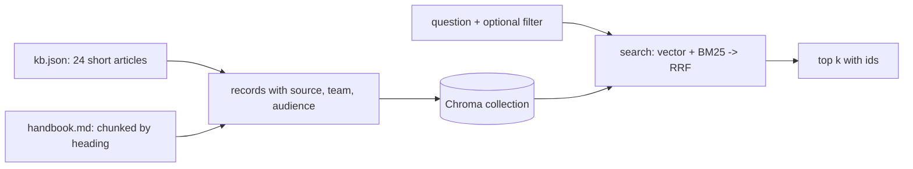

# 03.5 · Capstone: semantic search over the helpdesk knowledge base

**Module:** [03 · Embeddings and semantic search](../README.md) · **Time:** 45-60 minutes · **Model needs:** embeddings (no chat model) · **Packages:** `rag` extra (`chromadb`, `rank_bm25`)

## What you will learn

- How to combine the whole module: chunking (03.2), a vector store with metadata (03.3) and hybrid ranking (03.4).
- How to turn "it feels good" into **acceptance criteria** you can run.
- How to read a result where every method scores well on a small test set.

## The idea

**What is new since 03.4:** nothing new to learn; this lesson assembles the pieces into one working search service
and tests it against a brief.



### The brief

Larkspur Labs wants one search box for the helpdesk team. It must search both the short knowledge-base
articles and the long IT handbook, answer paraphrased questions and exact terms, and respect filters
(for example finance-only or software-only) so people do not see articles that are not for them.

### Acceptance criteria

1. Hybrid search finds an acceptable record in the top 3 for at least 10 of the 12 test questions.
2. Hybrid is at least as good as BM25 alone.
3. A filtered search returns only records that match the filter.
4. Every record has `source`, `team` and `audience` metadata.

### Stretch goals

- Add a "no good answer" rule: return nothing when the best vector similarity is too low. Pick the threshold from data (see 03.1 Try this 4).
- Add a `--team` option so the script takes a filter from the command line.
- Return the handbook heading with each handbook chunk so results can be cited.
- Add ten harder test questions (typos, two topics at once) and see which criteria fail.

## Scripts

Run all three with `./run 03.5` (Windows: `run 03.5`), or one at a time. No chat model is called.
Each script is self-contained (the shared helpers are copied, because lessons never import each other).

### 1. `01_build_index.py`: build the index

```
./run 03.5/1
```

Keeps KB articles whole, chunks the handbook by heading with a one-sentence overlap, attaches metadata, embeds, stores in
Chroma, and prints the metadata the filters will use.

**Expected output** (trimmed):

```
24 KB articles kept whole + 14 handbook chunks = 38 records
collection holds 38 records
source: {'kb': 24, 'handbook': 14}
team: {'access': 9, 'network': 8, 'hardware': 9, 'software': 6, 'security': 6}
audience: {'all': 31, 'engineering': 3, 'office': 3, 'finance': 1}
```

### 2. `02_search_with_filters.py`: one `search()` function

```
./run 03.5/2
```

`search(...)` supports `vector`, `bm25` and `hybrid` modes and a Chroma `where` filter. The script runs five
questions, with and without filters, in vector and hybrid mode.

**Expected output** (trimmed):

```
Step 3: how do I get a hardware security key   filter: {'audience': 'finance'}
vector #1 KB-024  [kb/security] Finance staff must use a hardware security key for the payments system
hybrid #1 KB-024  [kb/security] Finance staff must use a hardware security key for the payments system
Step 4: laptop will not update   filter: {'team': 'software'}
hybrid #1 KB-018  [kb/software] Restart your laptop after updates when asked. Delaying more than three
```

Note that the finance filter leaves exactly one record, so only one result is returned.

### 3. `03_acceptance_check.py`: the criteria as code

```
./run 03.5/3
```

Twelve labelled questions are scored in all three modes, then each acceptance criterion prints PASS or FAIL.

**Expected output** (trimmed):

```
vector  12/12
bm25    11/12
hybrid  12/12
[PASS] hybrid finds an acceptable record in the top 3 for at least 10 of 12 questions
[PASS] hybrid is at least as good as BM25 alone
[PASS] a filtered search returns only records that match the filter
[PASS] every record has source, team and audience metadata
```

All criteria pass, which tells you the test set is easy, not that the search is perfect: the questions were written
next to the articles, and two modes score 12/12. A real evaluation uses questions from real tickets.

## Try this

1. Remove the stop-word list and rerun script 3. Which criterion is first to fail?
2. Change `max_chars` in `chunk_section` to 150. Do the handbook record ids in `CASES` still match?
3. Add a question about something not in the knowledge base. What does each mode return, and why is that a problem?
4. Add a record with `audience: "engineering"` and show that a finance-only filter never returns it.
5. Use `mode="vector"` in script 2 for the "handset" question and compare with BM25.
6. Write five tricky test questions of your own and add them to `CASES`.

## If it does not work

Run `./run doctor`; it checks the `rag` extra and the embedding backend. Install with `uv sync --extra rag`
(or the command shown by `./run doctor`). Everything runs in memory; nothing is written to disk.

## In the running scenario

The helpdesk team now has a search over knowledge-base articles and handbook chunks that handles paraphrase and
exact terms, filters by team and audience, and comes with a test that tells you when a change breaks it. In
module 04 a chat model reads these results and writes the answer: retrieval-augmented generation.

**Next:** 04.1 · The RAG pipeline: retrieve, augment, generate (planned)
