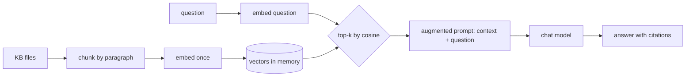

# 04.1 · The RAG pipeline: retrieve, augment, generate

**Module:** [04 · RAG by hand](../README.md) · **Time:** 45-60 minutes · **Model needs:** chat, embeddings · **Packages:** `rag` extra (scripts 2 and 3)

## What you will learn

- Why a model cannot answer questions about documents it has never seen.
- The three stages of **retrieval-augmented generation**: **retrieve** relevant text, **augment** the prompt with it, **generate** an answer.
- How to build all three by hand: chunk files, embed, rank by cosine similarity, assemble a prompt, ask for citations.
- How a prompt rule such as "say you don't know" stops the model answering from thin air, and how to test that it works.

## The idea

A model only knows its training data plus what is in the messages you send. Larkspur Labs'
laptop policy is in neither, so a plain question gets a plausible guess. RAG fixes this
without retraining: look the answer up first, then paste it into the prompt.



"Augment" sounds grand but it is string building: the retrieved chunks, each labelled with
its source, go into the user message above the question. The model then answers from that
text and cites the labels. Embeddings run locally by default (see lesson 03.1); set
`EMBEDDING_MODEL` to use a hosted model through the same `ctx.embed(...)` call.

The knowledge base is six short invented IT policies in `kb/` (VPN, passwords, laptops,
printers, software, Wi-Fi).

## Scripts

Run all three with `./run 04.1` (Windows: `run 04.1`), or one at a time.

### 1. `01_the_problem.py`: no context

```
./run 04.1/1
```

Asks "How often does Larkspur Labs replace employee laptops, and who do I contact if mine
breaks early?" with nothing but a one-line system message. No `rag` extra needed.

**Expected output** (trimmed; your model's guess will differ, but it will be a guess):

```
Reply from the model
assistant | Hello! I'm the IT helpdesk assistant here at Larkspur Labs. ...
          | At Larkspur Labs, we operate on a **three-year hardware refresh cycle**. ...
          | ... please call the IT Helpdesk line at **ext. 5555**.
tokens: 32 in + 350 out = 382
```

The real policy says four years. The invented phone extension is the dangerous part: it
sounds official.

### 2. `02_rag_by_hand.py`: the pipeline, every stage visible

```
./run 04.1/2
```

Chunks the six files by paragraph (18 chunks), embeds them, retrieves the top 3 for the same
question, prints the complete augmented prompt, then asks for an answer with citations.

**Expected output** (trimmed):

```
Step 3: 3. RETRIEVE: embed the question, take the top-k chunks
#1 score 0.89  [laptops.md#1]  Larkspur Labs replaces laptops every 4 years. Your manager will be rem...
#2 score 0.74  [laptops.md#2]  If your laptop is broken sooner, file a Hardware ticket. IT repairs it...
#3 score 0.66  [wifi.md#1]  Staff connect to the network named LarkspurStaff using their normal us...

Step 4: 4. AUGMENT: build the prompt
   system | You are the IT helpdesk assistant at Larkspur Labs. Answer using ONLY the context below. ...
     user | Context:
          | [laptops.md#1]
          | Larkspur Labs replaces laptops every 4 years. ...
          | Question: How often does Larkspur Labs replace employee laptops, ...

Step 5: 5. GENERATE: ask the model
assistant | Larkspur Labs replaces laptops every 4 years [laptops.md#1]. If your laptop breaks
          | earlier, you should file a Hardware ticket [laptops.md#2].
tokens: 184 in + 38 out = 222
```

Chunk #3 is irrelevant. Top-k always returns k chunks; the model has to ignore the noise.

### 3. `03_grounded_helpdesk.py`: grounded answers, and one the KB cannot answer

```
./run 04.1/3
```

Four questions, one chat call each. Three are covered by the knowledge base; the fourth
(parental leave) is not. The system prompt instructs: if the context lacks the answer, say
"I don't know based on the IT knowledge base."

**Expected output** (trimmed):

```
Step 2: Question: I forgot my password, how do I get back in?
retrieved passwords.md#2 (score 0.80)
assistant | To reset a forgotten password, open the self-service portal ... [passwords.md#2].

Step 5: Question: What is the company's parental leave policy?
retrieved software.md#2 (score 0.58)
retrieved wifi.md#2 (score 0.53)
assistant | I don't know based on the IT knowledge base. Please contact the helpdesk.
-> The assistant declined: the retrieved chunks did not hold the answer.
```

Notice the scores for the unanswerable question are lower, but retrieval still returned
chunks. The refusal came from the prompt, not from retrieval.

## Try this

1. **Change `TOP_K`** in script 2 to 1, then 6. What happens to the answer and the token count?
2. **Remove the "ONLY from the context" rule** from script 3's system prompt and re-run the parental-leave question. Does the model still decline?
3. **Edit `kb/laptops.md`** to say 5 years. Re-run script 2. The answer follows the file: that is why RAG beats retraining for changing facts.
4. **Ask a vague question** ("it is not working") in script 2. What does retrieval return?
5. **Check the citations** by hand: does each cited chunk actually contain the fact next to it?
6. **Add a seventh file** to `kb/` (for example `email.md`) and ask a question about it. No code changes needed.

## If it does not work

Run `./run doctor`: it checks your chat settings and the `rag` extra. Install the extra with
`uv sync --extra rag` (or the command `./run doctor` prints). The first embedding run
downloads a small local model once. Script 1 needs only the chat model.

## In the running scenario

The helpdesk assistant now answers from Larkspur Labs' own documents instead of guessing, and
cites where each fact came from. Weak spots remain: paragraph chunking is crude, the index
lives only in memory, and "I don't know" depends on the model behaving. Lesson 04.2 tightens
grounding and citations.

**Next:** 04.2 · Grounding, citations and saying 'I don't know' (planned)
