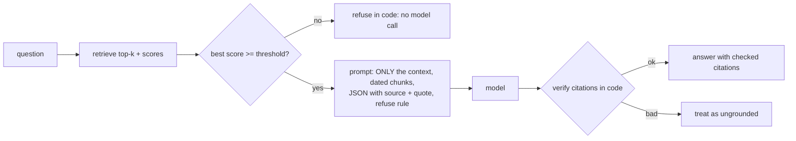

# 04.2 · Grounding, citations and saying 'I don't know'

**Module:** [04 · RAG by hand](../README.md) · **Time:** 45-60 minutes · **Model needs:** chat, embeddings · **Packages:** `rag` extra

## What you will learn

- Why a bracketed citation in a prompt is a request, and how to turn it into something code can **verify** (label check plus verbatim quote check).
- How to make "I don't know" reliable with two layers: a **retrieval gate** (score threshold) and a **prompt rule**.
- How to choose a gate threshold from the score gap between answerable and unanswerable questions, and why not to trust it blindly.
- What happens when **two sources conflict**, and a prompt pattern (dated chunks, "trust the newest, mention the disagreement") that handles it.

## The idea

**What is new since 04.1:** 04.1 built the pipeline and asked the model to cite and to decline. This lesson
treats both as things to *enforce and test*, not hope for.



Three defences, each cheap on its own:

1. **Verifiable citations.** The model returns JSON: an answer plus, per claim, a `source` label and a
   verbatim `quote`. Code checks that the label is one we supplied and the quote really occurs in that chunk.
2. **A refusal gate plus a prompt rule.** Retrieval always returns k chunks. If even the best score is low, refuse
   without calling the model. If chunks pass the gate but lack the answer, the prompt rule makes the model say so.
3. **Conflict handling.** Stale pages are semantically close to current ones, so both get retrieved. Show each
   chunk's last-updated date and tell the model what to do when they disagree.

The knowledge base in `kb/` is the six policies from 04.1, now each with an `Updated:` line, plus two stale files:
`laptops-archive.md` (3 years, 2022) and `passwords-faq-old.md` (12 characters, 90 days, 2023). The scripts treat
`Updated:` as metadata, not as a chunk, and label chunks `laptops#1` (file name, then paragraph number).
Embeddings run locally by default (see 03.1); with a hosted provider you would swap in
`client.embeddings.create(model=..., input=[...])` via `EMBEDDING_MODEL`.

## Scripts

Run all three with `./run 04.2` (Windows: `run 04.2`), or one at a time.

### 1. `01_verify_citations.py`: citations you can check

```
./run 04.2/1
```

Retrieves 3 chunks for "How long do I have to return my old laptop...", asks for JSON with a verbatim quote per
claim, validates it with pydantic, and verifies each citation. Then it runs the checker on a hand-made answer
with an invented label and a made-up quote (no model call) to prove it catches them.

**Expected output** (trimmed):

```
Step 3: 3. Validate the shape, then verify every citation in code
verification
{
  "answer": "You must return your old laptop to IT within 14 days of receiving your new one so that it can be securely wiped.",
  "citations": 1,
  "problems": []
}
All citations verified.

Step 4: 4. Prove the checker catches bad citations (no model call)
checker on the hand-made answer
{
  "problems": [
    "laptops#9: not one of the chunks we supplied (invented label)",
    "laptops#3: quote is not in that chunk: 'within 30 days of purchase'"
  ]
}
```

### 2. `02_refusal_gate.py`: saying "I don't know"

```
./run 04.2/2
```

Scores three answerable and three unanswerable questions, picks a threshold from the gap, answers through the
gate, then sends a near-miss question (VPN on a personal phone) that passes the gate so only the prompt rule can stop it.

**Expected output** (trimmed):

```
best score 0.84  in KB   How many wrong password attempts lock my account?
best score 0.58  NOT in KB  What is the company's parental leave policy?
best score 0.68  NOT in KB  How do I claim travel expenses for a conference?
Lowest answerable best-score: 0.81. Highest unanswerable best-score: 0.68.
The groups separate here. Threshold = midpoint = 0.75.
[NOT in KB] GATE refused (score 0.58 < 0.75): What is the company's parental leave policy?
   -> I don't know based on the IT knowledge base. (no model call)
Can I install the Larkspur VPN client on my personal phone?  best score 0.76: passes the gate. The KB never mentions phones.
assistant | I don't know based on the IT knowledge base. Please contact the helpdesk.
   -> the PROMPT RULE refused. ...
Model calls made: 4 for 7 questions.
```

The near miss scored 0.76 against a threshold of 0.75: the gate is a blunt tool, and the prompt rule earned its keep.

### 3. `03_conflicting_sources.py`: two sources disagree

```
./run 04.2/3
```

For a laptop question and a password question, retrieval returns both the current and the stale page. Each is
answered twice from the same chunks: a naive prompt, then a conflict-aware prompt with dated chunks.

**Expected output** (trimmed):

```
score 0.92  [laptops#1] updated 2025-09-01  Larkspur Labs replaces laptops every 4 years. ...
score 0.87  [laptops-archive#1] updated 2022-05-10  Larkspur Labs replaces laptops every 3 years. ...
--- naive prompt, no dates ---
assistant | Larkspur Labs replaces laptops every 4 years [laptops#1].
--- conflict-aware prompt, dated chunks ---
assistant | Larkspur Labs replaces laptops every 4 years [laptops#1]. An older source, [laptops-archive#1], disagreed
          | by stating the replacement cycle was every 3 years.
```

On this run the naive prompt was already right: the current page ranked first and the model went with it. What
differs is that only the conflict-aware answer *tells the reader* a disagreement exists. Do not assume your model
always gets lucky (try Try this 4).

## Try this

1. **Break a citation.** In script 1, change `TOP_K` to 1 and ask about something in a different chunk. Does the verifier flag the answer?
2. **Move the threshold** in script 2 to 0.60, then 0.85. Which questions are now wrongly answered or wrongly refused?
3. **Remove the refuse rule** from script 2's `SYSTEM` and rerun the phone question. Does the model guess?
4. **Reorder the chunks** in script 3 so the archived chunk comes first in `plain`. Does the naive prompt now follow position instead of date?
5. **Delete `laptops-archive.md`**. Conflict gone, prompt unchanged: the best fix is often in the corpus.
6. **Ask a question that mixes two topics** ("VPN and printer") in script 2: does one best score hide that half of it is unanswered?

## If it does not work

Run `./run doctor`: it checks your chat settings and the `rag` extra (`uv sync --extra rag`). The first
embedding run downloads a small local model once. If script 1 says the reply was not the expected JSON shape, your
model ignored JSON mode: that is an explained outcome, not a crash; the answer is then treated as ungrounded.

## In the running scenario

The helpdesk assistant now refuses cheaply when the knowledge base has nothing, refuses by rule when the chunks
are near but wrong, shows citations that code has verified, and flags stale-versus-current disagreements instead
of silently choosing. We have not yet *measured* any of this; 04.3 does.

**Next:** 04.3 · Measuring retrieval and answer quality (planned)
