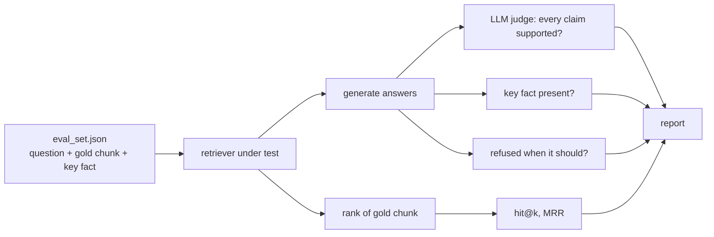

# 04.3 · Measuring retrieval and answer quality

**Module:** [04 · RAG by hand](../README.md) · **Time:** 45-60 minutes · **Model needs:** chat, embeddings (scripts 1 and 2 need only embeddings) · **Packages:** `rag` extra

## What you will learn

- How to build a small **labelled question set** (question, gold chunk, key fact) and why it is the real cost of evaluation.
- The retrieval metrics: **hit@k**, **recall@k** and **MRR** (mean reciprocal rank), and what each one tells you.
- How to use a scoreboard to **compare retrievers** (keyword baseline, paragraph chunks, titled chunks, whole files) fairly.
- Answer metrics: a key-fact check, refusal behaviour, and an **LLM-judge** for faithfulness, including how to test the judge with a planted bad answer.

## The idea

**What is new since 04.2:** we stop eyeballing and start scoring. 04.2 added defences; this lesson measures
whether the pipeline works at all, and whether a change helped.



Quality has two halves, and they fail independently:

- **Retrieval:** was the chunk with the answer in the top k? **hit@k** is the fraction of questions where it was;
  **MRR** is the average of 1/rank of the first gold chunk (1.0 = always first). With one gold chunk per question,
  recall@k equals hit@k; with several, recall is the fraction of gold chunks found.
- **Generation:** given good chunks, did the model answer correctly, refuse when it should, and avoid claims the
  context does not support (**faithfulness**)? A cheap string check covers the key fact; an LLM judge covers faithfulness.

`eval_set.json` has 14 questions over the same six-policy knowledge base: 12 answerable (each with a gold chunk
like `vpn#2` and a `must_contain` key fact) and 2 that are not in the KB. Questions are worded differently from
the documents on purpose ("swapped for a new one" vs "replaces"). Embeddings run locally by default
(`ctx.embed`); with a provider you would use `client.embeddings.create(model=..., input=[...])`.

## Scripts

Run all three with `./run 04.3` (Windows: `run 04.3`), or one at a time.

### 1. `01_retrieval_metrics.py`: hit rate and MRR

```
./run 04.3/1
```

Ranks all 18 chunks for each answerable question, prints the rank of the gold chunk, then the metrics. Also shows
the best scores of the two unanswerable questions. No chat model is called.

**Expected output** (trimmed):

```
rank  1  gold laptops#1     top1 laptops#1     How many years until my laptop is swapped for a ne
rank  2  gold printers#3    top1 printers#1    Can I print in colour on floor 4?   <-- not first
rank  2  gold vpn#1         top1 wifi#2        Working from home, how do I get to the wiki?   <-- not first
hit@1: 9/12 = 0.75   (gold chunk in the top 1)
hit@3: 12/12 = 1.00   (gold chunk in the top 3)
MRR: 0.88   (mean of 1/rank: 1.0 = always first, 0.5 = typically second)
best score 0.58  What is the company's parental leave policy?
Answerable questions' best scores range 0.66-0.81.
```

### 2. `02_compare_retrievers.py`: a scoreboard that settles arguments

```
./run 04.3/2
```

Same questions, four retrievers: keyword overlap, paragraph embeddings, paragraph embeddings with the file title
prepended, and whole files. Prints hit@1, hit@3, MRR for each and the questions where they disagree. No chat model.

**Expected output** (trimmed):

```
retriever   hit@1  hit@3    MRR
keyword      0.42   0.75   0.65
paragraph    0.75   1.00   0.88
titled       0.75   1.00   0.88
wholefile    0.92   1.00   0.96
```

Embeddings clearly beat keyword matching. Titles did not change the totals here (they moved two questions in
opposite directions), and the whole-file row looks best only because choosing among 6 files is an easier task, so
it is not a fair comparison. Do not over-read a 12-question set.

### 3. `03_judge_answers.py`: answer quality and an LLM judge

```
./run 04.3/3
```

Answers six questions (four in the KB, two not), runs deterministic checks, then makes ONE batched judge call
over all answers plus a planted unfaithful one ("5 years, and a free monitor"). The report combines retrieval hit,
key fact, refusal behaviour and judged faithfulness. 7 model calls in total.

**Expected output** (trimmed):

```
id          hit    key fact  refusal ok  faithful (judge)
q1          True   True      True        True
q3          True   True      True        True
q8          True   True      True        False
q10         True   True      True        True
q13         None   None      True        True
q14         None   None      True        True
q1-planted  None   None      None        False
The judge CAUGHT the planted unfaithful answer.
Faithfulness on real answers: 5/6
```

The judge caught the planted answer, but it also marked `q8` unfaithful with the reason "incomplete as it fails to
specify that Finance approval is only required for requests over 200 pounds". That is a completeness complaint, not
an unsupported claim: the judge drifted from the rubric. Read judge reasons; do not just average the booleans.

## Try this

1. **Add questions.** Append five questions to `eval_set.json` (with gold labels) and rerun script 1. Which metric moved most?
2. **Break retrieval on purpose.** In script 1 shuffle the chunk list order of the embeddings but not the labels. What do the metrics become?
3. **Change the embedding model** (`EMBEDDING_MODEL` in `.env`) and rerun script 2: does the ranking of retrievers hold?
4. **Add a fifth retriever** to script 2: paragraph chunks with a score of embedding plus keyword overlap. Does it beat `paragraph`?
5. **Plant a subtler bad answer** in script 3 (right number, wrong chunk label). Does the judge still catch it?
6. **Tighten the judge prompt** ("completeness is not your concern") and see whether `q8` flips back.

## If it does not work

Run `./run doctor` (checks chat settings and the `rag` extra; install with `uv sync --extra rag`). If the judge
does not return valid JSON, script 3 prints that and reports no faithfulness scores: an explained outcome.
Judge verdicts vary a little run to run; the deterministic checks should not.

## In the running scenario

The helpdesk assistant now has a report card: retrieval hit rate and MRR on a labelled set, a refusal check, and
judged faithfulness. 04.4 turns this into the module capstone: a grounded helpdesk assistant plus an evaluation
report with an acceptance bar.

**Next:** 04.4 · Capstone: helpdesk answers grounded in the knowledge base (planned)
