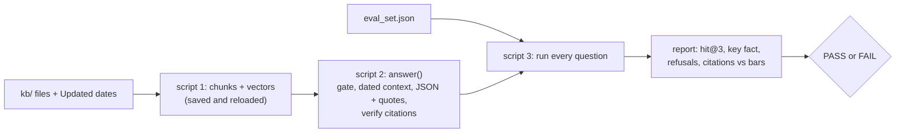

# 04.4 · Capstone: helpdesk answers grounded in the knowledge base

**Module:** [04 · RAG by hand](../README.md) · **Time:** 45-60 minutes · **Model needs:** chat, embeddings · **Packages:** `rag` extra

## What you will learn

- How to combine the whole module (chunking with metadata, retrieval, a refusal gate, dated context, verified citations, evaluation) into one function with explicit outcomes.
- How to give every answer a **status** (`answered`, `refused_gate`, `refused_model`, `citations_failed`, `bad_reply`) so callers never guess whether it is grounded.
- How to turn acceptance criteria into an **evaluation report** with PASS/FAIL bars, and why a failing report is a result, not a crash.

## The idea

This is a capstone: there is no new API feature. **What is new since 04.3** is only that the pieces are wired
together and judged against bars you wrote down first.

**The brief.** Larkspur Labs employees ask the helpdesk assistant IT questions. Answers must come from the
knowledge base in `kb/` (six current policies plus two stale files that disagree with them) and must be safe to
show: grounded, cited, and honest about what the KB does not say.

**Acceptance criteria** (the bars live in script 3 as `BARS`):

1. Every answer that is shown carries citations that code has verified (label supplied, quote found in the chunk).
2. Questions the KB cannot answer are refused, and answerable ones are not: refusal behaviour is right on **100%** of the eval set.
3. The gold chunk is in the top 3 for at least **90%** of answerable questions (hit@3).
4. The expected key fact appears in at least **80%** of answerable answers.
5. When a stale and a current source disagree, the answer uses the current one (checked by the key fact: "4 years", "14 characters").
6. Every outcome is explicit in a status; a reply that is not valid JSON is a `bad_reply`, never a crash.



**Stretch goals.**

1. Grow `eval_set.json` to 30 questions, including paraphrases and two-topic questions, and see which bars slip.
2. Add the batched LLM judge from 04.3 to script 3 and report faithfulness beside the other metrics.
3. Replace the single `GATE` constant with one calibrated on a dev half of the set and reported on the other half.
4. Add a `kb/` file with a *current* conflict (two files with the same date) and make the answerer say it cannot tell.
5. Cache the index on disk (script 1 shows how) and rebuild only when a `kb/` file changes.

## Scripts

Run all three in order with `./run 04.4` (Windows: `run 04.4`), or one at a time.

### 1. `01_build_index.py`: a reusable index

```
./run 04.4/1
```

Chunks the 8 files into 20 chunks with label, file and updated date, embeds them once, saves chunks and vectors to
a temporary folder, reloads and compares, then runs sanity checks. No chat model.

**Expected output** (trimmed):

```
8 files -> 20 chunks. Each keeps: label, text, updated date, file.
matrix shape (20, 384)
saved: {'vectors.npy': 61568, 'chunks.json': 4352}
reloaded identical: chunks=True, vectors=True
PASS  labels are unique
PASS  no empty chunks
PASS  every chunk has a date
PASS  test query lands on a vpn chunk (got vpn#3)
```

The test query ("How long can a VPN session last?") landed on `vpn#3` while the 12-hour fact is in `vpn#2`:
the check only demands a VPN chunk, and the miss shows why 04.3 measures the exact chunk.

### 2. `02_grounded_answerer.py`: `answer(question)`

```
./run 04.4/2
```

Five demo questions through one function: stale-versus-current conflicts, an out-of-scope question, and a near miss.

**Expected output** (trimmed):

```
Step 2: Question: How many years until my laptop is swapped for a new one?
best score 0.78; retrieved laptops#1, laptops#3, laptops-archive#1, laptops#2
STATUS: answered  cited: ['laptops#1', 'laptops-archive#1']  problems: []
SHOWN TO THE EMPLOYEE: Larkspur Labs replaces laptops every 4 years. An older source from 2022 stated that the replacement cycle was every 3 years.

Step 5: Question: What is the company's parental leave policy?
best score 0.58; retrieved software#2, laptops-archive#1, wifi#2, laptops#1
STATUS: refused_gate  cited: []  problems: []
SHOWN TO THE EMPLOYEE: I don't know based on the IT knowledge base.

Step 6: Question: Can I install the Larkspur VPN client on my personal phone?
STATUS: refused_model  cited: []  problems: []

answered: 3
refused_gate: 1
refused_model: 1
```

### 3. `03_evaluation_report.py`: the report against the bars

```
./run 04.4/3
```

Runs the 8 labelled questions (6 answerable, 2 not) through the same `answer()` and prints metrics against the
bars. It exits 0 even when a bar fails.

**Expected output** (trimmed):

```
c3 answered         best=0.77 rank=2 fact=True :: My VPN session keeps ending after half a day.
c7 refused_gate     best=0.58 rank=None fact=None :: What is the company's parental leave policy?
MRR (informational): 0.83
metric                value    bar  result
hit@3                  1.00   0.90  PASS
key fact               1.00   0.80  PASS
refusals               1.00   1.00  PASS
citations verified     1.00   1.00  PASS
OVERALL: PASS
```

A PASS on eight questions is encouraging, not proof; the metric table is the same shape you would use on 800.

## Try this

1. **Raise `GATE`** to 0.80 in script 3. Which bar fails first, and which question causes it?
2. **Delete `laptops-archive.md`** and rerun script 2. The conflict disappears; does anything else change?
3. **Break the bar**: set `"key fact"` to 1.0 and add a hard question to `eval_set.json`. Does the report name the failing question?
4. **Strip the dates** from the `Updated:` lines. Does the answerer still pick the current laptop policy?
5. **Set `TOP_K` to 1** and compare hit@3 (now capped by the list length) and the status counts.
6. **Edit a quote check**: make `norm()` lowercase-only (no whitespace collapsing) and see when verification starts failing.

## If it does not work

Run `./run doctor` (chat settings and the `rag` extra; install with `uv sync --extra rag`). If the model ignores
JSON mode, `answer()` returns `bad_reply` and shows the refusal; the report will then FAIL on refusals or key
fact, which is the intended behaviour, not a crash. Scores come from a local embedding model, so other embedding
models need a recalibrated `GATE`.

## In the running scenario

The helpdesk assistant is now a small but honest RAG service: it answers from Larkspur Labs' own documents,
prefers current policy over stale pages, cites in a way code can check, refuses cleanly, and comes with a report
that says whether it meets the bar. Module 05 wraps components like this in an API and a UI.

**Next:** 05.1 · REST and FastAPI basics with Pydantic models (planned)
