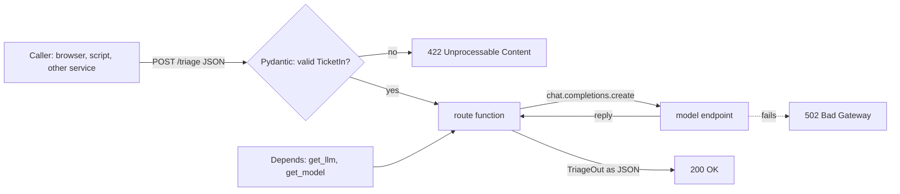

# 05.1 · REST and FastAPI basics with Pydantic models

**Module:** [05 · Serving AI apps: FastAPI, Streamlit, Gradio](../README.md) · **Time:** 45-60 minutes · **Model needs:** chat (script 3 also uses JSON-schema output) · **Packages:** `apps` extra (FastAPI, uvicorn)

## What you will learn

- What a REST API is: a URL plus a method (`GET`, `POST`) in, JSON and a status code out.
- How Pydantic models describe a request and a response, and why FastAPI rejects bad input with `422` before your code runs.
- How **dependency injection** (`Depends`) lets a route ask for "an LLM client" without knowing where it comes from, so tests can swap it.
- Which status code means what: `200`, `404`, `405`, `422`, and `502` for "the model endpoint failed".
- That FastAPI writes the OpenAPI schema and the interactive `/docs` page for you.

## The idea

Until now the helpdesk assistant has been a script you run. To let a web page, a chat bot or
another service use it, you put it behind an **API**: a program that listens for HTTP requests
and answers with JSON. **REST** is the common convention: the URL names a thing (`/triage`), the
method says what to do with it (`GET` reads, `POST` sends data), and the status code says how it went.

FastAPI builds on Pydantic. You write a class for the request body and a class for the response;
FastAPI parses and validates the incoming JSON into the first, serialises the second, and
describes both in an OpenAPI document.



The route never builds its own model client. It declares `llm: LLM` and `model: ModelName`,
and FastAPI calls `get_llm()` and `get_model()` for each request. In production those read
`.env`; in the lesson scripts they are replaced with `app.dependency_overrides`, exactly how a
test suite would substitute a fake.

All three scripts import the app in `helpdesk_api.py` and call it **in-process** with FastAPI's
`TestClient`: real HTTP requests, no port, nothing to start. Read `helpdesk_api.py` first; it is
short and commented.

## Scripts

Run all three in order with `./run 05.1` (Windows: `run 05.1`), or one at a time.

### 1. `01_rest_basics.py`: routes, Pydantic models, status codes

```
./run 05.1/1
```

Calls the two model-free routes: `GET /health` and `POST /echo`. Sends a valid body, then an
invalid one, then a body that is not JSON, an unknown path and a wrong method. No model calls.

**Expected output** (trimmed):

```
Step 1: GET /health ────────────────────────────────────────────────────────
GET /health  ->  200 OK
Response body
{ "status": "ok", "service": "helpdesk-api" }

Step 3: POST /echo with a bad body ─────────────────────────────────────────
POST /echo  ->  422 Unprocessable Content
  - body.message: String should have at least 1 character
  - body.repeat: Input should be less than or equal to 3
422 Unprocessable Content means: your JSON was readable, but it does not match the contract.
The unknown key 'colour' was silently ignored; ...

Step 4: Not JSON at all, a wrong path, a wrong method ──────────────────────
Body that is not JSON: POST /echo -> 422 Unprocessable Content
Unknown path: GET /tickets -> 404 Not Found
Wrong method: GET /echo -> 405 Method Not Allowed

Run summary: no model calls, 0.0s
```

### 2. `02_llm_backed_route.py`: `POST /reply`

```
./run 05.1/2
```

A route that makes one ordinary chat call (the call from 01.1) and wraps the result in a
`ReplyOut` model. Shows dependency injection (`app.dependency_overrides`), a ticket rejected with
`422` before any model call, and a dead model endpoint turned into `502`.

**Expected output** (trimmed; the reply and token numbers will differ):

```
Step 2: POST /reply with a ticket ──────────────────────────────────────────
POST /reply -> 200 OK
{
  "ticket_id": "LL-2001",
  "reply": "Hi Priya, I'm sorry to hear you're having trouble before your call. ...",
  "model": "your-model-name",
  "usage": { "prompt_tokens": 98, "completion_tokens": 64 }
}
tokens: 98 in + 64 out = 162

Step 3: POST /reply with a bad ticket ──────────────────────────────────────
POST /reply -> 422 Unprocessable Content
  - body.ticket_id: String should match pattern '^LL-\d{4}$'
  - body.text: String should have at least 10 characters
Rejected by TicketIn before the route ran, so no model call and no tokens spent.

Step 4: When the model endpoint is down ────────────────────────────────────
POST /reply -> 502 Bad Gateway
{ "detail": "The model endpoint failed: APIConnectionError: Connection error." }
```

### 3. `03_helpdesk_triage_api.py`: `POST /triage` and the OpenAPI schema

```
./run 05.1/3
```

The lesson 01.6 triage behind an API. The model is constrained by a JSON schema, and the route
validates the reply with Pydantic again, so a `200` always has the promised shape; a broken
reply becomes a clear `502`. Then it reads `/openapi.json` to show what FastAPI generated.

**Expected output** (trimmed):

```
Step 1: POST /triage for two tickets ───────────────────────────────────────
POST /triage  LL-2002  ->  200 OK
{ "category": "hardware", "urgency": "high",
  "summary": "The front door badge reader is non-functional following a power outage, ...",
  "needs_human": true }
POST /triage  LL-2003  ->  200 OK
{ "category": "software", "urgency": "low", ... "needs_human": true }

Step 3: The OpenAPI schema FastAPI generated ───────────────────────────────
Paths in /openapi.json
{ "/health": ["GET"], "/echo": ["POST"], "/reply": ["POST"], "/triage": ["POST"] }
POST /triage, as the schema describes it
{ "request body": { "$ref": "#/components/schemas/TicketIn" },
  "responses": { "200": "Successful Response", "422": "Validation Error" } }

Step 4: The interactive docs ───────────────────────────────────────────────
GET /docs -> 200, text/html; charset=utf-8: the Swagger UI page, built from /openapi.json.

Run summary: 2 model call(s), 632 in + 104 out = 736 tokens, 2.4s
```

## Try this

1. **Run it for real.** From this lesson's folder run `uv run uvicorn helpdesk_api:app --reload`
   (from the repo root, add `--app-dir modules/05-serving-ai-apps/01-rest-and-fastapi-basics-with-pydantic-models`).
   Open <http://127.0.0.1:8000/docs>, expand `POST /triage`, click **Try it out**, and send the
   example ticket. Stop the server with Ctrl+C.
2. **Break the contract in /docs.** Send a `ticket_id` of `4821` and a one-word `text`. Read the
   `422` body, then find the same rules in `TicketIn`.
3. **Forbid extra keys.** Add `model_config = ConfigDict(extra="forbid")` to `EchoIn` and re-run
   script 1: the `colour` key is now an error too.
4. **Tighten a field.** Change `repeat` to allow at most 2 and watch the schema in `/openapi.json`
   (and the `/docs` form) change without any other edit.
5. **Add a route.** Write `GET /tickets/{ticket_id}` that returns the id and its length. What status
   does a request for `/tickets/abc` get if you type the parameter as `int`?
6. **Kill the model.** Set `LLM_BASE_URL` in `.env` to a wrong address, start the server, call
   `/reply`. You should see `502`, not `500`. Which line in `helpdesk_api.py` decides that?

## If it does not work

Run `./run doctor`: it checks your settings and the `apps` extra. Install the extra with
`uv sync --extra apps`. If port 8000 is busy,
add `--port 8001`. Script 3 needs a model that supports JSON-schema output; if yours does not, it
prints the `502` body and explains, rather than crashing.

## In the running scenario

The helpdesk assistant is no longer a script: it is a service with a contract. Anything that can
send HTTP can ask it for a reply or a triage and gets validated JSON back. Lesson 05.2 will stream
replies through the API, and 05.3 puts a web UI in front of it.

**Next:** 05.2 · Streaming responses from FastAPI (planned)
