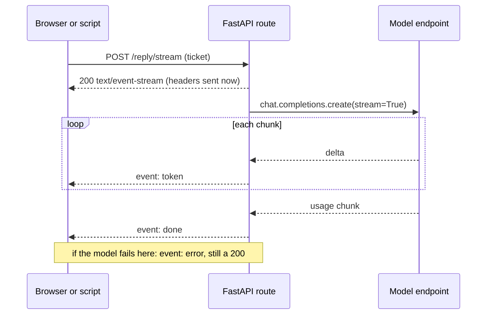

# 05.2 · Streaming responses with Server-Sent Events

**Module:** [05 · Serving AI apps: FastAPI, Streamlit, Gradio](../README.md) · **Time:** 45-60 minutes · **Model needs:** chat with streaming (scripts 2 and 3) · **Packages:** `apps` extra (FastAPI, uvicorn)

## What you will learn

- Why a chat UI streams: the user sees words after about a second instead of a blank page for several.
- What a **Server-Sent Events** (SSE) response is: media type `text/event-stream`, events made of `event:` and `data:` lines, each ended by a blank line.
- How a FastAPI route returns a `StreamingResponse` fed by a generator, and how the model's stream (lesson 01.3) is forwarded event by event.
- Why errors behave differently in a stream: after the `200` is sent there is no `502`, only an `error` event.
- What happens when the client disconnects, and why the generator needs a `finally:` block.

## The idea

**What is new since 05.1:** the reply no longer arrives as one JSON body. The route returns a
`StreamingResponse` wrapped around a Python generator, and every `yield` becomes a small piece of the
response that the client can read immediately.

SSE is the simplest way to do this. It is plain HTTP, one direction (server to client), and a browser
reads it with the built-in `EventSource`. Each event looks like this:

```
event: token
data: {"text": "Hi Priya"}

```

The blank line ends the event. This API uses three event names: `token` (a piece of the reply), `done`
(the final usage numbers) and `error` (something failed after the stream began).



The order matters. Validation (`TicketIn`) runs before the route, so a bad body is still a `422`.
But the model call happens inside the generator, after the status line has gone out. That is why the
failure case in script 3 shows a `200` followed by an `error` event, where 05.1 had a `502`.

The app is in `stream_api.py`; all scripts call it in-process with `TestClient`, so nothing listens
on a port. One honest limit: `TestClient` hands over the body when the response is complete, so you
cannot *feel* the streaming from a script. The server therefore measures `first_token_s` itself and
puts it in the `done` event. To feel it, run the app for real (see Try this).

## Scripts

Run all three in order with `./run 05.2` (Windows: `run 05.2`), or one at a time.

### 1. `01_sse_format.py`: what SSE looks like on the wire

```
./run 05.2/1
```

No model. `GET /countdown` streams three ticks and a final event. The script prints the raw lines, then
parses them back into events with a ten-line `parse_sse()` function, which is all a client needs.

**Expected output** (trimmed):

```
Step 1: The raw response, line by line ─────────────────────────────────────
GET /countdown -> 200, content-type: text/event-stream; charset=utf-8
'event: tick'
'data: {"n": 3}'
''
'event: tick'
'data: {"n": 2}'
''
...
Step 2: Parse the lines back into events ───────────────────────────────────
event=tick  data={'n': 5}
...
event=done  data={'message': 'liftoff'}

Run summary: no model calls, 0.5s
```

### 2. `02_stream_a_reply.py`: stream a model reply through the API

```
./run 05.2/2
```

`POST /reply/stream` opens a streaming chat call and forwards each delta as a `token` event. The script
reassembles the reply and reads the token usage from the `done` event, because the model call happened
inside the route where `ctx` cannot see it.

**Expected output** (trimmed; wording and numbers will differ):

```
Step 1: POST /reply/stream ─────────────────────────────────────────────────
POST /reply/stream -> 200, content-type: text/event-stream; charset=utf-8
Cache-Control: no-cache; X-Accel-Buffering: no (both tell proxies not to hold the stream back)
event #1: token {'text': 'Hi Priya'}
event #2: token {'text': ", I'm sorry to hear you're having trouble before your call. Please try restarting"}
...
Step 2: What the client reassembled ────────────────────────────────────────
5 events: 4 token events plus one done event, in 1.7s.
The done event
{ "ticket_id": "LL-2101", "usage": { "prompt_tokens": 98, "completion_tokens": 61 }, "first_token_s": 1.385 }

Run summary: 1 model call(s), 98 in + 61 out = 159 tokens, 1.7s
```

Some gateways batch several words into one chunk, so a short reply may be only a handful of events.

### 3. `03_errors_and_disconnects.py`: failure in a stream

```
./run 05.2/3
```

Three cases: a bad body (a normal `422`), a dead model endpoint (a `200` followed by an `error` event),
and a client that stops reading after two events (the server's `finally:` block still runs).

**Expected output** (trimmed):

```
Step 1: A bad request fails before the stream starts ───────────────────────
POST /reply/stream -> 422 Unprocessable Content, content-type: application/json

Step 2: The model endpoint is down: 200, then an error event ───────────────
POST /reply/stream -> 200 (the status was sent before the model was even called)
event=error data={'message': 'The model endpoint failed: APIConnectionError: Connection error.'}

Step 3: The client walks away after a few events ───────────────────────────
event=token data={'text': 'Hi Mei'}
event=token data={'text': ", I'm sorry to hear the badge reader is down. Please try unplugging the"}
What the server logged
[ "LL-2102: generator closed, upstream stream released" ]
```

## Try this

1. **Feel it.** From the repo root run
   `uv run uvicorn stream_api:app --app-dir modules/05-serving-ai-apps/02-streaming-responses-with-server-sent-events`, then in a
   second terminal `curl -N -X POST http://127.0.0.1:8000/reply/stream -H "Content-Type: application/json" -d '{"ticket_id":"LL-2101","employee":"Priya","text":"My laptop cannot join the office Wi-Fi."}'`.
   (`-N` turns off curl's own buffering.) The tokens appear as they arrive. Stop with Ctrl+C. Windows:
   use `curl.exe` and escape the quotes, or send the request from `/docs`.
2. **Drop the proxy hint.** Remove the `X-Accel-Buffering` header and read what a buffering reverse
   proxy would do to your stream (it would hold events back until the buffer fills).
3. **Add a heartbeat.** SSE lines that start with `:` are comments clients ignore. Emit `: ping\n\n`
   every few events and check that `parse_sse()` still works.
4. **Name the error better.** Add a `code` field to the `error` event (`upstream_unavailable`) and make
   script 3 print it. Why is a machine-readable code better than the message text?
5. **Count events.** Change `REPLY_PROMPT` to ask for a long answer and watch the number
   of `token` events grow. Does the `done` usage still match?
6. **Disconnect for real.** With the real server from step 1, press Ctrl+C in curl after two tokens.
   Add a `print` in the `finally:` block and see when it fires.

## If it does not work

Run `./run doctor`: it checks your settings and the `apps` extra; install it with `uv sync --extra apps`.
If your provider does not support `stream_options`, the `done` event reports `"usage": null` and the run
summary says the provider reported no usage. If your gateway buffers streams, script 2 still works but
`first_token_s` will be close to the total time.

## In the running scenario

The helpdesk API from 05.1 now has a `POST /reply/stream` route: a front end can show Priya the first
words of the answer within about a second and fill in the rest while she watches. Lesson 05.3 builds that
front end in Streamlit.

**Next:** 05.3 · A chat UI in Streamlit (planned)
