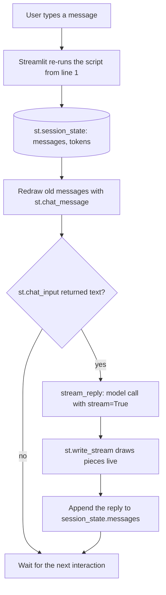

# 05.3 · A chat UI in Streamlit

**Module:** [05 · Serving AI apps: FastAPI, Streamlit, Gradio](../README.md) · **Time:** 45-60 minutes · **Model needs:** chat with streaming (scripts 2 and 3) · **Packages:** `apps` extra (Streamlit)

## What you will learn

- How a Streamlit page works. Streamlit re-runs your script from top to bottom every time the user does something, and `st.session_state` is the page's memory.
- The chat building blocks: `st.chat_input`, `st.chat_message`, `st.write_stream`.
- How to keep a conversation of several turns in `session_state` and send the whole history each turn (lesson 01.2).
- How sidebar widgets feed the prompt, and how an `on_click` callback (a function that runs when a button is clicked) resets state.
- How to test a page without a browser or a server, using `streamlit.testing.v1.AppTest`.

## The idea

In 05.2 you built a service that streams events. Now you build the part a person looks at.
Streamlit is a Python library that turns a plain Python script into a web page, so you can write a
front end without HTML or JavaScript.

It works differently from a normal program. Streamlit re-runs your whole script each time the user
clicks something or sends a message. Ordinary variables start fresh on every run. Anything that must
survive, such as the messages and the token counts, goes in `st.session_state`.



This lesson's pages call the model directly, with the streaming call from 01.3, so they work on their
own. In the capstone (05.5) the page talks to the FastAPI service from 05.1 and 05.2 instead.

To test a page, `AppTest.from_file(...)` runs it in-process. You set widget values, call `.run()`, and
read the elements that result (`at.chat_message`, `at.sidebar.caption`, `at.error`). Nothing is launched.
The scripts put the course's client in `session_state` so the page uses it. A real run reads `.env`.

## Scripts

Run all three in order with `./run 05.3` (Windows: `run 05.3`), or one at a time. The page files
`chat_app.py` and `helpdesk_chat_app.py` have no number because they are the app, not lesson scripts.

### 1. `01_streamlit_rerun_model.py`: the re-run model

```
./run 05.3/1
```

No model here. `AppTest.from_function` runs a tiny page with a button. After three clicks the plain
variable has never gone past 1, while `session_state` has counted to 3.

**Expected output** (trimmed):

```
Step 2: Click the button three times ───────────────────────────────────────
After click 1
[ "plain variable: 1", "session_state.clicks: 1" ]
After click 3
[ "plain variable: 1", "session_state.clicks: 3" ]
The plain variable shows 1 only on the run that handled the click. Every run resets it to 0, so it never reaches 2.
session_state kept counting. That is why a chat page keeps its message list there.

Run summary: no model calls, 0.2s
```

### 2. `02_a_streaming_chat_page.py`: a streaming chat page

```
./run 05.3/2
```

Drives `chat_app.py`. It loads the page and types a message, then a follow-up that only makes sense if
the page remembers the first turn. It reads the chat bubbles after each run and adds the token usage the
page recorded to the totals.

**Expected output** (trimmed; wording and numbers will differ):

```
Step 2: Turn 1: the employee types a message ───────────────────────────────
{ "role": "user", "text": "My laptop can't join the office Wi-Fi. Other people are fine." }
{ "role": "assistant", "text": "Since other devices are working, please try \"forgetting\" the Larkspur-Office network ..." }

Step 3: Turn 2: a follow-up that only makes sense with memory ──────────────
{ "role": "user", "text": "I already restarted it. What should I try next?" }
{ "role": "assistant", "text": "Since a restart didn't resolve the issue, please \"forget\" the Larkspur-Office network ..." }
The page sent 4 messages to the model on this turn: the whole history, as in lesson 01.2.

Step 4: Tokens ─────────────────────────────────────────────────────────────
tokens: 56 in + 51 out = 107
tokens: 118 in + 55 out = 173
Run summary: 2 model call(s), 174 in + 106 out = 280 tokens, 4.1s
```

Notice that the model invented the network name "Larkspur-Office". It has no such data. Retrieval
fixes that (module 04).

### 3. `03_helpdesk_chat_page.py`: sidebar, reset button, errors

```
./run 05.3/3
```

Drives `helpdesk_chat_app.py`. It sets the name and tone in the sidebar, sends a message and clicks
**New conversation**. Then it points the page at a dead endpoint to check that the page shows `st.error`
instead of crashing.

**Expected output** (trimmed):

```
Step 1: Fill in the sidebar, then ask ──────────────────────────────────────
Sidebar widgets
{ "employee": "Priya", "tone": "Formal" }
{ "role": "assistant", "text": "Hello Priya. Please restart your computer and ensure you are connected to a stable wired network connection. ..." }
Sidebar caption: Tokens used: 58 in, 28 out

Step 2: Click 'New conversation' ───────────────────────────────────────────
Chat bubbles after the reset: 0; messages in session_state: 0.
Token counts survive the reset: Tokens used: 58 in, 28 out

Step 3: When the model endpoint is down ────────────────────────────────────
st.error messages on the page
[ "The model endpoint failed: APIConnectionError. Try again in a moment." ]
Exceptions raised: 0; messages kept in history: 0 (the unanswered turn was dropped).

Run summary: 1 model call(s), 58 in + 28 out = 86 tokens, 1.3s
```

## Try this

1. Run it for real. From the repo root: `uv run streamlit run modules/05-serving-ai-apps/03-a-chat-ui-in-streamlit/helpdesk_chat_app.py`.
   Your browser opens. Chat, change the tone, click **New conversation**. Stop with Ctrl+C.
2. Break the memory. In `chat_app.py` send only `[{"role": "user", "content": prompt}]` to the model
   instead of the whole history, and re-run script 2. Does the follow-up still make sense?
3. Add a tone. Add `"Playful"` to `TONES` and extend script 3 to try it.
4. Cap the history. Keep only the last six messages when calling the model. What do you lose?
5. Draw a plain variable. In script 1, add a second button that sets `plain = 5`. Predict the text
   after clicking it once, then run it.
6. Test an edge case. Use `at.chat_input[0].set_value("")` in script 3. Why does nothing happen?

## If it does not work

Run `./run doctor`. It checks your settings and the `apps` extra. Install the extra with
`uv sync --extra apps`. Streamlit prints a harmless "missing ScriptRunContext" warning when it runs
without a browser, and the scripts silence it. If `at.exception` is not empty, the scripts print it. If
your provider does not support streaming, the page raises an error inside `write_stream` and then shows
the `st.error` message.

## In the running scenario

Priya now has something to type into. The page keeps her conversation and calls her by name. It shows
how many tokens the chat has used, and it fails politely when it cannot reach the model. The next lesson
builds the same kind of front end in Gradio and compares the two.

**Next:** 05.4 · A demo UI in Gradio; choosing between the two (planned)
