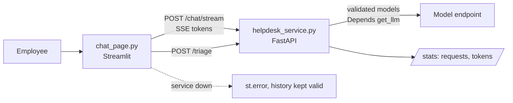

# 05.5 · Capstone: helpdesk assistant as an API with a chat front-end

**Module:** [05 · Serving AI apps: FastAPI, Streamlit, Gradio](../README.md) · **Time:** 45-60 minutes · **Model needs:** chat, streaming, JSON-schema output · **Packages:** `apps` extra (FastAPI, Streamlit)

## What you will learn

- How the pieces of module 05 fit together: a FastAPI service with validated models and dependency injection (05.1), streaming over SSE (05.2), and a Streamlit chat page (05.3) that talks to it.
- Why the front end should hold **no model code**: keys, prompts and model names stay behind the API.
- How a front end reads an SSE stream, and what it does when the service is unreachable.
- How to write acceptance criteria as a script that prints PASS or FAIL.

## The idea

This lesson is a capstone: there is no new API feature. You wire what you built into one working system.

**The brief.** Larkspur Labs employees need a chat window for first-line IT help. Behind it sits one service
that every other tool (a ticketing bot, a mobile app) can use too.

| Piece | File | Job |
|---|---|---|
| Service | `helpdesk_service.py` | `GET /health`, `POST /triage`, `POST /chat/stream`, `GET /stats` |
| Chat page | `chat_page.py` | Streamlit page; talks only HTTP; has a triage button |

**Acceptance criteria** (script 3 checks each one).

1. `S1` `/health` answers `200`.
2. `S2` `/triage` returns exactly `category`, `urgency`, `summary`, `needs_human`, validated.
3. `S3` A malformed ticket is rejected with `422` before any model call.
4. `S4` `/chat/stream` sends one or more `token` events and ends with a `done` event.
5. `S5` The `done` event reports token usage, or an explicit `null`.
6. `F1` The page shows both turns of a conversation.
7. `F2` On turn two the page sends the whole history.
8. `F3` The page calls only the service, never a model.
9. `F4` When the service is down the page shows an error message and does not crash.



The seam between the two is HTTP. The page picks its client from `st.session_state["_api"]`: the scripts
put FastAPI's `TestClient` there so everything runs in-process with no port; a real run builds an
`httpx.Client` for `$HELPDESK_API_URL`. The same page code works in both.

**Stretch goals.**

- Add `POST /chat` (non-streaming JSON) and a toggle in the page to use it.
- Add an API key check (a header, via `Depends`) and make the page send it.
- Show the `first_token_s` from the `done` event in the page's sidebar.
- Rebuild the page in Gradio (05.4) against the same service. What changes? What does not?
- Let triage pick the ticket's first user message instead of the last one; add an acceptance check.

## Scripts

Run all three in order with `./run 05.5` (Windows: `run 05.5`), or one at a time.

### 1. `01_the_service.py`: the API on its own

```
./run 05.5/1
```

Calls every route through `TestClient`: health, a triage, a two-turn streaming chat (the second request carries
the history), three bad requests that must be `422`, and `/stats`.

**Expected output** (trimmed):

```
Step 2: POST /triage ───────────────────────────────────────────────────────
POST /triage -> 200 OK
{ "ticket_id": "LL-3001",
  "triage": { "category": "hardware", "urgency": "high",
              "summary": "The front door badge reader is non-functional following a power outage, ...", "needs_human": true },
  "usage": { "prompt_tokens": 284, "completion_tokens": 53 } }

Step 3: POST /chat/stream (two turns, the second carries the history) ──────
turn 1: 200 text/event-stream; charset=utf-8, sending 1 message(s)
done event: {'usage': {'prompt_tokens': 69, 'completion_tokens': 45}, 'first_token_s': 1.454, 'history_messages': 1}
turn 2: 200 text/event-stream; charset=utf-8, sending 3 message(s)

Step 4: Requests the service must reject ───────────────────────────────────
ticket id that is not LL-dddd: 422 (String should match pattern '^LL-\d{4}$')
empty conversation: 422 (List should have at least 1 item after validation, not 0)
conversation ending with an assistant message: 422 (Value error, the last message must come from the user)

Run summary: 3 model call(s), 476 in + 137 out = 613 tokens, 5.5s
```

### 2. `02_the_chat_front_end.py`: the page wired to the service

```
./run 05.5/2
```

Runs `chat_page.py` with `AppTest`, its HTTP client pointing at the service. Two chat turns, the triage button,
a log of every request the page made, then a dead service.

**Expected output** (trimmed; wording differs between runs):

```
Step 2: The employee chats (two turns) ─────────────────────────────────────
user: My laptop can't join the office Wi-Fi. Other people are fine.
assistant: Hi Priya, please try restarting your laptop to refresh the network configuration. ...
user: I already restarted it. What should I try next?
assistant: Priya, please go into your Wi-Fi settings and select "Forget" for the office network ...
Requests the page made
[ "POST /chat/stream", "POST /chat/stream" ]

Step 3: The 'Triage my last message' button ────────────────────────────────
Requests the page made
[ "POST /chat/stream", "POST /chat/stream", "POST /triage" ]

Step 4: The service goes down ──────────────────────────────────────────────
st.error on the page
[ "Could not reach the helpdesk service (ConnectError)." ]
Exceptions: 0; the unanswered turn was removed, 4 messages remain.

Run summary: 3 model call(s), 539 in + 161 out = 700 tokens, 6.0s
```

The triage button runs on the user's last message, which on turn two ("I already restarted it") has little context.
It is a real limitation of triaging a single chat line; the last stretch goal addresses it. The model also invents
network names ("Larkspur-Guest"): the assistant has no real data yet (modules 03 and 04).

### 3. `03_acceptance_check.py`: the criteria as code

```
./run 05.5/3
```

Runs checks S1-S5 against the service and F1-F4 against the page and prints PASS or FAIL for each. It exits 0 either way.

**Expected output** (trimmed):

```
Step 1: Service criteria ───────────────────────────────────────────────────
PASS  S1 /health answers 200 ok: GET /health
PASS  S3 a bad ticket is a 422 before any model call: status 422
PASS  S4 chat streams token events then one done event: 4 token(s), last event ['done']
Step 2: Front-end criteria ─────────────────────────────────────────────────
PASS  F2 turn 2 sends the whole history: messages per request: [1, 3]
PASS  F4 a dead service gives an error message, not a crash: 1 error message(s), 0 exception(s)
Step 3: Result ─────────────────────────────────────────────────────────────
{ "passed": 9, "total": 9, "failed": [] }
All criteria met.

Run summary: 4 model call(s), 529 in + 193 out = 722 tokens, 7.4s
```

## Try this

1. **Run the whole thing.** Terminal 1, from the repo root:
   `uv run uvicorn helpdesk_service:app --app-dir modules/05-serving-ai-apps/05-capstone-helpdesk-assistant-as-an-api-with-a-cha`.
   Terminal 2: `uv run streamlit run modules/05-serving-ai-apps/05-capstone-helpdesk-assistant-as-an-api-with-a-cha/chat_page.py`.
   Chat, then stop the API with Ctrl+C and send another message. Stop both when done.
2. **Break S3 on purpose.** Loosen the `ticket_id` pattern in `TicketIn` and run script 3. Which check fails, and why is that the right one?
3. **Break F2.** Make the page send only the last message. Which check catches it?
4. **Add a check.** Write `S6`: a conversation of 41 messages is rejected with `422`. Does the service already do that?
5. **Tighten the prompt.** Change `CHAT_PROMPT` to answer in one sentence and compare reply lengths and token counts.
6. **Add a stretch goal** from the list above and the acceptance check that proves it.

## If it does not work

Run `./run doctor`: it checks your settings and the `apps` extra; install it with `uv sync --extra apps`.
A failing `S2` usually means the model does not support JSON-schema output; the service answers `502` and
script 3 prints the body. If you run the two processes for real, check `HELPDESK_API_URL` and that the API port matches.

## In the running scenario

The helpdesk assistant is now a small product: one service with a contract, a streaming chat, a triage
endpoint and counters, and a front end that knows nothing about models. Module 06 re-builds the same ideas with
LangChain, starting from prompt, model and parser chains.

**Next:** 06.1 · Runnables and LCEL: prompt | model | parser
