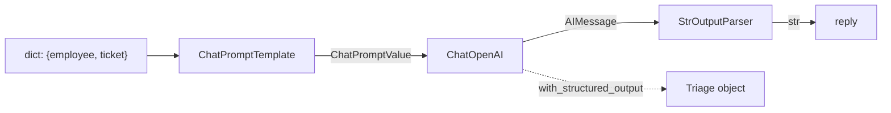

# 06.1 · Runnables and LCEL: prompt | model | parser

**Module:** [06 · LangChain core: chains, memory, RAG](../README.md) · **Time:** 45-60 minutes · **Model needs:** chat (script 3 benefits from structured output, with a fallback) · **Packages:** `langchain` extra (`langchain-core`, `langchain-openai`)

## What you will learn

- How the lesson 01.1 call looks through LangChain's `ChatOpenAI`: message classes, `AIMessage`, `usage_metadata`.
- What a **Runnable** is: anything with `invoke`, `batch` and `stream`.
- How the `|` operator (LCEL) chains runnables, and what type each one hands to the next.
- How to template a system prompt, and how `with_structured_output` returns a pydantic object.

## The idea

Everything you built by hand in module 01 (build messages, call the model, pull out the text,
validate JSON) is a sequence of steps where each takes the previous step's output. LangChain
gives every step the same interface, a **Runnable**, and the `|` operator joins them into a
**RunnableSequence**, which is itself a Runnable.



Because the chain is a Runnable, `chain.invoke(x)` runs one input, `chain.batch([x, y, z])` runs
several concurrently, and `chain.stream(x)` yields the answer in pieces, with no extra code. The
price is a new vocabulary on top of the SDK call you already know. The lesson shows both side by side.

## Scripts

Run all three with `./run 06.1` (Windows: `run 06.1`), or one at a time.

### 1. `01_langchain_call.py`: the same call, through LangChain

```
./run 06.1/1
```

Makes the 01.1 call with the raw SDK, then with `ChatOpenAI` (configured with the same base URL,
key and model), and opens up the `AIMessage`.

**Expected output** (trimmed; wording and tokens will differ):

```
Step 1: The raw SDK call (what you know from 01.1) ─────────────────────────
assistant | A VPN (Virtual Private Network) creates an encrypted tunnel for your internet traffic, ...
tokens: 18 in + 28 out = 46

Step 2: The same call with ChatOpenAI ──────────────────────────────────────
Message classes
[ "SystemMessage(type='system'): You are a concise IT helpdesk assistant.",
  "HumanMessage(type='human'): In one sentence, what is a VPN?" ]

Step 3: Look inside the AIMessage ──────────────────────────────────────────
{
  "class": "AIMessage",
  "message.content": "A VPN (Virtual Private Network) creates an encrypted, secure connection ...",
  "message.usage_metadata": { "input_tokens": 18, "output_tokens": 30, "total_tokens": 48, ... },
  "message.response_metadata['finish_reason']": "stop"
}
Run summary: 2 model call(s), 36 in + 58 out = 94 tokens
```

### 2. `02_lcel_chain.py`: `prompt | model | parser`

```
./run 06.1/2
```

Builds a chain, then runs the three hops by hand to show what each passes on
(`dict` to `ChatPromptValue` to `AIMessage` to `str`), then uses `invoke`, `batch` (three topics)
and `stream`.

**Expected output** (trimmed):

```
The pieces
{ "prompt": "ChatPromptTemplate", "model": "ChatOpenAI", "parser": "StrOutputParser", "chain": "RunnableSequence" }

1. prompt.invoke(dict) -> ChatPromptValue
[ "SystemMessage: You explain IT topics to non-technical employees in one short sentence.",
  "HumanMessage: What is a VPN?" ]
2. model.invoke(prompt_value) -> AIMessage
{ "content": "A VPN acts as a secure, private tunnel ...", "usage_metadata": { "input_tokens": 19, ... } }
3. parser.invoke(ai_message) -> TextAccessor
"A VPN acts as a secure, private tunnel ..."

chain.batch -> multi-factor authentication
"Multi-factor authentication is an extra layer of security ..."

chain.stream yielded
{ "number of pieces": 5, "first pieces": ["", "Multi-factor authentication is an extra layer ...", ...] }
```

Notes: in this LangChain version the string parser returns a `TextAccessor` (a `str` subclass), and
a stream may begin or end with an empty piece. The pieces' size depends on your provider.

### 3. `03_helpdesk_reply_chain.py`: reply chain plus a structured step

```
./run 06.1/3
```

A reply chain with a templated system prompt (`{employee}`, `{ticket}`), then a triage chain
using `model.with_structured_output(Triage)` that returns a `Triage` object. If the endpoint cannot
do structured output, the script falls back to a prompt with format instructions and
`PydanticOutputParser`, and if that also fails it says so and carries on.

**Expected output** (trimmed):

```
Step 1: Chain 1: a templated reply ─────────────────────────────────────────
Prompt variables  [ "employee", "ticket" ]
   system | You are the first-line IT helpdesk assistant at Larkspur Labs. Reply to Priya in at most four short sentences, ...
reply_chain.invoke(...)
"Hi Priya, I'm sorry to hear you're having trouble before your call. Please try restarting your laptop, ..."

Step 2: Chain 2: structured output with a pydantic class ───────────────────
Result: a Triage object
{ "category": "network", "urgency": "high", "summary": "Priya's laptop is unable to connect ...", "needs_human": true }

Step 3: Putting both chains to use ─────────────────────────────────────────
network / high -> on-site support
```

The run summary for this script reports no model calls: the parsers discard the `AIMessage` that
carries token counts (script 1 shows where those live).

## Try this

1. **Print a prompt.** Call `reply_prompt.invoke(TICKET)` in script 3 with an extra variable
   missing. What error do you get, and when (at build time or at invoke time)?
2. **Drop the parser.** Remove `StrOutputParser()` from the chain in script 2. What does `invoke`
   return now? What does `stream` yield?
3. **Batch more.** Add three more topics and time `batch` against a Python loop of `invoke`.
4. **Swap the model.** Change `temperature` to `1` and run script 3 twice. Does the structured
   output stay valid?
5. **Inspect the schema.** Print `Triage.model_json_schema()` and compare with what you wrote by hand
   in lesson 01.6. Run with `--raw` and find where it appears in the request.
6. **Add a step.** Pipe a plain function into the chain with `| (lambda s: s.upper())`. Functions are
   Runnables too (`RunnableLambda`).

## If it does not work

Run `./run doctor`; install the packages with `uv sync --extra langchain`. If script 3 prints that
`with_structured_output` did not work, your endpoint lacks JSON-schema or tool-call support; the
prompt-based fallback usually still works. Errors containing `401` or `404` mean the same settings
problems as lesson 01.1: check `LLM_API_KEY` and `LLM_MODEL`.

## In the running scenario

The helpdesk assistant's two jobs from module 01, replying and triaging, are now two small chains
you can compose, batch and stream. Next the assistant gains memory of the conversation.

**Next:** 06.2 · Prompt templates and output parsers (planned)
