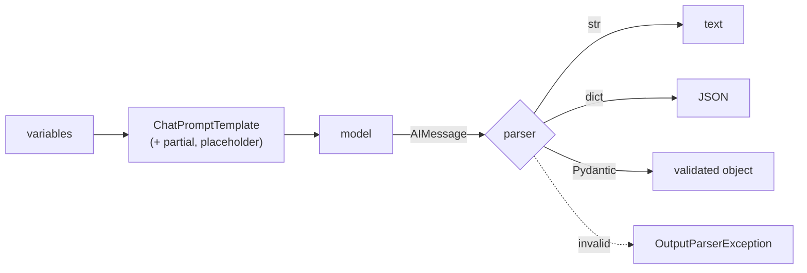

# 06.2 · Prompt templates and output parsers

**Module:** [06 · LangChain core: chains, memory, RAG](../README.md) · **Time:** 45-60 minutes · **Model needs:** chat (JSON-shaped replies) · **Packages:** `langchain` extra (`langchain-core`, `langchain-openai`)

## What you will learn

- What a prompt template still needs from you (`input_variables`) and how `.partial(...)` fixes the rest.
- How `MessagesPlaceholder` takes a whole list of messages, such as a chat history.
- What `StrOutputParser`, `JsonOutputParser` and `PydanticOutputParser` return, and what happens when the reply is not valid.
- How `get_format_instructions()` tells the model the shape you want, and how to handle a parse failure.

## The idea

**What is new since 06.1:** there you used a template and a parser as given. Now you open both up. The template
is the *input* end of a chain, the parser is the *output* end, and both are Runnables you can test without a model.



A parser reads the reply *text*, so it works on any chat endpoint. That is the difference from
`with_structured_output` (06.1), which needs JSON-schema or tool-call support on the endpoint. The price is that
the model may ignore the format, so the parse step can fail and you must plan for that.

## Scripts

Run all three with `./run 06.2` (Windows: `run 06.2`), or one at a time.

### 1. `01_prompt_templates.py`: variables, partials, placeholders

```
./run 06.2/1
```

Shows the variables a template needs, the error for a missing one, `partial` with fixed values, and a
`MessagesPlaceholder("history", optional=True)` rendered with and without history. One model call at the end.

**Expected output** (trimmed):

```
Step 1: A template and what it still needs ─────────────────────────────────
input_variables  [ "company", "question", "sentences", "today" ]
Missing variables fail at invoke time, before any model call: KeyError "Input to ChatPromptTemplate is missing variables {'today', 'company', 'sentences'}. ...

Step 2: partial: fix what does not change ──────────────────────────────────
input_variables after partial  [ "question", "sentences" ]
Rendered
[ "SystemMessage: You are the IT helpdesk assistant at Larkspur Labs. Today is 2026-11-27. Answer in at most 2 sentences.",
  "HumanMessage: How do I reset my password?" ]

Step 3: MessagesPlaceholder: a slot for a list of messages ─────────────────
optional_variables  [ "history" ]
With history
[ "SystemMessage: You are the IT helpdesk assistant at Larkspur Labs. Be brief.",
  "HumanMessage: How do I set up the VPN on my laptop?",
  "AIMessage: Install the Larkspur VPN client and sign in with your work email.",
  "HumanMessage: And on my phone?" ]

Step 4: Use it with a model ────────────────────────────────────────────────
AIMessage content
"Download the **Larkspur VPN** app from the App Store or Google Play, then sign in with your work credentials."
Run summary: 1 model call(s), 45 in + 25 out = 70 tokens
```

### 2. `02_output_parsers.py`: str, JSON, Pydantic

```
./run 06.2/2
```

First feeds the three parsers a hand-made `AIMessage` (a fenced JSON reply) and two bad ones, so you see the
exceptions without a model. Then runs the same ticket through three prompt/parser pairs.

**Expected output** (trimmed):

```
Step 1: Parsers are runnables: feed one a hand-made AIMessage ──────────────
StrOutputParser            "```json\n{\"category\": \"printer\", ...}\n```"
JsonOutputParser (fence stripped)  { "category": "printer", "urgency": "high", "summary": "Floor 3 printer offline." }
PydanticOutputParser       { "category": "printer", "urgency": "high", ... }
Rejected 'Sure! It is a printer problem.': Invalid json output: Sure! It is a printer problem.
Rejected '{"category": "toaster", "urgency": "high': Failed to parse Ticket from completion ...

Step 2: Tell the model the shape: get_format_instructions() ────────────────
897 characters of instructions, built from the class. First lines:

Step 3: The same triage with three different parsers ───────────────────────
tokens: 41 in + 19 out = 60
str -> TextAccessor      "I have escalated this to the network team as a priority ticket to ensure your deadline is met."
json -> dict             { "category": "Hardware", "urgency": "High", "summary": "Floor 3 shared printer is offline; ..." }
pydantic -> Ticket       { "category": "printer", "urgency": "high", "summary": "The shared printer on floor 3 is offline, ..." }
Run summary: 3 model call(s), 373 in + 108 out = 481 tokens
```

Look at the three replies. The `str` run answered as if it were the helpdesk (it even claims an action it never
took). The plain `json` prompt gave `"Hardware"` and `"High"`: valid JSON, but *not* the vocabulary your code
expects. Only the Pydantic version, whose instructions carry the schema, returned the allowed values.

### 3. `03_helpdesk_triage_chain.py`: a triage chain with a retry

```
./run 06.2/3
```

A partial prompt with format instructions, a `PydanticOutputParser`, one `batch` call for three tickets, and a
retry loop (capped at 2 attempts) that sends the parse error back to the model. A ticket that never parses is routed to a person.

**Expected output** (trimmed):

```
Step 2: Triage three tickets (one batched call) ────────────────────────────
My laptop won't connect to the office Wi-Fi since ...
{ "category": "network", "urgency": "high", "summary": "User is unable to connect to office Wi-Fi, ...", "needs_human": true, "queue": "on-site support" }
Can I get a licence for the design tool? It costs ...
{ "category": "software", "urgency": "low", ..., "needs_human": true, "queue": "on-site support" }
I locked myself out of my account after changing m...
{ "category": "access", "urgency": "high", ..., "needs_human": true, "queue": "on-site support" }
Run summary: 3 model call(s), 951 in + 155 out = 1106 tokens
```

The real model parsed on the first attempt every time here, so the retry branch did not run; on the stub
it does. Notice that a software licence request is marked `needs_human`: an approval is a human act.

## Try this

1. **Break a partial.** Make `today` a function: `.partial(today=lambda: date.today().isoformat())`. When is it called?
2. **Make the placeholder required.** Remove `optional=True` and call without `history`. What error appears?
3. **Tighten the parser.** In script 3 remove `"other"` from the `category` `Literal` and add a ticket that fits no category. What happens?
4. **Add few-shot examples.** Put two example human/AI message pairs in the `history` slot of script 1. Does the style of the answer change?
5. **Force a failure.** In script 3 set the prompt's format instructions to an empty string. How often does the retry branch run?
6. **Compare with 06.1.** Replace the parser in script 3 with `model.with_structured_output(Triage)`. What do you gain, and what do you lose (token counts, portability)?

## If it does not work

Run `./run doctor`; install the packages with `uv sync --extra langchain`. If script 3 says it is giving up on a
ticket, your model is not following the JSON format: try `temperature=0`, a stronger model, or shorter
instructions. `401` or `404` errors are settings problems as in lesson 01.1: check `LLM_API_KEY` and `LLM_MODEL`.

## In the running scenario

The helpdesk's triage step is now a chain with a typed result and a safety net: the next stages of the system
(queue routing, replies) can trust a `Triage` object instead of parsing prose. Next the assistant learns to remember the conversation.

**Next:** 06.3 · Conversation memory across turns and sessions (planned)
