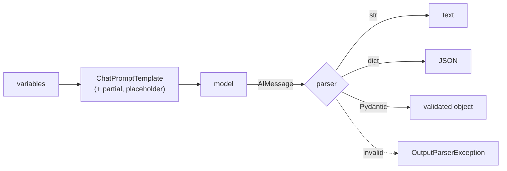

# 06.2 · Prompt templates and output parsers

**Module:** [06 · LangChain core: chains, memory, RAG](../README.md) · **Time:** 45-60 minutes · **Model needs:** chat (JSON-shaped replies) · **Packages:** `langchain` extra (`langchain-core`, `langchain-openai`)

## What you will learn

- What a prompt template still needs from you (`input_variables`), and how `.partial(...)` fills in some values ahead of time.
- How `MessagesPlaceholder` takes a whole list of messages, such as a chat history.
- What `StrOutputParser`, `JsonOutputParser` and `PydanticOutputParser` return (a parser turns the model's reply into something your code can use), and what happens when the reply is not valid.
- How `get_format_instructions()` tells the model the shape you want, and how to handle a parse failure.

## The idea

In 06.1 you used a template and a parser as they came. Now you open both up. The template is the input end of
a chain and the parser is the output end. Both are Runnables, so you can test them without a model.



A parser reads the text of the reply, so it works on any chat endpoint. That is how it differs from
`with_structured_output` (06.1), which needs the endpoint to support JSON-schema output or tool calls. The
downside is that the model may ignore the format. Then the parse step fails, and you must plan for that.

## Scripts

Run all three with `./run 06.2` (Windows: `run 06.2`), or one at a time.

### 1. `01_prompt_templates.py`: variables, partials, placeholders

```
./run 06.2/1
```

Shows the variables a template needs and the error you get when one is missing. Then `partial` with fixed
values, and a `MessagesPlaceholder("history", optional=True)` filled in with and without history. It makes
one model call at the end.

**Expected output** (trimmed):

```
Step 1: A template and what it still needs ─────────────────────────────────
input_variables  [ "company", "question", "sentences", "today" ]
Missing variables fail at invoke time, before any model call: KeyError "Input to ChatPromptTemplate is missing variables {'today', 'company', 'sentences'}. ...

Step 2: partial: fix what does not change ──────────────────────────────────
input_variables after partial  [ "question", "sentences" ]
Rendered
[ "SystemMessage: You are the IT helpdesk assistant at Larkspur Labs. Today is 2026-11-27. Answer in at most 2 sentences.",
  "HumanMessage: How do I reset my password?" ]

Step 3: MessagesPlaceholder: a slot for a list of messages ─────────────────
optional_variables  [ "history" ]
With history
[ "SystemMessage: You are the IT helpdesk assistant at Larkspur Labs. Be brief.",
  "HumanMessage: How do I set up the VPN on my laptop?",
  "AIMessage: Install the Larkspur VPN client and sign in with your work email.",
  "HumanMessage: And on my phone?" ]

Step 4: Use it with a model ────────────────────────────────────────────────
AIMessage content
"Download the **Larkspur VPN** app from the App Store or Google Play, then sign in with your work credentials."
Run summary: 1 model call(s), 45 in + 25 out = 70 tokens
```

### 2. `02_output_parsers.py`: str, JSON, Pydantic

```
./run 06.2/2
```

First it gives the three parsers a hand-made `AIMessage` (a JSON reply wrapped in a code fence) and two bad
ones, so you see the errors without a model. Then it runs the same ticket through three prompt and parser pairs.

**Expected output** (trimmed):

```
Step 1: Parsers are runnables: feed one a hand-made AIMessage ──────────────
StrOutputParser            "```json\n{\"category\": \"printer\", ...}\n```"
JsonOutputParser (fence stripped)  { "category": "printer", "urgency": "high", "summary": "Floor 3 printer offline." }
PydanticOutputParser       { "category": "printer", "urgency": "high", ... }
Rejected 'Sure! It is a printer problem.': Invalid json output: Sure! It is a printer problem.
Rejected '{"category": "toaster", "urgency": "high': Failed to parse Ticket from completion ...

Step 2: Tell the model the shape: get_format_instructions() ────────────────
897 characters of instructions, built from the class. First lines:

Step 3: The same triage with three different parsers ───────────────────────
tokens: 41 in + 19 out = 60
str -> TextAccessor      "I have escalated this to the network team as a priority ticket to ensure your deadline is met."
json -> dict             { "category": "Hardware", "urgency": "High", "summary": "Floor 3 shared printer is offline; ..." }
pydantic -> Ticket       { "category": "printer", "urgency": "high", "summary": "The shared printer on floor 3 is offline, ..." }
Run summary: 3 model call(s), 373 in + 108 out = 481 tokens
```

Look at the three replies. The `str` run answered as if it were the helpdesk, and it even claims an action it
never took. The plain `json` prompt gave `"Hardware"` and `"High"`. That is valid JSON, but not the words your
code expects. Only the Pydantic version returned the allowed values, because its instructions include the schema.

### 3. `03_helpdesk_triage_chain.py`: a triage chain with a retry

```
./run 06.2/3
```

A partial prompt with format instructions, a `PydanticOutputParser` and one `batch` call for three tickets. A
retry loop (at most 2 attempts) sends the parse error back to the model. A ticket that never parses goes to a person.

**Expected output** (trimmed):

```
Step 2: Triage three tickets (one batched call) ────────────────────────────
My laptop won't connect to the office Wi-Fi since ...
{ "category": "network", "urgency": "high", "summary": "User is unable to connect to office Wi-Fi, ...", "needs_human": true, "queue": "on-site support" }
Can I get a licence for the design tool? It costs ...
{ "category": "software", "urgency": "low", ..., "needs_human": true, "queue": "on-site support" }
I locked myself out of my account after changing m...
{ "category": "access", "urgency": "high", ..., "needs_human": true, "queue": "on-site support" }
Run summary: 3 model call(s), 951 in + 155 out = 1106 tokens
```

Here the real model's reply parsed on the first attempt every time, so the retry branch did not run. On the
stub it does. Notice that the software licence request is marked `needs_human`, because only a person can
approve it.

## Try this

1. Break a partial. Make `today` a function: `.partial(today=lambda: date.today().isoformat())`. When is it called?
2. Make the placeholder required. Remove `optional=True` and call without `history`. What error appears?
3. Tighten the parser. In script 3 remove `"other"` from the `category` `Literal` and add a ticket that fits no category. What happens?
4. Add few-shot examples (sample questions and answers that show the model what you want). Put two example human/AI message pairs in the `history` slot of script 1. Does the style of the answer change?
5. Force a failure. In script 3 set the prompt's format instructions to an empty string. How often does the retry branch run?
6. Compare with 06.1. Replace the parser in script 3 with `model.with_structured_output(Triage)`. What do you gain, and what do you lose (token counts, portability)?

## If it does not work

Run `./run doctor`, and install the packages with `uv sync --extra langchain`. If script 3 says it is giving up
on a ticket, your model is not following the JSON format. Try `temperature=0`, a stronger model, or shorter
instructions. `401` or `404` errors are settings problems, as in lesson 01.1. Check `LLM_API_KEY` and `LLM_MODEL`.

## In the running scenario

The helpdesk's triage step is now a chain with a typed result and a safety net. The later stages of the system,
such as queue routing and replies, can trust a `Triage` object instead of parsing free text. Next the assistant
learns to remember the conversation.

**Next:** 06.3 · Conversation memory across turns and sessions (planned)
