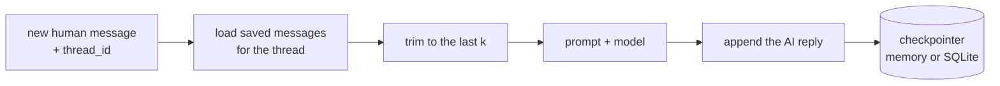

# 06.3 · Conversation memory across turns and sessions

**Module:** [06 · LangChain core: chains, memory, RAG](../README.md) · **Time:** 45-60 minutes · **Model needs:** chat · **Packages:** `langchain` extra; scripts 2-3 also use `langgraph` and `langgraph-checkpoint-sqlite` (installed with `uv sync --extra langgraph`)

## What you will learn

- Why a chat model forgets everything between calls, and that "memory" means re-sending stored messages.
- How a `MessagesPlaceholder` receives the history, and what you own when you keep it by hand.
- How a LangGraph graph with a **checkpointer** stores one conversation per `thread_id`.
- How to bound what the model sees (`trim_messages`) and how to survive a restart (SQLite saver).

## The idea

**What is new since 06.2:** the `MessagesPlaceholder` from 06.2 now gets filled from stored conversations.

The older LangChain classes for this (`InMemoryChatMessageHistory`, `RunnableWithMessageHistory`) print a
deprecation warning in LangChain 1.x, which points to LangGraph persistence. So the lesson teaches that way:
the state of a small graph is the message list, and a **checkpointer** saves it after every step under a thread id.



By hand (script 1) it is a Python list you append to. With the checkpointer (scripts 2 and 3) the list is
loaded and saved for you, per thread, and can live in a database. Either way the model only ever sees
the messages you send it, which is why trimming matters: tokens per call grow with the conversation.

## Scripts

Run all three with `./run 06.3` (Windows: `run 06.3`), or one at a time.

### 1. `01_memory_by_hand.py`: memory is a message list

```
./run 06.3/1
```

Asks "What was my name again?" cold, then runs a three-turn chat appending each exchange to a list passed into the placeholder.

**Expected output** (trimmed):

```
Step 1: No memory: each call stands alone ──────────────────────────────────
tokens: 31 in + 39 out = 70
Asked cold: What was my name again, and what was the problem?
"I do not have access to your personal identity or the specific details of your current support ticket. ..."

Step 2: Memory by hand: a list you append to ───────────────────────────────
tokens: 35 in + 48 out = 83
[2 messages stored] Hi, I'm Priya. My laptop has no sound after the update.
"Hi Priya, please try restarting your laptop first, ..."
tokens: 168 in + 22 out = 190
[6 messages stored] What was my name again, and what was the problem?
"Your name is Priya, and you are experiencing an issue where your laptop has no sound following a recent update."

Run summary: 4 model call(s), 328 in + 171 out = 499 tokens
```

Look at the input tokens: 35, then 94, then 168. Each turn re-sends the whole history.

### 2. `02_sessions_with_checkpointer.py`: threads and a checkpointer

```
./run 06.3/2
```

A START -> chat -> END graph over `MessagesState`, compiled with `InMemorySaver`. Two employees chat interleaved on thread ids `priya` and `tom`; the script then reads each thread's saved state back with `graph.get_state`.

**Expected output** (trimmed):

```
Step 2: Two employees, interleaved ─────────────────────────────────────────
[priya] Hi, I'm Priya. My monitor flickers when I plug in the dock.
"Hi Priya, please try unplugging and reseating the USB-C cable from both the dock and your laptop ..."
[tom] Hi, I'm Tom. I need access to the finance shared drive.
"Hi Tom, please submit a formal access request through the Larkspur Labs IT portal ..."
[priya] Which of my devices did I say had the problem?
"You mentioned that your monitor flickers when you plug in your dock."
[tom] Who am I and what did I ask for?
"You are Tom, and you requested access to the finance shared drive."

Step 3: Look inside each thread's saved state ──────────────────────────────
thread priya  [ "human: Hi, I'm Priya. My monitor flickers when I plug in the dock.", "ai: Hi Priya, please try unplugging ...", ... ]
Run summary: 4 model call(s), 260 in + 123 out = 383 tokens
```

### 3. `03_bounded_persistent_memory.py`: a window and a database

```
./run 06.3/3
```

The model sees at most the last 4 messages (`trim_messages`), while the saver (a SQLite file in a temp directory) stores them all. Halfway through, the script builds a new graph and a new connection over the same file, as an app restart would.

**Expected output** (trimmed):

```
Step 2: Restart the app: a new graph and connection over the same file ─────
Remind me: what was the problem I reported?
"You reported that you were experiencing issues with your computer's audio output. ..."
Thanks. Now my headset mic is quiet too.
"I have updated your existing ticket to include the microphone issues you are experiencing. ..."

Step 3: Stored versus seen ─────────────────────────────────────────────────
messages stored in the database  10
messages the model saw per call  [ 1, 3, 3, 3, 3 ]
Run summary: 5 model call(s), 382 in + 224 out = 606 tokens
```

Two things to notice. The conversation survived the restart (the answer still knows it was about audio). And
the model said "I have updated your existing ticket": it has no ticket tool, so it made that up. A model that talks
as if it acts is a reason for the tool lessons in module 07, and for checking what a reply claims. The window is
4 messages, but `start_on="human"` drops a leading AI message, so the model saw 3.

## Try this

1. **Widen the window.** Set `KEEP_LAST = 20` in script 3. Does the name `Priya` survive, and what happens to tokens in?
2. **Third employee.** Add a thread `sam` to script 2 and ask it about Priya's monitor. What does it say?
3. **Look at the raw request.** Run script 2 with `--raw` and find the whole history in the request body.
4. **Clear a conversation.** Use a new `thread_id` for the same person. What is forgotten, and what stays in the database?
5. **Summarise instead of dropping.** After 4 messages, ask the model to summarise the old ones into one `SystemMessage` and send that plus the last messages.
6. **Read the checkpoints.** Open the SQLite file from script 3 (print `db_path`) with `graph.get_state_history(THREAD)` and list the steps.

## If it does not work

Run `./run doctor`; install with `uv sync --extra langchain` (script 1) and `uv sync --extra langgraph` (scripts 2-3).
An `ImportError` for `langgraph.checkpoint.sqlite` means the `langgraph-checkpoint-sqlite` package is missing.
`401` or `404` errors are settings problems as in lesson 01.1.

## In the running scenario

The helpdesk chat now keeps one conversation per employee, caps its cost and survives a restart. A conversation
that remembers, but cannot look anything up, still guesses about company facts. Next: the knowledge base.

**Next:** 06.4 · Loaders, splitters and retrievers: RAG with LangChain (planned)
