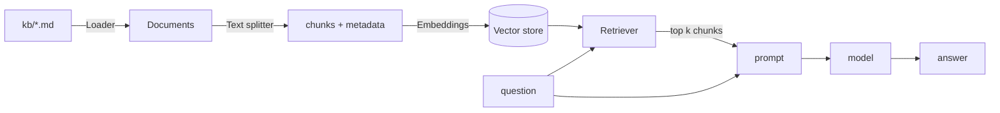

# 06.4 · Loaders, splitters and retrievers: RAG with LangChain

**Module:** [06 · LangChain core: chains, memory, RAG](../README.md) · **Time:** 45-60 minutes · **Model needs:** chat and embeddings (local by default) · **Packages:** `langchain` extra (`langchain-core`, `langchain-openai`, `langchain-community`, `langchain-text-splitters`) and the `rag` extra for the local embedding model

## What you will learn

- What a `Document` is and how a loader and a text splitter produce and cut them.
- How chunk size and overlap change the pieces, and how a Markdown header splitter keeps structure as metadata.
- How to plug the course's embeddings into LangChain with a small `Embeddings` class.
- How `InMemoryVectorStore` and `as_retriever` replace the numpy code of lessons 03.1 and 04.1.
- How to write the whole RAG pipeline as one LCEL chain.

## The idea

**What is new since 06.3:** the model now reads from a knowledge base instead of its own memory.
In lesson 04.1 you did every step by hand; LangChain names each step and gives it an interface you can swap.



Every box is a Runnable or a small interface: change the loader to read PDFs, the store to Chroma, or the
embeddings to a hosted model, and the rest does not move. The caution from 04.1 still applies: the retriever
always returns *something*, so the prompt must tell the model what to do when the chunks do not answer.

## Scripts

Run all three with `./run 06.4` (Windows: `run 06.4`), or one at a time. The `kb/` folder has seven small Larkspur Labs files (the 04.1 set plus a longer `onboarding.md`).

### 1. `01_loaders_and_splitters.py`: files, Documents, chunks

```
./run 06.4/1
```

`TextLoader` over each file, `RecursiveCharacterTextSplitter` with three size/overlap settings, then `MarkdownHeaderTextSplitter` on `onboarding.md`. No model call.

**Expected output** (trimmed):

```
Step 1: Load: one Document per file ───────────────────────────────────────
Documents loaded  [ { "source": "laptops.md", "characters": 420 }, { "source": "onboarding.md", "characters": 1126 }, ... ]

Step 2: Split: RecursiveCharacterTextSplitter ─────────────────────────────
chunk_size=1000  overlap=0   -> 8 chunks, longest 971, shortest 152
chunk_size=300   overlap=0   -> 21 chunks, longest 296, shortest 24
chunk_size=300   overlap=60  -> 21 chunks, longest 296, shortest 45
onboarding.md as chunks (300/60): first three
[ { "metadata": { "source": "onboarding.md" }, "text": "# New starter IT checklist\n\n## Before day one" },
  { ..., "text": "IT prepares a laptop for every new starter at Larkspur Labs. ... \n\n## Day one" },
  { ..., "text": "## Day one\n\nCollect your laptop from the IT desk on floor 1 between 9:00 and 10:00. ..." } ]

Step 3: Split by structure: MarkdownHeaderTextSplitter ─────────────────────
sections  [ { "metadata": { "title": "New starter IT checklist", "section": "Before day one" }, "characters": 282 }, ... ]
```

Look at the first chunk: a bare heading. Small chunk sizes cut headings away from their text; that is why the
header splitter, which turns headings into metadata, is often the better first pass.

### 2. `02_embeddings_vector_store_retriever.py`: index and search

```
./run 06.4/2
```

A six-line `Embeddings` subclass over `ctx.embed`, an `InMemoryVectorStore`, `similarity_search_with_score`, and the same search as a retriever (`as_retriever(search_kwargs={"k": 3})`).

**Expected output** (trimmed):

```
Step 1: Index the knowledge base ───────────────────────────────────────────
21 chunks embedded in one batch and stored (21 ids returned).

Step 2: Search with scores ─────────────────────────────────────────────────
I can't print, the printer says offline
[ { "score": 0.68, "source": "printers.md", "text": "If a printer shows as offline, switch it off and on, ..." },
  { "score": 0.66, "source": "printers.md", "text": "# Printers\n\nThere is one shared printer on every floor. ..." } ]
What is the parental leave policy?
[ { "score": 0.58, "source": "onboarding.md", "text": "## Leaving the company\n\nOn your last day IT disables ..." }, ... ]

Step 3: The retriever: the same search as a Runnable ───────────────────────
retriever.batch(...) gave [3, 3] documents per query
```

The parental-leave question, which the knowledge base cannot answer, still returns chunks. Scores are only comparable with each other.
With a hosted provider, replace `LabEmbeddings` with `OpenAIEmbeddings(model=..., base_url=..., api_key=...)`; the real endpoint used for this course has no embedding models, so the local model runs.

### 3. `03_rag_chain.py`: the RAG chain

```
./run 06.4/3
```

`{"context": retriever | format_docs, "question": RunnablePassthrough()} | prompt | model | StrOutputParser()`, run with `batch` on four questions. The script first prints the exact prompt for question one.

**Expected output** (trimmed):

```
Step 2: What the model receives for the first question ─────────────────────
   system | You are the IT helpdesk assistant at Larkspur Labs. Answer ONLY from the context. Cite the file name ...
     user | Context:
          | [passwords.md]
          | To reset a forgotten password, open the self-service portal ...
          | [onboarding.md]
          | ## Day one ...

Step 3: Ask four questions (one batch) ─────────────────────────────────────
I forgot my password, how do I get back in?
"To reset a forgotten password, open the self-service portal ... [passwords.md]"
When do new starters collect their laptop?
"New starters collect their laptop from the IT desk on floor 1 between 9:00 and 10:00 on their first day. [onboarding.md]"
What is the company's parental leave policy?
"I don't know based on the IT knowledge base. Please contact the helpdesk."
-> declined: the retrieved chunks did not hold the answer.
```

The run summary shows no model calls because the parser drops the `AIMessage` that carries token counts (as in 06.1).
Notice the retrieved context for question one included an `onboarding.md` chunk that has nothing to do with resetting a password: retrieval is approximate, and the model had to ignore it.

## Try this

1. **Change k.** Set `k` to 1, then 6. How do the answers and the prompt length change?
2. **Change chunk size.** Try 150 and 600 in script 3. Which questions get worse first?
3. **Header-first splitting.** Replace the splitter with `MarkdownHeaderTextSplitter` followed by the recursive splitter. Do citations improve?
4. **Add a document.** Write a new file in `kb/` (for example `badges.md`) and ask a question about it. No code change needed.
5. **Remove the safety rule.** Delete the "I don't know" sentence from the prompt and re-ask the parental-leave question. What does the model do?
6. **Swap the store.** Replace `InMemoryVectorStore` with Chroma (`langchain_community.vectorstores.Chroma` or `chromadb` directly with a temp directory). What else has to change?

## If it does not work

Run `./run doctor`; install with `uv sync --extra langchain --extra rag`. The first run downloads the small local embedding model, which needs a network connection. If you set `EMBEDDING_MODEL` to a hosted model, check that your provider serves it. `401`/`404` errors are settings problems as in lesson 01.1. A `LangChainDeprecationWarning` about `langchain-community` on import is harmless; the scripts silence it around the loader import.

## In the running scenario

The helpdesk assistant now answers from the Larkspur Labs IT knowledge base, with file names as citations and a
refusal for what the KB lacks. The capstone adds proper source tracking, retrieval tests and follow-up questions.

**Next:** 06.5 · Capstone: the helpdesk RAG chain (planned)
