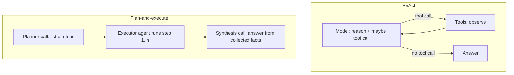

# 07.2 · ReAct and plan-and-execute agents

**Module:** [07 · LangChain agents and tool use](../README.md) · **Time:** 45-60 minutes · **Model needs:** chat, tools · **Packages:** `langchain` extra (`uv sync --extra langchain`)

## What you will learn

- What ReAct (Reason, Act, Observe) means and how `create_agent` already implements it with tool calling.
- How to watch the loop turn by turn with `agent.stream(..., stream_mode="updates")` and cap it with `recursion_limit`.
- How to write a plan-and-execute agent by hand: a planner call, an executor loop, a synthesis call.
- What each approach costs in model calls, and when the extra structure is worth it.

## The idea

**What is new since 07.1:** there you built a tool-using agent and treated it as a black box. Now you open it up, and then build the other classic agent shape yourself.

A ReAct agent decides one step at a time: it looks at everything so far, either calls a tool or answers, and repeats. A plan-and-execute agent first asks the model for the whole plan, then runs the steps, then writes the answer. Current LangChain ships the first as `create_agent` (a LangGraph graph); the second is not a prebuilt class, and you do not need one: it is about thirty lines.



## Scripts

Run all three with `./run 07.2` (Windows: `run 07.2`), or one at a time.

### 1. `01_react_loop_traced.py`: the ReAct loop, turn by turn

```
./run 07.2/1
```

Builds an agent over three tools and streams graph updates, printing each REASON (the model's text), ACT (tool calls) and OBSERVE (tool results). The loop is capped at 11 graph steps; hitting the cap is caught and explained.

**Expected output** (trimmed):

```
[model] turn 1: ACT    open_tickets_for({'owner': 'Priya'})
[tools] turn 1: OBSERVE LL-2041, LL-2043
[model] turn 2: ACT    lookup_ticket({'ticket_id': 'LL-2041'})
[model] turn 2: ACT    lookup_ticket({'ticket_id': 'LL-2043'})
[tools] turn 2: OBSERVE {'status': 'open', 'owner': 'Priya', 'summary': 'VPN token reset', 'device': 'LT-118'}
[tools] turn 2: OBSERVE {'status': 'open', 'owner': 'Priya', 'summary': 'Printer on floor 3 offline', 'device': 'PR-031'}
[model] turn 3: ACT    lookup_device({'device_id': 'PR-031'})
[tools] turn 3: OBSERVE Printer, floor 3, firmware 4.2 (known bug: drops off the network after 30 days)
[model] turn 4: REASON 'The printer is PR-031, located on floor 3, and it has a known bug where it drops off ...'
Model turns: 4.
Run summary: 4 model call(s), 1078 in + 125 out = 1203 tokens, 9.1s
```

The REASON text is empty on the tool-calling turns here: this model goes straight to the tool call even though the prompt asks for a sentence first. Whether the "thought" appears depends on the model, and the loop works either way.

### 2. `02_plan_and_execute.py`: a hand-written planner

```
./run 07.2/2
```

Three phases: `model.with_structured_output(Plan)` produces up to 4 steps, a small `create_agent` executor runs each step (given the facts found so far, each step capped at 9 graph steps), and one last model call writes the answer from the collected facts.

**Expected output** (trimmed):

```
Plan
[ "Search for open tickets associated with Priya to identify the printer ticket number.",
  "Retrieve the details of the specific printer ticket to find the associated device name.",
  "Look up the device information to check for any reported issues or known problems." ]
Step 1 of 3: Search for open tickets associated with Priya ...
tool call | open_tickets_for({"owner": "Priya"})
   result | LL-2041, LL-2043
Step 2 of 3: Retrieve the details of the specific printer ticket ...
tool call | lookup_ticket({"ticket_id": "LL-2043"})
   result | {'status': 'open', 'owner': 'Priya', 'summary': 'Printer on floor 3 offline', 'device': 'PR-031'}
Step 3 of 3: ...
Answer: The device is printer PR-031. It has a known firmware bug that causes it to drop off the network every 30 days.
Run summary: 8 model call(s), 1581 in + 201 out = 1782 tokens, 16.1s
```

In an earlier run the planner wrote steps in function-call syntax with placeholders (`runbook(ticket_id='ticket_id_from_previous_step')`) and one executor step hit the recursion cap. Both were caught and recorded; the prompt now asks for plain-English steps. A planner is another model call that can be wrong, which is why every step has a cap and a failure path.

### 3. `03_helpdesk_compare.py`: the same question both ways

```
./run 07.2/3
```

"List Priya's open tickets, then tell me the runbook fix for each one" goes through a ReAct agent and then through plan-and-execute. The script counts model calls and tool calls for each.

**Expected output** (trimmed):

```
Cost of each approach
[ {"approach": "react", "model_calls": 3, "tool_calls": 3},
  {"approach": "plan-and-execute", "model_calls": 6, "tool_calls": 3} ]
Run summary: 8 model call(s), 1273 in + 370 out = 1643 tokens, 16.2s
```

Both gave a correct answer. Plan-and-execute used twice the model calls for the same three tool calls. It earns that cost only when you want the plan itself (to log it, show it, or have a person approve it) or when the task has many independent parts.

## Try this

1. In script 1, set `RECURSION_LIMIT = 3` and read the cap message.
2. In script 1, change the system prompt to forbid tool use for questions about printers and see what the agent does.
3. In script 2, print `plan.steps` and edit one step by hand before the executor runs. This is the "human approves the plan" pattern.
4. In script 2, set `MAX_STEPS = 2` and see how the answer degrades when the plan is cut short.
5. In script 3, ask a one-fact question ("Who owns LL-2041?") and compare the costs again.
6. Give the executor in script 2 only `lookup_device` and watch a step fail and be recorded.

## If it does not work

- Run `./run doctor`. It checks the endpoint, the model and the optional extras.
- `ModuleNotFoundError: langchain`: install the extra with `uv sync --extra langchain`.
- `GraphRecursionError` is the cap working. Raise the limit slowly, or make the tools return more useful results.
- `with_structured_output` returns `None` or fails: the model may not support structured output; the script falls back to one step that is the question itself.

## In the running scenario

The helpdesk assistant can now handle multi-part requests two ways. Short lookups stay with ReAct; bulk or approval-gated work (a plan a team lead can read before anything runs) fits plan-and-execute.

**Next:** 07.3 · Agents over SQL data (planned)
