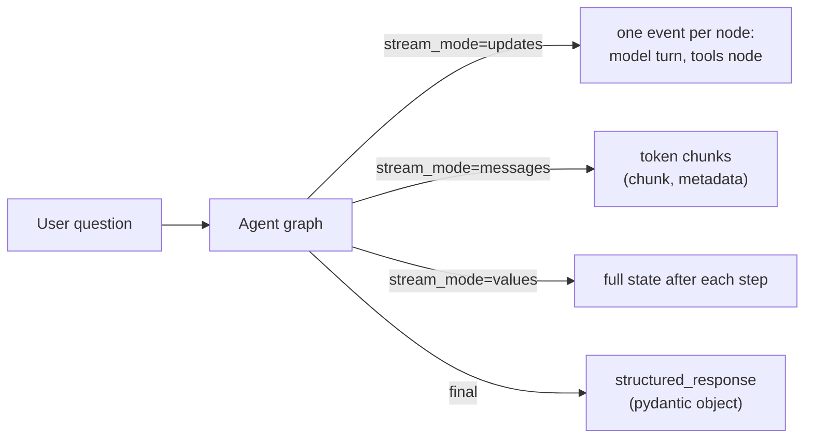

# 07.4 · Structured final answers and streaming intermediate steps

**Module:** [07 · LangChain agents and tool use](../README.md) · **Time:** 45-60 minutes · **Model needs:** chat, tools, stream · **Packages:** `langchain` extra (`uv sync --extra langchain`)

## What you will learn

- How `response_format` makes an agent end with a validated pydantic object in `result["structured_response"]`.
- The difference between `ToolStrategy` and `ProviderStrategy`, and how to check for a missing structured response.
- How `stream_mode` `"updates"`, `"messages"` and `"values"` expose the run as it happens.
- How to combine progress events with a typed result, and why typed output still needs checking.

## The idea

**What is new since 07.3:** until now an agent's answer was a string. Code that consumes an agent (an API, a UI, another program) wants fields, and a user watching wants progress, not a ten-second pause.

With `response_format=ToolStrategy(Model)` the schema is offered to the model as one more tool; calling it ends the run, and the validated object lands in the result. (`ProviderStrategy` asks the provider for schema-constrained JSON instead, if it supports that.) Streaming is a separate switch on the same graph: `agent.stream(input, config, stream_mode=...)`.



## Scripts

Run all three with `./run 07.4` (Windows: `run 07.4`), or one at a time.

### 1. `01_structured_final_answer.py`: free text versus a typed object

```
./run 07.4/1
```

The same ticket question goes to a plain agent (result has only `messages`) and to one with `response_format=ToolStrategy(TicketReport)` (result also has `structured_response`). The script checks the type before using it.

**Expected output** (trimmed):

```
Result keys: ['messages']
Final message (text to parse yourself): 'Ticket LL-2041 ("VPN token reset") is currently **open** and assigned to **Priya**. ...'
Result keys: ['messages', 'structured_response']
{ "ticket_id": "LL-2041", "status": "open", "owner": "Priya", "next_action": "Priya is currently working on the VPN token reset." }
A typed object: report.status == 'open', so `if report.status == 'open':` is safe code.
Run summary: 4 model call(s), 562 in + 132 out = 694 tokens, 8.3s
```

Note the last message in the typed run is the framework's "Returning structured response: ..." tool result, not prose for the user.

### 2. `02_streaming_the_run.py`: progress and tokens

```
./run 07.4/2
```

Streams one run with `stream_mode="updates"`, then another with `["messages", "updates"]`, which yields `(mode, payload)` tuples: token chunks for the answer and node events for progress.

**Expected output** (trimmed):

```
+ 2.0s node=model  tool calls ['lookup_ticket', 'lookup_ticket']
+ 2.0s node=tools  message 'open, owner Priya, waiting on a VPN token reset'
+ 4.0s node=model  message 'Priya should prioritize **LL-2041** (VPN token reset), as it is a bloc'
Text chunks received: 3; first chunk after 3.7s
First chunks: ['P', 'riya should prioritize **LL-2041** (VPN token reset), as it', ' is a blocker for her work, ...']
```

Only 3 chunks arrived for a whole sentence: this endpoint batches its stream, so do not expect word-by-word output from every provider. Tokens of the second (streamed) run are not recorded, because streamed chunks carry usage only if the provider sends it.

### 3. `03_helpdesk_streamed_report.py`: progress, then a typed report

```
./run 07.4/3
```

Streams with `stream_mode="values"`, printing a progress line for each step, and ends with a validated `OwnerReport` (a list of `TicketLine`s plus advice). The script then checks the ticket ids against the data.

**Expected output** (trimmed):

```
progress: calling open_tickets_for(['Priya'])
progress: got LL-2041, LL-2043, LL-2045
progress: calling lookup_ticket(['LL-2041']), lookup_ticket(['LL-2043']), lookup_ticket(['LL-2045'])
...
Ticket ids in the report that exist in the data: ['LL-2041', 'LL-2043', 'LL-2045'] of 3
Complete? True (expected ['LL-2041', 'LL-2043', 'LL-2045']). Typed output is well-formed, not automatically correct: check it.
Run summary: 2 model call(s), 407 in + 88 out = 495 tokens, 5.6s
```

## Try this

1. In script 1, change `status` to `str` and then back to a `Literal`; which one lets a typo through?
2. Add `confidence: float = Field(ge=0, le=1)` to `TicketReport` and see whether the model fills it sensibly.
3. In script 1, ask about a ticket that does not exist (`LL-9999`) and read what the typed answer says.
4. In script 2, print `meta` for a few chunks to see what `langgraph_node` and other keys exist.
5. In script 2, use `stream_mode="values"` and print `len(state["messages"])` at each step.
6. In script 3, try `ProviderStrategy(OwnerReport)` instead of `ToolStrategy` (it needs a provider that supports JSON schema output) and compare.

## If it does not work

- Run `./run doctor`. It checks the endpoint, the model and the optional extras.
- `ModuleNotFoundError: langchain`: install the extra with `uv sync --extra langchain`.
- No `structured_response` in the result: the model did not call the schema tool. Check for it, retry once, or fall back to the last message text. The scripts do this check.
- All the text arrives in one chunk: your endpoint does not stream token by token.

## In the running scenario

The helpdesk assistant can now feed a dashboard or API with fields instead of prose, and a chat window can show "looking up LL-2041..." while the answer is being prepared.

**Next:** 07.5 · Capstone: helpdesk agent with search, ticket and database tools (planned)
