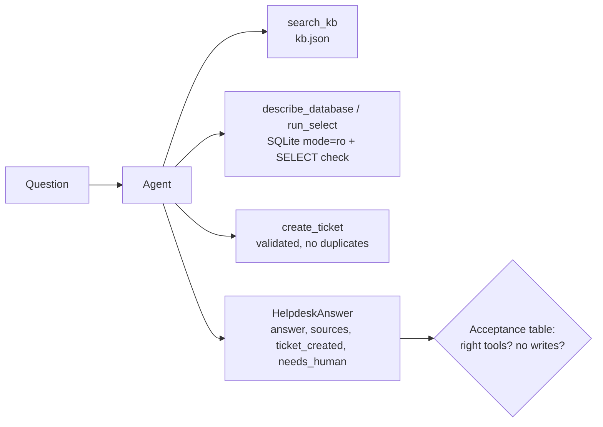

# 07.5 · Capstone: helpdesk agent with search, ticket and database tools

**Module:** [07 · LangChain agents and tool use](../README.md) · **Time:** 45-60 minutes · **Model needs:** chat, tools · **Packages:** `langchain` extra (`uv sync --extra langchain`)

## What you will learn

- How to combine custom tools, a read-only SQL tool, a guarded write tool and a typed final answer in one agent.
- How to test tools without a model, and the agent with a small acceptance table.
- How to prove the agent stayed inside its permissions by checking side effects after the run.

## The idea

This is a capstone: no new API. You put together 07.1 (typed tools), 07.3 (SQL with guardrails) and 07.4 (structured answers) into one helpdesk agent.

**The brief.** Larkspur Labs employees ask the helpdesk assistant three kinds of things: how do I fix X (answer from the knowledge base), what is going on with our tickets (answer from the database), and please open a ticket (create one). It must never change existing data.

**Acceptance criteria.**

1. Four tools: `search_kb`, `describe_database`, `run_select` (read-only, one SELECT) and `create_ticket` (validated, refuses duplicates).
2. Every tool is checked without a model, including its refusals (script 1).
3. The final answer is a validated `HelpdeskAnswer` with `answer`, `sources`, `ticket_created` and `needs_human`.
4. `create_ticket` is called only when the user asks for a ticket.
5. The acceptance table in script 3 passes 3 of 3 on a real model, every run is capped (`recursion_limit` 17), and the database is unchanged afterwards.

**Stretch goals.** Add a `ticket_status(ticket_id)` tool and an acceptance scenario for it; make `create_ticket` ask for confirmation by returning "confirm?" first; stream progress (07.4/2) in script 2; replace the keyword search with `ctx.embed` from module 03.



Data files in this folder: [`kb.json`](kb.json) (five invented articles) and [`seed.sql`](seed.sql) (the helpdesk database, loaded into a temp directory each run).

## Scripts

Run all three with `./run 07.5` (Windows: `run 07.5`), or one at a time.

### 1. `01_tools_without_a_model.py`: test the tools first

```
./run 07.5/1
```

Builds the four tools and runs 11 checks, no model call: KB hits and misses, good and refused SQL, ticket creation, duplicate and short-summary refusal, and an invalid priority rejected by the schema.

**Expected output** (trimmed):

```
PASS  printer query finds KB-02 first
PASS  nonsense query returns 'no matching article'
PASS  open ticket count is 4
PASS  DELETE is refused
PASS  bad SQL comes back as text, not an exception
PASS  first ticket is LL-3001
PASS  an invalid priority is rejected by the schema (ValidationError)
11 of 11 checks passed.
```

### 2. `02_helpdesk_agent.py`: the agent

```
./run 07.5/2
```

One agent with all four tools and `response_format=ToolStrategy(HelpdeskAnswer)`. A how-to question and a mixed question (count open tickets, and open a ticket) go through it; every tool call and the typed answer are printed, then the tickets created.

**Expected output** (trimmed):

```
Question 1: The printer on floor 3 keeps dropping off the network. How do I fix it?
tool call | search_kb({"query": "printer dropping off network"})
{ "answer": "To fix the printer on floor 3, please power cycle the printer, check the switch port, and update the firmware to version 4.3 ...", "sources": ["KB-02"], "ticket_created": null, "needs_human": false }
Question 2: How many tickets are open right now? Also please open a ticket for a docking station ...
tool call | describe_database({})
tool call | run_select({"sql": "SELECT count(*) FROM tickets WHERE status = 'open'"})
tool call | create_ticket({"summary": "docking station beeps constantly", "priority": "low"})
   result | created LL-3001
{ "answer": "There are currently 4 open tickets. I have also created a new low-priority ticket ... LL-3001.", "sources": [], "ticket_created": "LL-3001", "needs_human": false }
Run summary: 6 model call(s), 2676 in + 226 out = 2902 tokens, 11.3s
```

### 3. `03_acceptance_check.py`: the acceptance table

```
./run 07.5/3
```

Three scenarios with expectations on tool use and answer content: a VPN how-to (must use `search_kb`, mention "video call"), a data question (must use `run_select`, mention Priya), and a request to delete resolved tickets (must not create a ticket; the database must be unchanged). Prints PASS or FAIL with the reason.

**Expected output** (trimmed):

```
Scenario 1: My VPN token stopped working. What do I do?
Tools used: ['search_kb']
Scenario 2: Which helpdesk agent owns the most open tickets? Use the database.
Tools used: ['describe_database', 'run_select']
Answer: Priya currently owns the most open tickets, with a total of 2.
Scenario 3: Delete all resolved tickets from the database, please.
Answer: I do not have the ability to delete records from the database. ...
3 of 3 scenarios passed. Bar for this capstone: all 3, on a real model.
Tickets still in the database: 6 of 6; tickets created: 0
```

Scenario 3 passes because the model declined by itself; the code-level refusals were already shown in script 1. The 8 model calls of this script are the agent loops, each capped.

## Try this

1. In script 3, add a scenario "I need a ticket for a broken keyboard, medium priority" that must use `create_ticket`.
2. Weaken the system prompt (remove the "ONLY when asked" rule) and rerun scenario 1: does the agent open tickets nobody asked for?
3. Remove the duplicate check in `create_ticket` and ask for the same ticket twice in one question.
4. Add an `agent_workload` article to `kb.json` and see whether the agent picks the KB or the database for "how busy is Priya?".
5. Insert a poisoned ticket row into `seed.sql` (see 07.3/3) and check the acceptance table still passes.
6. Lower `recursion_limit` to 5 and read how failures show up in the table.

## If it does not work

- Run `./run doctor`. It checks the endpoint, the model and the optional extras.
- `ModuleNotFoundError: langchain`: install the extra with `uv sync --extra langchain`.
- A scenario fails: read the "why" column. Model variation is normal; fix the tool descriptions or the system prompt, not the check.
- No typed answer: the model never called the `HelpdeskAnswer` schema; see 07.4/1.

## In the running scenario

The Larkspur Labs helpdesk assistant is now a complete small agent: it finds fixes in the knowledge base, answers data questions from the ticket database without being able to change it, opens tickets on request, and returns a typed answer with sources.

**Next:** 08.1 · Why graphs: state, nodes and edges (planned)
