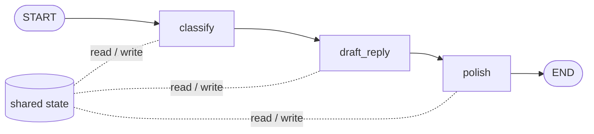

# 08.1 · Why graphs: state, nodes and edges

**Module:** [08 · LangGraph: stateful workflows and routing](../README.md) · **Time:** 45-60 minutes · **Model needs:** chat (script 1 needs no model) · **Packages:** `langgraph` extra (also installs `langchain-openai`)

## What you will learn

- The three parts of a LangGraph program: **state**, **nodes** and **edges**.
- How to compile, run, stream and draw a graph (Mermaid).
- What a **reducer** is and why chat history uses `add_messages`.
- How a model call becomes just one more node.
- Why a chain of steps eventually wants to be a graph.

## The idea

A chain is a function calling a function: `polish(draft(classify(ticket)))`. It works until
the workflow needs to do something a straight line cannot:

- **Branch**: a password reset and a failing monitor need different next steps.
- **Loop**: draft, check, and go back to draft if the check fails.
- **Share state**: step 4 needs something step 1 found, without threading it through every call.

A **graph** makes the structure explicit. The **state** is one shared record. **Nodes** are
plain functions that read the state and return the fields they changed. **Edges** say what
runs next. Because the wiring is data, LangGraph can draw it, trace it step by step, and
(later) pause and resume it. Choosing the next node from the state (routing) is 08.2.



By hand (module 01) you passed values from call to call yourself. The graph does the passing,
merges each node's returned fields into the state, and records every step.

## Scripts

Run all three with `./run 08.1` (Windows: `run 08.1`), or one at a time.

### 1. `01_state_nodes_edges.py`: the structure, with no model

```
./run 08.1/1
```

Two plain functions (`clean`, `tag`) wired as a graph. It runs it with `invoke()`, watches it
with `stream(stream_mode="updates")`, and prints the graph as Mermaid.

**Expected output** (trimmed):

```
Step 3: Run it once with invoke()
Final state (every field any node wrote)
{
  "raw": "  Ticket #5102: my MONITOR flickers ...  ",
  "text": "ticket #5102: my monitor flickers and then goes black, about every ten minutes.",
  "words": 13,
  "tags": ["hardware"]
}

Step 4: Run it again with stream(stream_mode="updates")
after node 'clean'
{ "text": "...", "words": 13 }
after node 'tag'
{ "tags": ["hardware"] }

Step 5: Draw it
graph TD;
        __start__([<p>__start__</p>]):::first
        clean(clean)
        tag(tag)
        __end__([<p>__end__</p>]):::last
        __start__ --> clean;
        clean --> tag;
        tag --> __end__;
```

Paste that Mermaid text into any Mermaid viewer to see the picture. Nodes return only what
they change; LangGraph merges it into the state.

### 2. `02_model_node_and_reducer.py`: a reducer and a model node

```
./run 08.1/2
```

First shows a field without and with a reducer (`operator.add`). Then builds a chat graph whose
state has `messages: Annotated[list, add_messages]` and a node that calls `ChatOpenAI` (pointed
at your endpoint through `ctx.settings`).

**Expected output** (trimmed; the reply wording will differ):

```
Step 1: Without a reducer, a node's return value replaces the field
[ "written by second" ]

Step 2: With a reducer, the values are combined
[ "from the input", "written by first", "written by second" ]

Step 4: Run it and watch the messages grow
after node 'frame' returned 2 new message(s)
   system | You are the IT helpdesk assistant at Larkspur Labs. Answer in at most two sentences.
     user | Ticket #5110: How do I connect to the office printer from my laptop?
tokens: 38 in + 60 out = 98
after node 'assistant' returned 1 new message(s)
assistant | Please navigate to "Printers & Scanners" in your system settings, ...

Step 5: Read the final state
messages holds 3 entries: the reducer appended each node's messages in turn.
The last one is an AIMessage; model_calls = 1.
```

Without a reducer a returned field replaces the old value. With one, the values combine, so each
node only returns the new messages.

### 3. `03_helpdesk_ticket_workflow.py`: classify, draft, polish

```
./run 08.1/3
```

The scenario: three nodes (`classify`, `draft_reply`, `polish`), each one model call, wired in a
line. The script prints which fields each node wrote.

**Expected output** (trimmed):

```
Step 2: Run it and watch the state flow
Input state
{ "ticket": "Ticket #5121 from Priya (Finance): ... cannot sign in to the VPN ... 'certificate not found' ..." }
after 'classify' (fields written)
{ "category": "network" }
after 'draft_reply' (fields written)
{ "draft": "Subject: Re: Ticket #5121 - VPN Access Issue\n\nHi Priya, ..." }
after 'polish' (fields written)
{ "final": "The \"certificate not found\" error indicates ... \n\nLarkspur IT" }

Run summary: 3 model call(s), 282 in + 177 out = 459 tokens, 4.7s
```

## Try this

1. In script 1, add a third node `urgent` that sets `urgent: True` when the text contains "black" or "locked". Wire it between `tag` and `END`, and rerun.
2. In script 1, swap the order of `clean` and `tag`. What breaks, and why does the graph not warn you?
3. In script 2, change `Annotated[list, add_messages]` to a plain `list` and compare the final state.
4. In script 3, print `graph.get_graph().draw_mermaid()` and paste it into a Mermaid viewer.
5. In script 3, make `polish` return `{"draft": ...}` instead of `{"final": ...}`. The state still works; what did you lose?
6. Try to add an edge from `polish` back to `classify` and think about what would stop the loop (that is the problem 08.2 and 13.1 solve).

## If it does not work

- Run `./run doctor` to check the endpoint and the extras.
- `ModuleNotFoundError: langgraph`: install the extra with `uv sync --extra langgraph`.
- An empty or odd reply is not an error; the state shows exactly what each node got back.

## In the running scenario

The helpdesk assistant becomes a workflow: every ticket is classified, answered and polished
by named steps whose state you can inspect. Right now every ticket takes the same path; 08.2
adds conditional edges so a hardware ticket and an access ticket can take different ones.

**Next:** 08.2 · Conditional edges and routing (planned)
