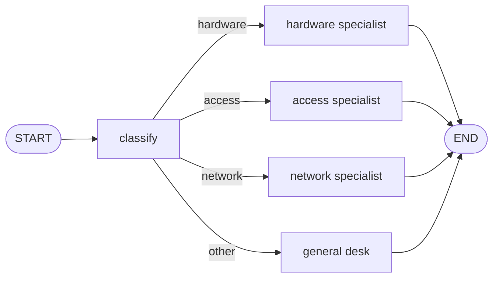

# 08.2 · Conditional edges and routing to specialists

**Module:** [08 · LangGraph: stateful workflows and routing](../README.md) · **Time:** 45-60 minutes · **Model needs:** chat (script 1 needs no model) · **Packages:** `langgraph` extra (also installs `langchain-openai`)

## What you will learn

- How `add_conditional_edges` picks the next node from the state with a router function.
- Why a path map makes the drawn graph honest.
- How to use a model as the router, and why its answer must be normalised onto known branch names.
- How `Command(update=..., goto=...)` lets a node write state and choose the next node in one step.
- How to build specialist nodes, each with its own prompt.

## The idea

**What is new since 08.1:** every ticket used to take the same straight line. Now the graph
looks at the state and chooses a branch. Only the chosen branch runs.

A **conditional edge** has a source node and a **router**: a function that takes the state and
returns the name of the next node. The router decides; it does not write state. When the choice
needs a model, the usual pattern is two steps: a `classify` node writes a label into the state,
then a tiny router reads that label. The label is free text from a model, so you map it onto the
known names and fall back to `other` for anything else.



By hand (module 02) this was an `if/elif` over the model's label. The graph keeps that logic but
makes the branches part of the structure, so they can be drawn, traced and tested.

## Scripts

Run all three with `./run 08.2` (Windows: `run 08.2`), or one at a time.

### 1. `01_conditional_edges.py`: a router function, no model

```
./run 08.2/1
```

A keyword router sends a ticket to `hardware`, `access` or `fallback`. It draws the graph twice:
without a path map and with one.

**Expected output** (trimmed):

```
Step 2: Without a path map the drawing cannot show the branches
graph TD;
        __start__(<p>__start__</p>)
        hardware(hardware)
        ...
        __start__ -.-> __end__;

Step 3: Give the router a path map
        __start__ -.-> access;
        __start__ -.-> fallback;
        __start__ -.-> hardware;
        access --> __end__;

Step 4: Run three tickets and see which branch each takes
Ticket #5201: my monit
{ "handled_by": "hardware", "plan": "Check cables, swap the monitor, book a desk visit." }
Ticket #5202: I am loc
{ "handled_by": "access", "plan": "Verify identity, unlock the account, resend the MFA enrolment link." }
Ticket #5203: can you
{ "handled_by": "fallback", "plan": "Not an IT issue: reply politely and close." }
```

Dotted arrows are conditional edges. Without the path map the drawing hides the branches.

### 2. `02_llm_classifier_router.py`: a model picks the branch

```
./run 08.2/2
```

A `classify` node asks the model for one word, stores both the raw answer and a normalised label,
and a conditional edge routes on the label. A final step shows `normalise()` on messy answers.

**Expected output** (trimmed):

```
Step 2: Run three tickets
tokens: 42 in + 1 out = 43
Ticket #5211: the scre
{ "model said": "hardware", "routed to": "hardware" }
Ticket #5212: MFA code
{ "model said": "access", "routed to": "access" }
Ticket #5213: when is
{ "model said": "other", "routed to": "other" }

Step 3: Why normalise?
normalise('Hardware.') -> 'hardware'
normalise('I think this is a network problem') -> 'network'
normalise('banana') -> 'other'
```

Returning a name that is not a node is a runtime error; normalising turns a bad answer into a
safe default.

### 3. `03_specialist_nodes.py`: specialists and `Command`

```
./run 08.2/3
```

The scenario. `classify` returns `Command(update={"label": ...}, goto=label)`, so one object writes
state and names the next node. Four specialist nodes each carry their own system prompt. The
`Literal[...]` return annotation tells LangGraph (and the drawing) the possible targets.

**Expected output** (trimmed; the wording will differ):

```
after 'classify'
{ "label": "network" }
after 'network'
{
  "answer": "The most likely cause is a cached or corrupted network profile on your laptop. Please \"Forget\" the office Wi-Fi network ...",
  "specialist": "network"
}
Run summary: 2 model call(s), 122 in + 37 out = 159 tokens, 3.8s
```

## Try this

1. In script 1, add an `urgent` branch for tickets that contain "demo" or "deploy", and extend the path map.
2. In script 1, make the router return a name that is not in the path map. Read the error.
3. In script 2, change the system prompt so the model answers in sentences. Does `normalise` still route correctly?
4. In script 2, add a `software` label and node. What else has to change?
5. In script 3, delete the `Literal[...]` annotation and redraw. What disappears?
6. In script 3, add a second ticket about a locked account and check it reaches the access specialist.

## If it does not work

- Run `./run doctor` to check the endpoint and the extras.
- `ModuleNotFoundError: langgraph`: install the extra with `uv sync --extra langgraph`.
- A branch name error at run time means the router returned something that is not a node: normalise the label.
- An odd label is not a crash: the state keeps the raw answer, and the ticket goes to `other`.

## In the running scenario

The helpdesk assistant now has a front desk: it reads the ticket, picks hardware, access,
network or the general desk, and only that specialist answers. 08.3 shows how to watch,
draw and test such a graph.

**Next:** 08.3 · Streaming, visualising and testing a graph (planned)
