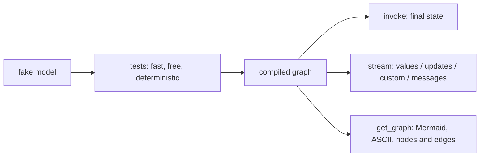

# 08.3 · Streaming, visualising and testing a graph

**Module:** [08 · LangGraph: stateful workflows and routing](../README.md) · **Time:** 45-60 minutes · **Model needs:** chat, stream (scripts 2 needs no model) · **Packages:** `langgraph` extra (also installs `langchain-openai`); optional `grandalf` for ASCII drawings

## What you will learn

- The four `stream_mode` values (`values`, `updates`, `custom`, `messages`) and when to use each.
- How a node emits its own progress events with `get_stream_writer()`.
- How to inspect and draw a graph: nodes and edges as data, Mermaid text, an optional ASCII sketch.
- How to test nodes, routers and a whole graph without a model, by passing in a fake.

## The idea

**What is new since 08.2:** the graph can branch; now you learn to watch it, draw it and prove it works.

`graph.invoke()` returns only the end result. `graph.stream()` reports the run as it happens, and
`stream_mode` picks the shape: the whole state (`values`), what each node returned (`updates`),
events a node emits itself (`custom`), or the model's tokens (`messages`). A compiled graph can also
describe itself, which is how the drawings are made. And since nodes and routers are plain
functions, tests do not need a model: build the graph from a function that takes the model as an
argument, and hand the test a fake.



By hand (module 01) you would have printed inside your loop. The streaming modes give the same
visibility without editing the nodes.

## Scripts

Run all three with `./run 08.3` (Windows: `run 08.3`), or one at a time.

### 1. `01_stream_modes.py`: the four modes

```
./run 08.3/1
```

A two-node graph (`clean`, `answer`) streamed in each mode, then two modes combined.

**Expected output** (trimmed):

```
Step 1: stream_mode="values": the whole state after each step
state now has fields: ticket
state now has fields: ticket, cleaned
state now has fields: ticket, cleaned, answer

Step 3: stream_mode="custom": progress messages a node emits itself
custom event
{ "progress": "cleaning the ticket text" }
custom event
{ "progress": "asking the model" }

Step 4: stream_mode="messages": the model reply token by token
2 chunk(s) from node 'answer' joined to: 'Please submit a hardware request form through the Larkspur Labs employee portal, ...'

Step 5: Several modes at once
[custom] {'progress': 'cleaning the ticket text'}
[updates] ['clean']
[custom] {'progress': 'asking the model'}
[updates] ['answer']
```

The number of `messages` chunks depends on the endpoint. In `messages` mode the endpoint may not
report token usage, so the run summary can show one unreported call.

### 2. `02_visualising_graphs.py`: draw the router

```
./run 08.3/2
```

Prints nodes and edges as data (with a `conditional` flag), the Mermaid text, writes the Mermaid
to a temp file, and tries `draw_ascii()`. No model is called.

**Expected output** (trimmed):

```
nodes
[ "__start__", "classify", "hardware", "access", "network", "other", "__end__" ]
Step 2: Mermaid text
graph TD;
        classify -.-> access;
        ...
        access --> __end__;
Step 3: Write it to a file
wrote helpdesk_router.mmd: 529 bytes (temp folder, removed afterwards)
Step 4: An ASCII sketch for the terminal
draw_ascii needs the optional 'grandalf' package (ImportError); skipping.
```

If you install `grandalf` the ASCII sketch is printed instead of the skip message.

### 3. `03_testing_nodes.py`: test without a model

```
./run 08.3/3
```

The scenario. A router graph built by `build_graph(llm)`. Checks run on the helper, the router,
and the whole graph with a `FakeModel`, then one real run for comparison.

**Expected output** (trimmed):

```
PASS  normalise('Hardware.') == 'hardware'
PASS  route({'label': 'access'}) == 'access'
PASS  fake model says 'no idea' -> handled_by 'other'
PASS  visited nodes: ['classify', 'hardware']
real run
{ "ticket": "Ticket #5311: the office printer on floor 2 is jammed.", "label": "hardware", "handled_by": "hardware" }
7 of 7 checks passed.
Run summary: 1 model call(s), 28 in + 1 out = 29 tokens, 0.9s
```

The real run is not asserted, because a real model is not deterministic.

## Try this

1. In script 1, add a `writer({"progress": ...})` call to `clean` with the word count and re-run the custom mode.
2. In script 1, print each `messages` chunk with a marker between them to see where they split.
3. In script 2, `uv pip install grandalf` and re-run to see the ASCII sketch.
4. In script 2, paste the Mermaid text into a Mermaid viewer.
5. In script 3, add a check that `FakeModel("")` (an empty answer) routes to `other`.
6. In script 3, break `normalise` on purpose and see which checks catch it.

## If it does not work

- Run `./run doctor` to check the endpoint and the extras.
- `ModuleNotFoundError: langgraph`: install the extra with `uv sync --extra langgraph`.
- Zero `messages` chunks means the endpoint does not stream; the run still finishes.
- `get_stream_writer()` outside a node (or when not streaming) raises an error: call it only inside nodes.

## In the running scenario

The helpdesk router can now be watched live, drawn for documentation and tested in milliseconds
with a fake model. 08.4 puts routing, specialists and tests together in the capstone.

**Next:** 08.4 · Capstone: helpdesk router with specialist nodes (planned)
