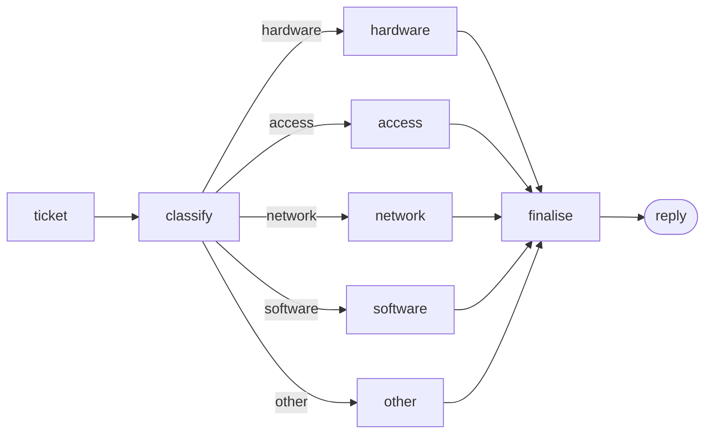

# 08.4 · Capstone: helpdesk router with specialist nodes

**Module:** [08 · LangGraph: stateful workflows and routing](../README.md) · **Time:** 45-60 minutes · **Model needs:** chat (script 3 needs no model) · **Packages:** `langgraph` extra (also installs `langchain-openai`)

## What you will learn

- How state, nodes, conditional edges, specialists, streaming and tests fit together in one graph.
- How to measure a router against a labelled set with an acceptance bar.
- How to keep the model an injectable dependency so the whole graph is testable offline.

## The idea

This lesson is a capstone: there is no new LangGraph feature. You combine 08.1 to 08.3.

**The brief.** The Larkspur Labs helpdesk receives tickets as free text. Build a graph that
classifies each ticket, hands it to the right specialist node (`hardware`, `access`, `network`,
`software`, `other`), and finishes with a reply carrying a sign-off.

**Acceptance criteria.**

1. One graph: `classify` -> conditional edge -> exactly one specialist -> `finalise`.
2. The classifier's free-text answer is normalised; anything unknown goes to `other`.
3. Every node reads and writes named fields in a typed state.
4. At least **6 of the 8** tickets in [`tickets.json`](tickets.json) are routed to the expected label (script 2).
5. An offline test suite with fake models checks routing, the fallback and that only one specialist runs (script 3).
6. An empty specialist answer still produces a usable reply.

**Stretch goals.**

- Add an `urgent` flag to the state and a second conditional edge after `finalise` that sends urgent tickets to an `escalate` node.
- Have the classifier return a confidence word and route low-confidence tickets to a human queue node.
- Add a `messages`-mode stream so a UI could show the specialist's answer token by token.
- Add a ninth ticket that is ambiguous and decide, with a test, which branch it should take.



## Scripts

Run all three with `./run 08.4` (Windows: `run 08.4`), or one at a time.

### 1. `01_build_the_router.py`: the graph, one ticket

```
./run 08.4/1
```

Builds the graph (the drawing is printed), runs one ticket with updates streaming, and shows the
reply. `build_graph(classify_llm, draft_llm)` takes the models as arguments.

**Expected output** (trimmed; the wording will differ):

```
after 'classify'
{ "label": "access" }
after 'access'
{ "answer": "Please reset your MFA device in the Larkspur Identity Portal under \"Security Settings\" ..." }
after 'finalise'
{ "reply": "Please reset your MFA device ... Larkspur IT (handled by: access)" }
Run summary: 2 model call(s), 101 in + 46 out = 147 tokens, 3.2s
```

### 2. `02_route_the_batch.py`: measure the router

```
./run 08.4/2
```

Runs all eight tickets through a graph with canned specialists (only the classifier calls the
model) and scores the routing against the answer key in `tickets.json`.

**Expected output** (trimmed):

```
ok   #5401: expected hardware  routed hardware
ok   #5402: expected access    routed access
...
ok   #5408: expected network   routed network
8 of 8 routed correctly (bar: 6).
PASS
Run summary: 8 model call(s), 265 in + 8 out = 273 tokens, 12.6s
```

A model may miss one; then you see a `MISS` line and the misroute pairs. Report what you see.

### 3. `03_test_the_graph.py`: the offline test suite

```
./run 08.4/3
```

Fake models stand in for the real ones. Checks cover each label, messy answers, the visited nodes,
the call counts, an empty draft and the Mermaid output.

**Expected output** (trimmed):

```
PASS  classifier says 'access' -> reply mentions 'handled by: access'
PASS  'unknown' -> 'other'
PASS  visited ['classify', 'access', 'finalise']
PASS  reply says no answer was produced
14 of 14 checks passed.
Run summary: no model calls, 0.0s
```

## Try this

1. Add a ninth ticket to `tickets.json` that mixes two categories and see where the router sends it.
2. Weaken the classifier prompt (drop the list of labels) and rerun script 2. How many misses?
3. Make `finalise` add the ticket's category as a prefix and update the test that checks the reply.
4. Add a `check` to script 3 that every label in `LABELS` has a specialist prompt in script 1.
5. Start on a stretch goal: the `urgent` flag and the `escalate` node.

## If it does not work

- Run `./run doctor` to check the endpoint and the extras.
- `ModuleNotFoundError: langgraph`: install the extra with `uv sync --extra langgraph`.
- Misroutes are results, not crashes: the score line and the misroute pairs say what happened.
- Script 3 needs no endpoint at all; if it fails, the graph wiring is wrong.

## In the running scenario

The helpdesk assistant is now a routed workflow with specialists, a measured router and an
offline test suite. It still only moves forward; module 09 adds loops, human approval and
persistence.

**Next:** 09.1 · Cycles and self-correction loops
