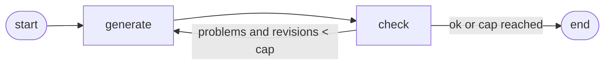

# 09.1 · Cycles and self-correction loops

**Module:** [09 · LangGraph: cycles, human-in-the-loop, persistence](../README.md) · **Time:** 45-60 minutes · **Model needs:** chat · **Packages:** `langgraph` extra (`uv sync --extra langgraph`)

## What you will learn

- How a LangGraph graph loops. You need a node (a step that does some work), a state (the data passed between steps) and a conditional edge (a rule that sends the run back or on to `END`).
- What `recursion_limit` does, and the error you get when a loop never stops.
- The generate, check, revise pattern. You will build it twice: once with a checker written in plain Python and once with an LLM judge (a second model call that grades the first).
- Why every loop needs its own cap, and why the script should say so when the cap is hit.

## The idea

A chain runs in one direction. A graph can go back to an earlier step. That is what makes
self-correction possible: the model produces a draft, something checks it, and if the check
finds problems, they go back to the model so it can try again.

Two things keep this loop safe. The checker must return concrete problems the model can act
on, and there must be a hard cap on the number of rounds.



You could do the same thing by hand with a `for` loop around `client.chat.completions.create` (module 02).
The graph version makes the state and the routing visible in the code. You will see why that helps in lessons 09.2 and 09.3.

## Scripts

Run all three with `./run 09.1` (Windows: `run 09.1`), or one at a time.

### 1. `01_counter_cycle.py`: a cycle and its limit (no model)

```
./run 09.1/1
```

One node adds 1 to a counter, and a conditional edge keeps looping until the counter reaches
the target. A second run sets a target the loop can never reach, with `recursion_limit=5`, so
you can see LangGraph stop it.

**Expected output** (trimmed):

```
state = {'count': 0, 'target': 3}
state = {'count': 1, 'target': 3}
state = {'count': 2, 'target': 3}
state = {'count': 3, 'target': 3}
GraphRecursionError: Recursion limit of 5 reached without hitting a stop condition. ...
```

### 2. `02_generate_check_revise.py`: draft, check in Python, revise

```
./run 09.1/2
```

The model drafts a reply about ticket LL-2041. `check_reply` is plain Python. It checks the
word count, checks that the reply mentions the ticket id, and looks for forbidden phrases. Any
problems go back to the model as feedback, for at most 3 revisions. The limit is set to 35
words on purpose, so the model usually needs more than one try.

**Expected output** (trimmed):

```
tokens: 44 in + 67 out = 111
[check] revision 0: 1 problem(s) ['too long: 48 words, limit is 35']
[route] problems found: back to generate with feedback
[check] revision 1: 1 problem(s) ['too long: 45 words, limit is 35']
...
[check] revision 3: 1 problem(s) ['too long: 39 words, limit is 35']
[route] cap of 3 revisions reached with problems left: stop anyway
The reply still has problems after the cap. A real system would hand it to a person.
Run summary: 4 model call(s), 448 in + 251 out = 699 tokens, 7.0s
```

### 3. `03_llm_judge_loop.py`: the checker is a model

```
./run 09.1/3
```

This is the same loop, but now the checker is a second model call. It uses
`with_structured_output(Verdict)` so the answer comes back as `{ok, problems}`. The loop stops
after 2 revisions (6 model calls). If the judge returns something the script cannot read, the
script counts it as "not ok" and carries on until the cap.

**Expected output** (trimmed):

```
[judge] ok=False problems=['The reply exceeds the 60-word limit.']
[route] judge rejected: revise
...
[route] cap of 2 revisions reached: stop with the last draft
Run summary: 6 model call(s), 1210 in + 371 out = 1581 tokens, 11.0s
```

A judge can be wrong, or it can keep rejecting drafts that are fine. The cap is what makes the loop safe.

## Try this

1. In script 1, set `recursion_limit` to 3 with `target=3`. Does it finish? Count the steps.
2. In script 2, change the word limit to 80 and watch the loop end right away.
3. In script 2, add a forbidden phrase the model is likely to use ("Best regards") and watch the feedback.
4. In script 2, set `MAX_REVISIONS = 0`. What happens?
5. In script 3, change the judge's `temperature` to 0.9. Does the verdict stay the same between runs?
6. In script 3, change the judge's criteria in the `Verdict` field description and see how the verdicts change.

## If it does not work

- Run `./run doctor`. It checks the endpoint and the optional extras.
- `ModuleNotFoundError: langgraph`: install the extra with `uv sync --extra langgraph`.
- Script 3 shows "could not parse a verdict": the model may not handle structured output well. The loop still ends at the cap.

## In the running scenario

The helpdesk assistant now checks its own replies before they go out. A cheap rule-based
check runs first. An LLM judge then looks at what rules cannot see. A cap makes sure a draft
that keeps failing ends up with a person instead of looping forever.

**Next:** 09.2 · Human-in-the-loop: interrupt, approve, resume (planned)
