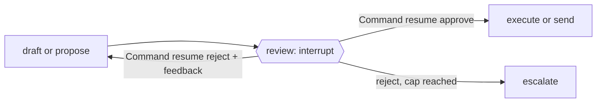

# 09.2 · Human-in-the-loop: interrupt, approve, resume

**Module:** [09 · LangGraph: cycles, human-in-the-loop, persistence](../README.md) · **Time:** 45-60 minutes · **Model needs:** chat · **Packages:** `langgraph` extra (`uv sync --extra langgraph`)

## What you will learn

- How `interrupt()` pauses a graph, and how `Command(resume=...)` picks it up again on the same `thread_id` (the name of one conversation or run).
- Why an interrupt needs a checkpointer (the place where the graph saves its state), and what the paused state looks like (`get_state`, `__interrupt__`).
- How to build an approve or reject loop, where a rejection sends the reviewer's feedback back to the model.
- How to put an approve, edit or reject gate in front of the only node with a side effect (the one step that actually changes something).

## The idea

In 09.1 the checker was code or a second model. Now the checker is a person, and the graph has
to wait for them, maybe for days. A graph cannot sit waiting in a Python `input()`. Instead, it
saves its state and stops. Saving needs a checkpointer (09.3 covers these in depth). Resuming is
just another call on the same thread.



Here is how `interrupt(payload)` works inside a node. The first time the run reaches it, the run
stops and `invoke` returns the payload under `__interrupt__`. When you later call
`invoke(Command(resume=value), config)`, the node starts again from the top, and this time
`interrupt()` returns `value`.

That means anything before the `interrupt()` call in that node runs twice. Keep that node small
and make sure it does not change anything outside the graph. The by-hand version (module 02) is a
`while` loop with `input()`. It works in a terminal and nowhere else.

In these scripts the approvals come from fixed lists, so the lesson runs without you typing
anything. In a real app the decision comes from a button, a chat message or an email link,
possibly in a different process.

## Scripts

Run all three with `./run 09.2` (Windows: `run 09.2`), or one at a time.

### 1. `01_interrupt_and_resume.py`: the mechanics (no model)

```
./run 09.2/1
```

One node asks a manager for approval and the graph pauses. The script looks at the paused state,
resumes with `Command(resume="yes")`, and then shows that a second `thread_id` is kept separate.

**Expected output** (trimmed):

```
invoke() returned
{ "request": "Grant Priya access to the finance share", "decision": "", "result": "",
  "__interrupt__": [ "Interrupt(value={'question': 'Approve this request?', ...}, id='...')" ] }
next node to run: ('ask_manager',)
pending interrupt value: {'question': 'Approve this request?', 'request': 'Grant Priya access to the finance share'}
Command(resume='yes') on the same thread_id. interrupt() now returns 'yes'.
"result": "done: Grant Priya access to the finance share"
next after finishing: () (empty means the run is complete)
thread LL-2051 -> skipped: Reset the CEO's password
thread LL-2050 still says: done: Grant Priya access to the finance share
```

### 2. `02_approve_or_reject.py`: a person as the checker

```
./run 09.2/2
```

The model drafts a VPN reply. The scripted reviewer first rejects it with feedback, then approves
the next draft. A rejection loops back to `draft` with the feedback. After 2 rejections the graph
would hand the ticket to a human agent instead.

**Expected output** (trimmed):

```
[pause 1] draft awaiting review: Hi there! Great news... Please try connecting to the VPN again ...
[reviewer] {'action': 'reject', 'feedback': 'Too wordy. Two sentences, and name the ticket id.'}
[pause 2] draft awaiting review: Hi there! Your VPN token reset (LL-2060) is complete, so please try logging in again. ...
[reviewer] {'action': 'approve'}
pauses: 2, rejections: 1
outcome: sent to the employee
Run summary: 2 model call(s), 184 in + 127 out = 311 tokens, 4.2s
```

### 3. `03_edit_and_gated_action.py`: approve, edit or reject before the side effect

```
./run 09.2/3
```

There are three tickets, each on its own thread. For each one the model proposes an action, and
the gate offers approve, edit or reject. The only way to reach `execute` is through the gate. The
gate returns a `Command(goto=..., update=...)`, so the routing and the state changes both come from
one place.

**Expected output** (trimmed):

```
[LL-2071] reviewer decides: {'action': 'approve'}
[LL-2071] audit trail: ['EXECUTED: Please provide your username or employee ID so I can verify ...']
[LL-2072] reviewer decides: {'action': 'edit', 'proposal': 'Grant temporary admin on the build server for 24 hours, then revoke.'}
[LL-2072] audit trail: ['edited by reviewer', 'EXECUTED: Grant temporary admin on the build server for 24 hours, then revoke.']
[LL-2073] reviewer decides: {'action': 'reject', 'reason': 'Needs a records-retention review first.'}
[LL-2073] audit trail: ['rejected: Needs a records-retention review first.']
```

The model's own proposals are often vague ("please provide your username..."). The gate is where
a person catches that, and the edit option lets them fix it without another model call.

## Try this

1. In script 1, resume with something other than `"yes"` and watch the `act` node's branch.
2. In script 1, call `graph.invoke(Command(resume="yes"), config)` a second time after the run finished. What happens?
3. In script 2, change `SCRIPTED_DECISIONS` to three rejections and see the escalation path.
4. In script 2, add a `print` before the `interrupt()` call in `review` and count how often it prints per pause (the node starts over when it resumes).
5. In script 3, change LL-2073's decision to `approve`. The audit trail shows why the person at the gate has to actually read the proposal.
6. In script 3, remove `"execute"` from the gate's `destinations` and read the error or the changed graph drawing.

## If it does not work

- Run `./run doctor`. It checks the endpoint and the optional extras.
- `ModuleNotFoundError: langgraph`: install the extra with `uv sync --extra langgraph`.
- `ValueError ... checkpointer`: an interrupt needs `compile(checkpointer=...)` and a `thread_id` in `config["configurable"]`.
- If the model rambles in script 2 or 3, that is fine. The scripted decisions do not depend on the text.

## In the running scenario

The helpdesk assistant no longer sends anything or takes a risky action on its own. It proposes,
a person approves, edits or rejects, and only then does the single side-effect node run. The next
lesson makes the pause survive a restart.

**Next:** 09.3 · Checkpointers: SQLite and Redis persistence
