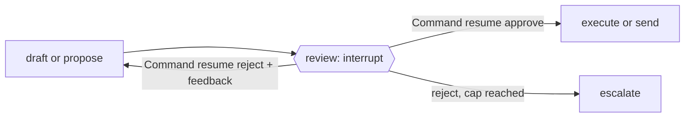

# 09.2 · Human-in-the-loop: interrupt, approve, resume

**Module:** [09 · LangGraph: cycles, human-in-the-loop, persistence](../README.md) · **Time:** 45-60 minutes · **Model needs:** chat · **Packages:** `langgraph` extra (`uv sync --extra langgraph`)

## What you will learn

- How `interrupt()` pauses a graph and how `Command(resume=...)` continues it on the same `thread_id`.
- Why an interrupt needs a checkpointer, and what the paused state looks like (`get_state`, `__interrupt__`).
- An approve or reject loop where a rejection sends feedback back to the model.
- An approve, edit or reject gate in front of the only node with a side effect.

## The idea

**What is new since 09.1:** in 09.1 the checker was code or a second model. Now the checker is a
person, and the graph has to wait for them, possibly for days. A graph cannot block in a Python
`input()`; instead it saves its state and stops. That needs a checkpointer (09.3 goes deeper), and
the resume is just another call on the same thread.



`interrupt(payload)` inside a node: the first time it is reached the run stops and `invoke` returns the
payload under `__interrupt__`. When you call `invoke(Command(resume=value), config)` the node starts
again from its top and this time `interrupt()` returns `value`. Anything before the `interrupt()` call
in that node runs twice, so keep that node small and free of side effects. The by-hand equivalent
(module 02) is a `while` loop with `input()`; it works in a terminal and nowhere else.

The approvals in these scripts are scripted lists so the lesson runs unattended. In an app the
decision arrives from a button, a chat message or an email link, possibly in another process.

## Scripts

Run all three with `./run 09.2` (Windows: `run 09.2`), or one at a time.

### 1. `01_interrupt_and_resume.py`: the mechanics (no model)

```
./run 09.2/1
```

One node asks a manager; the graph pauses; the script inspects the paused state, resumes with
`Command(resume="yes")`, then shows that a second `thread_id` is independent.

**Expected output** (trimmed):

```
invoke() returned
{ "request": "Grant Priya access to the finance share", "decision": "", "result": "",
  "__interrupt__": [ "Interrupt(value={'question': 'Approve this request?', ...}, id='...')" ] }
next node to run: ('ask_manager',)
pending interrupt value: {'question': 'Approve this request?', 'request': 'Grant Priya access to the finance share'}
Command(resume='yes') on the same thread_id. interrupt() now returns 'yes'.
"result": "done: Grant Priya access to the finance share"
next after finishing: () (empty means the run is complete)
thread LL-2051 -> skipped: Reset the CEO's password
thread LL-2050 still says: done: Grant Priya access to the finance share
```

### 2. `02_approve_or_reject.py`: a person as the checker

```
./run 09.2/2
```

The model drafts a VPN reply. The reviewer's scripted decisions are: reject with feedback, then
approve. A rejection loops back to `draft` with the feedback; after 2 rejections the graph would
escalate to a human agent instead.

**Expected output** (trimmed):

```
[pause 1] draft awaiting review: Hi there! Great news... Please try connecting to the VPN again ...
[reviewer] {'action': 'reject', 'feedback': 'Too wordy. Two sentences, and name the ticket id.'}
[pause 2] draft awaiting review: Hi there! Your VPN token reset (LL-2060) is complete, so please try logging in again. ...
[reviewer] {'action': 'approve'}
pauses: 2, rejections: 1
outcome: sent to the employee
Run summary: 2 model call(s), 184 in + 127 out = 311 tokens, 4.2s
```

### 3. `03_edit_and_gated_action.py`: approve, edit or reject before the side effect

```
./run 09.2/3
```

Three tickets, each its own thread. The model proposes one action; the gate offers approve, edit
or reject; `execute` is only reachable through the gate. The gate returns a `Command(goto=..., update=...)`
so routing and state changes come from one place.

**Expected output** (trimmed):

```
[LL-2071] reviewer decides: {'action': 'approve'}
[LL-2071] audit trail: ['EXECUTED: Please provide your username or employee ID so I can verify ...']
[LL-2072] reviewer decides: {'action': 'edit', 'proposal': 'Grant temporary admin on the build server for 24 hours, then revoke.'}
[LL-2072] audit trail: ['edited by reviewer', 'EXECUTED: Grant temporary admin on the build server for 24 hours, then revoke.']
[LL-2073] reviewer decides: {'action': 'reject', 'reason': 'Needs a records-retention review first.'}
[LL-2073] audit trail: ['rejected: Needs a records-retention review first.']
```

Notice the model's own proposals are often vague ("please provide your username..."): the gate is
exactly where a person catches that, and the edit decision is how they fix it without a new model call.

## Try this

1. In script 1, resume with something other than `"yes"` and watch the `act` node's branch.
2. In script 1, call `graph.invoke(Command(resume="yes"), config)` a second time after the run finished. What happens?
3. In script 2, change `SCRIPTED_DECISIONS` to three rejections and see the escalation path.
4. In script 2, add `print` before the `interrupt()` call in `review` and count how often it prints per pause (the node restarts on resume).
5. In script 3, change LL-2073's decision to `approve`. The audit trail shows why a gate needs a human who reads.
6. In script 3, remove `"execute"` from the gate's `destinations` and read the error or the changed graph drawing.

## If it does not work

- Run `./run doctor`. It checks the endpoint and the optional extras.
- `ModuleNotFoundError: langgraph`: install the extra with `uv sync --extra langgraph`.
- `ValueError ... checkpointer`: an interrupt needs `compile(checkpointer=...)` and a `thread_id` in `config["configurable"]`.
- A model that rambles in script 2 or 3 is fine: the scripted decisions do not depend on the text.

## In the running scenario

The helpdesk assistant no longer sends or does anything risky on its own. It proposes, a person approves,
edits or rejects, and only then does the single side-effect node run. The next lesson makes the pause durable.

**Next:** 09.3 · Checkpointers: SQLite and Redis persistence
