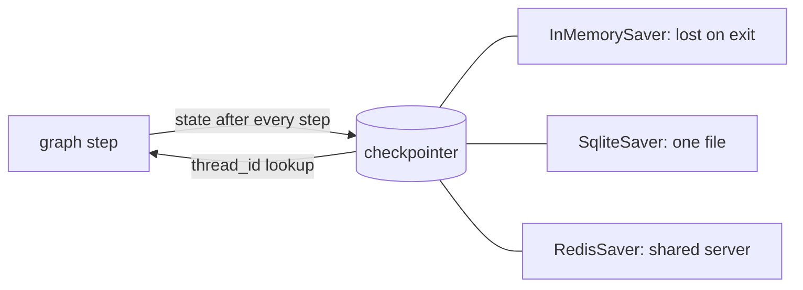

# 09.3 · Checkpointers: SQLite and Redis persistence

**Module:** [09 · LangGraph: cycles, human-in-the-loop, persistence](../README.md) · **Time:** 45-60 minutes · **Model needs:** chat · **Packages:** `langgraph` extra (`uv sync --extra langgraph`, includes the SQLite saver); script 3 also needs `langgraph-checkpoint-redis` and a Redis server

## What you will learn

- What a checkpointer stores and what `thread_id` means.
- Resuming after a crash with `invoke(None, config)`, from a SQLite file and a brand new graph object.
- Listing history with `get_state_history` and branching from an old checkpoint.
- When SQLite is enough and when to move to Redis (or Postgres).

## The idea

**What is new since 09.2:** 09.2 used an in-memory saver, which forgets everything when the process
ends, so an approval could not outlive a restart. A checkpointer is the storage behind
`compile(checkpointer=...)`: after every step it writes the state, keyed by `thread_id`. Swap
the saver and the graph code does not change.



By hand (module 02) the "state" was a `messages` list you kept in a variable or wrote to a file
yourself. The checkpointer does that for every step, including the step you were in the middle of.

## Scripts

Run all three with `./run 09.3` (Windows: `run 09.3`), or one at a time. Script 3 needs Redis and exits with code 3 without it.

### 1. `01_sqlite_resume_after_crash.py`: crash and resume (no model)

```
./run 09.3/1
```

A three-step graph writes checkpoints to a temporary SQLite file. Step 2 raises on purpose. The script closes the
connection, opens the file again with a new graph object and continues: `collect` does not run again.

**Expected output** (trimmed):

```
crashed: worker killed while provisioning
saved state: {'ticket': 'LL-2080 new hire', 'log': ['collect: read ticket']}
next node to run: ('provision',)
state loaded from the file: {'ticket': 'LL-2080 new hire', 'log': ['collect: read ticket']}
"log": ["collect: read ticket", "provision: account created", "notify: employee emailed"]
step 3: next=() log entries=3
step 2: next=('notify',) log entries=2
step 1: next=('provision',) log entries=1
step 0: next=('collect',) log entries=0
step -1: next=('__start__',) log entries=0
```

### 2. `02_threads_history_and_forking.py`: threads as memory, history, branching

```
./run 09.3/2
```

Two turns on thread `priya` (the second turn relies on the first), the same question on thread
`marco`, the history list, then a branch from the checkpoint after turn 1.

**Expected output** (trimmed):

```
thread 'priya' holds 4 message(s):
    human: Hi, I am Priya and my laptop is a ThinkPad X1.
       ai: Hello Priya. Please submit a ticket at the Larkspur Labs portal so we can assist with your
    human: Which laptop did I say I have?
       ai: You have a ThinkPad X1.
thread 'marco' holds 2 message(s):
       ai: Our records indicate you are using a MacBook Pro. Please let us know if you need assistanc
step  4  messages=4  next=()
...
step  1  messages=2  next=()
checkpoints in the thread now: 9 (was 6); the branch added to the history
Run summary: 4 model call(s), 192 in + 86 out = 278 tokens, 4.5s
```

Thread `marco` has no memory of Priya, so the model invented a laptop: a missing thread is a missing memory, not an error.
A branch lives in the same thread: its latest checkpoint becomes the thread's current state, while the old checkpoints stay in the history.

### 3. `03_redis_checkpointer.py`: the same graph on Redis (needs a Redis server)

```
./run 09.3/3
```

Same graph, `RedisSaver` instead of SQLite. It calls `require("REDIS_URL")` first. Redis is not running on the author's
machine, so the run here stops with exit code 3. The Redis saver needs the RediSearch and RedisJSON modules (use the
`redis/redis-stack-server` image) and the package `langgraph-checkpoint-redis`; it was not run against a real Redis.

**Expected output without Redis** (real, exit code 3):

```
This lesson needs Redis: REDIS_URL is not set.
- Start one: docker run --rm -p 6379:6379 redis:7
- Then set it in .env, for example REDIS_URL=redis://localhost:6379/0
```

With the service running you should see the final state with `log: ['collect', 'provision']`, then the same state read
back through a second connection and a checkpoint count for the thread.

## Try this

1. In script 1, leave `CRASH["armed"]` True for the second process too. What does `get_state` show after a second crash?
2. In script 1, call `graph.invoke({"ticket": "x", "log": []}, config)` instead of `invoke(None, config)` in process 2. Does it resume?
3. In script 1, print the SQLite file's tables with the `sqlite3` module (`.execute("select name from sqlite_master")`).
4. In script 2, change `thread_id` for the second turn. Is the model's answer still right?
5. In script 2, branch from the checkpoint at step 0 (one message) instead of step 1.
6. In script 3 (with Redis), run it twice: the thread id is random each time. Make it fixed and see the history grow.

## If it does not work

- Run `./run doctor`. It checks the endpoint, the extras and the services.
- `ModuleNotFoundError: langgraph.checkpoint.sqlite`: `uv sync --extra langgraph`.
- Script 3 exits with code 3: start Redis and set `REDIS_URL` in `.env`. For a cloud-hosted Redis (Upstash, Redis Cloud, ElastiCache) put its `rediss://...` URL in the same variable.
- Script 3 says the Redis checkpointer package is missing: `uv sync --extra langgraph`.
- On Windows the temp SQLite file is removed after the connection closes; the scripts use `with` blocks for that reason.

## In the running scenario

The helpdesk workflow (onboarding a new hire, waiting for an approval) no longer lives in one process.
Whoever restarts it, on any day, picks the thread up where it stopped.

**Next:** 09.4 · Parallel workers and sub-graphs
