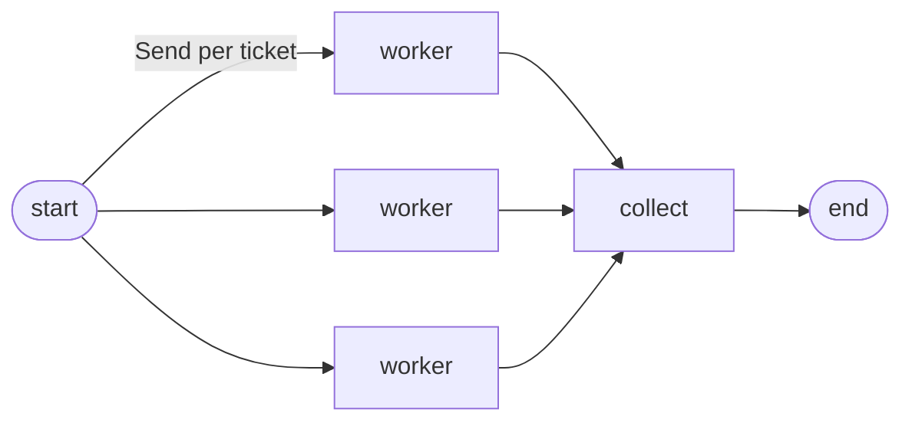

# 09.4 · Parallel workers and sub-graphs

**Module:** [09 · LangGraph: cycles, human-in-the-loop, persistence](../README.md) · **Time:** 45-60 minutes · **Model needs:** chat · **Packages:** `langgraph` extra (`uv sync --extra langgraph`)

## What you will learn

- How to run fixed branches in parallel, and how the `Send` API starts as many workers as you need, decided while the graph runs.
- Why parallel writes to one state key need a reducer (a rule for merging them, here `Annotated[list, operator.add]`).
- How to run one model call per item in parallel and collect the answers.
- How to package a loop as a sub-graph, two ways to attach it, and what `stream(..., subgraphs=True)` shows.

## The idea

Every graph so far did one thing at a time. This lesson adds two things. First, a graph can do many
things in the same step: it fans out to several workers and then fans back in to collect their results.
Second, you can put one graph inside another (a sub-graph).



`Send("worker", payload)` starts a worker with its own private input. The reducer on the shared state key
merges what the workers return. By hand you would write a loop of `create()` calls, or use `asyncio.gather`
from module 05. The graph version keeps the checkpointing and tracing you have already seen.

## Scripts

Run all three with `./run 09.4` (Windows: `run 09.4`), or one at a time.

### 1. `01_fan_out_fan_in.py`: Send and reducers (no model)

```
./run 09.4/1
```

First come fixed branches. Then the graph fans out to four workers, picked at run time, that each sleep 0.2 s. Last comes the case with no work at all.

**Expected output** (trimmed):

```
notes: ['mail ok', 'vpn ok', 'joined after 2 checks']
[fan_out] 4 tickets -> 4 Send() objects
[collect] got 4 results
results: LL-3001..LL-3004 handled
4 workers of 0.2s each took 0.21s: they ran in parallel (sequential would be 0.8s).
[fan_out] 0 tickets -> 0 Send() objects
no tickets -> results = []
```

The order of `notes` (mail before vpn) is not guaranteed, so do not rely on it. With an empty Send list nothing runs, not even `collect`.

### 2. `02_parallel_ticket_triage.py`: one model call per ticket, in parallel

```
./run 09.4/2
```

The model classifies five tickets at once, and then plain Python sums them up. `normalise` maps the model's answer
onto the allowed categories. Anything else becomes `other`.

**Expected output** (trimmed):

```
[worker] LL-3105 -> other (model said: 'other')
wall time for 5 model calls: 2.6s (they overlap)
summary: {"hardware": 1, "account": 1, "network": 1, "software": 1, "other": 1}
Run summary: 5 model call(s), 180 in + 5 out = 185 tokens, 2.7s
```

### 3. `03_subgraph_reply_drafter.py`: a graph inside a graph

```
./run 09.4/3
```

A small drafter graph writes a reply, checks the word count and revises at most once. A parent graph picks a tone
and then uses the drafter. The script attaches it two ways. In the first, the drafter is wrapped in a function, keeps
its own private state, and the keys are mapped by hand. In the second, it is added directly and shares keys with the
parent. Streaming with `subgraphs=True` labels each event with the graph it came from (its namespace).

**Expected output** (trimmed):

```
nodes: write, check
"tone": "calm and quick, acknowledge urgency"
[inside drafter] node 'write' wrote keys ['draft', 'revisions']
[inside drafter] node 'check' wrote keys ['problems']
[parent] node 'drafter' wrote keys ['brief', 'draft', 'problems', 'revisions']
Run summary: 4 model call(s), 336 in + 326 out = 662 tokens, 6.2s
```

## Try this

1. In script 1, remove the reducer from `results` and read the `InvalidUpdateError`.
2. In script 1, change the sleep to 1 second. How does the total change with 4 and with 8 tickets?
3. In script 2, add a sixth ticket and a sixth category. Do you need to change the graph?
4. In script 2, make `normalise` stricter (return `unknown` for answers it does not recognise) and see what a chatty model does to the results.
5. In script 3, set `WORD_LIMIT = 10` and watch the sub-graph loop to its cap.
6. In script 3, give the sub-graph a checkpointer of its own and compare with letting it inherit the parent's.

## If it does not work

- Run `./run doctor`. It checks the endpoint and the optional extras.
- `ModuleNotFoundError: langgraph`: `uv sync --extra langgraph`.
- Rate-limit errors in script 2: the provider may not accept five calls at the same time. Use fewer tickets.
- An empty fan-out ends the graph before the join node. If you need an output, handle the empty case before you call the graph.

## In the running scenario

The helpdesk assistant sorts a morning's tickets in parallel. Wherever it needs a reply, it reuses
the same reply-drafting sub-graph.

**Next:** 09.5 · Capstone: helpdesk change request with an approval gate
