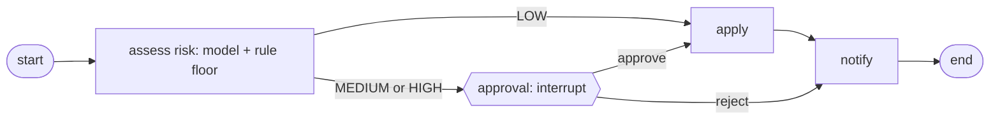

# 09.5 · Capstone: helpdesk change request with an approval gate

**Module:** [09 · LangGraph: cycles, human-in-the-loop, persistence](../README.md) · **Time:** 45-60 minutes · **Model needs:** chat · **Packages:** `langgraph` extra (`uv sync --extra langgraph`)

## What you will learn

- Combining a model call, a rule floor, an interrupt and a persistent checkpointer in one graph.
- Making a gate fail safe: unclear model output means "needs approval".
- Testing graph structure with a fake model so the checks do not depend on what a model says.

## The idea

**What is new since 09.4:** nothing new to learn; this lesson puts 09.1 to 09.4 together.



### The brief

Larkspur Labs employees file change requests. Low-risk ones should not wait for anyone. Anything else needs a
person's approval before anything is applied, and the approval may arrive after a restart.

### Acceptance criteria

1. LOW risk requests are applied without a pause.
2. MEDIUM and HIGH requests pause; nothing is applied until an approver approves.
3. A rejected request is never applied, and the requester is told.
4. Words like "delete" or "production" make a request at least HIGH, whatever the model says.
5. Unparseable model output counts as HIGH.
6. A paused request can be resumed from a new process (SQLite file).
7. Every step leaves a line in the audit trail.

### Stretch goals

- Add a second approver for HIGH risk (two interrupts in a row).
- Add a timeout: a request waiting more than N days is closed (store a timestamp in the state).
- Swap the SQLite saver for the Redis saver of 09.3/3.
- Fan out several change requests with `Send` and collect the audit trails.

## Scripts

Run all three with `./run 09.5` (Windows: `run 09.5`), or one at a time. The graph code is copied into each script on purpose (lessons and scripts stay independent).

### 1. `01_change_request_graph.py`: the graph, three requests

```
./run 09.5/1
```

Three change requests with scripted approvers: a small quota change, a production deletion, a printer driver.

**Expected output** (trimmed):

```
nodes: assess, approval, apply, notify
no pause: LOW risk goes straight to apply
  audit | risk=LOW (model said LOW, rule floor LOW)
  audit | APPLIED CR-101
PAUSED for approval, risk HIGH. Model's reason: HIGH: Deleting production storage data carries a critical risk of ...
approver decision: {'approve': False, 'by': 'scripted approver'}
  audit | approval: scripted approver -> reject
  audit | notice: Change request CR-102 was not applied.
  audit | APPLIED CR-103
Run summary: 6 model call(s), 261 in + 102 out = 363 tokens, 8.9s
```

### 2. `02_persistent_approval.py`: pause, restart, resume

```
./run 09.5/2
```

Process 1 stops at the gate; process 2 opens the same SQLite file with a new graph, finds the waiting request and rejects it; process 3 shows the decision stuck.

**Expected output** (trimmed):

```
paused: True; next node: ('approval',)
process 1 exits here. Nothing is in memory; the request exists only in the SQLite file.
requests waiting for approval: ['CR-201']
  audit | risk=HIGH (model said MEDIUM, rule floor HIGH)
  audit | approval: network-lead -> reject
applied? False
next nodes: () (empty: finished), approval = rejected
```

Here the model said MEDIUM and the rule floor raised it to HIGH: the max of the two wins.

### 3. `03_acceptance_checks.py`: the gate's invariants as checks

```
./run 09.5/3
```

Seven deterministic checks using a fake assessor (no model calls for the checks), then two live model calls that only report. Exits non-zero if a check fails.

**Expected output** (trimmed):

```
[PASS] LOW risk is applied with no pause (paused=False, applied=True)
[PASS] HIGH risk pauses, reject -> NOT applied (paused=True, applied=False)
[PASS] model says LOW but text says production delete -> still pauses (paused=True, applied=False)
[PASS] resume from a fresh connection works
model risk for 'Delete the production customer database.': HIGH  | rule floor: HIGH
7 of 7 checks passed
```

## Try this

1. In script 1, add a request that says "Reset one employee's password" and see whether the model rates it LOW.
2. In script 1, remove `"delete"` from `HIGH_RISK_WORDS` and see whether the model alone catches CR-102.
3. In script 2, approve instead of rejecting; check the audit trail order.
4. In script 3, add a check for "two requests on different threads do not affect each other".
5. In script 3, deliberately break the graph (route `assess` straight to `apply`) and watch a check fail.

## If it does not work

- Run `./run doctor`. It checks the endpoint and the optional extras.
- `ModuleNotFoundError: langgraph.checkpoint.sqlite`: `uv sync --extra langgraph`.
- The model answers with a sentence instead of starting with LOW/MEDIUM/HIGH: `parse_risk` scans for the first risk word and falls back to HIGH, so you get an approval request, not a crash.

## In the running scenario

The helpdesk assistant can now take a change request from an employee, decide whether it needs a person,
wait for that person for as long as it takes, and leave an audit trail. This ends module 09.

**Next:** 10.1 · Tracing runs: spans, latency and token cost
