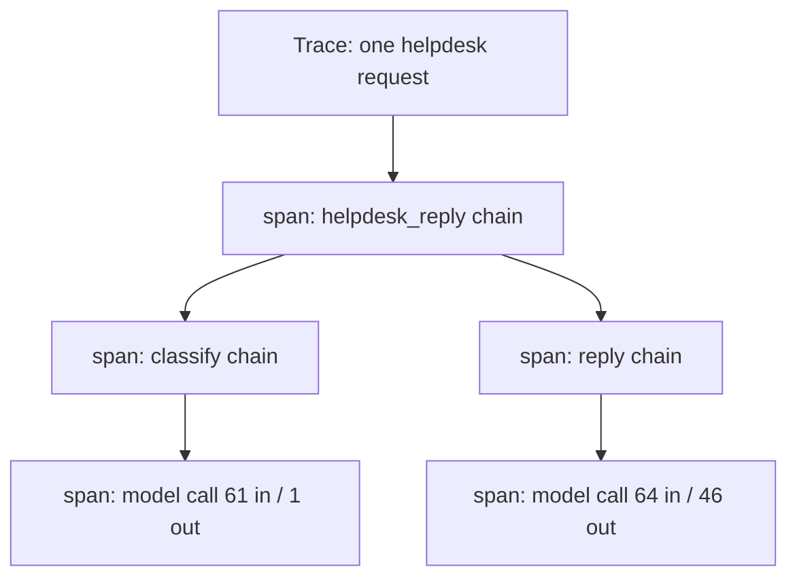

# 10.1 · Tracing runs: spans, latency and token cost

**Module:** [10 · Tracing, evaluation and testing](../README.md) · **Time:** 45-60 minutes · **Model needs:** chat · **Packages:** `langchain` extra (scripts 2-3)

## What you will learn

- What a trace and a span are, and why every LLM app needs them.
- How to record the time taken (latency), inputs, outputs and token cost of each step with 40 lines of plain Python.
- How LangChain callback handlers collect the same information without any change to your chain.
- How to answer "which step is slowest, which costs most?", and how to send the same data to LangSmith.

## The idea

A model app is rarely a single call. It is usually a chain of steps, such as classify, retrieve
and reply. When an answer is slow, wrong or expensive, you need to know which step caused it.

A trace is the record of one run. It is shaped like a tree, and each branch is a span. A span is
one unit of work. It records the start and end time, the inputs, the outputs, the tokens used,
any error, and a link to its parent span.



Script 1 builds the recorder by hand. In LangChain you do not need to wrap anything. The
framework tells its callback handlers (`on_chain_start`, `on_llm_end`, ...) every time a chain
or model call starts and ends. A handler that stores these events is a tracer. LangSmith is a
handler that uploads them.

Cost is the number of tokens times your provider's price per token. The lesson uses made-up
prices, so put in your own.

## Scripts

### 1. `01_trace_by_hand.py`: a span recorder in 40 lines

```
./run 10.1/1
```

A context manager opens a span, and `with` blocks nested inside it become its children. A tree
printer adds the tokens up from children to parents. You only need the standard library.

**Expected output** (trimmed; numbers will differ):

```
`- chain helpdesk_reply              2.72s     125 in    47 out   $0.000031
   |- llm   classify                 0.81s      61 in     1 out   $0.000007
   `- llm   reply                    1.91s      64 in    46 out   $0.000025
```

### 2. `02_trace_with_callbacks.py`: the same tree, collected by LangChain

```
./run 10.1/2
```

A `BaseCallbackHandler` subclass (`TraceRecorder`) records every chain and model call, linked by
`run_id` and `parent_run_id`. It reads the tokens from the model message's `usage_metadata`. The
chain itself has no tracing code. You only pass the recorder in: `chain.invoke(..., config={"callbacks": [recorder]})`.

**Expected output** (trimmed):

```
9 spans recorded. Cost uses invented prices: $0.1/M in, $0.4/M out.
`- chain helpdesk_reply                    3.12s   125 in    47 out  $0.000031
   |- chain classify                       0.89s    61 in     1 out  $0.000007
   |  |- chain ChatPromptTemplate          0.00s     0 in     0 out  $0.000000
   |  |- llm   ChatOpenAI                  0.88s    61 in     1 out  $0.000007
   |  `- chain StrOutputParser             0.00s     0 in     0 out  $0.000000
   `- chain reply                          2.24s    64 in    46 out  $0.000025
      ...
```

By hand you wrote `with tracer.span(...)` around each step. Here LangChain sends those events
itself, even for the prompt and parser, which you may not have thought of as steps.

### 3. `03_scenario_triage_trace_report.py`: slowest and costliest span

```
./run 10.1/3
```

The script runs the triage-then-reply chain on three tickets and prints the trace. It reports the
slowest model call, the most expensive one, and a total for each step. If `LANGSMITH_API_KEY` is set,
it also sends the run to LangSmith. If not, it explains how to turn that on and carries on.

**Expected output** (trimmed):

```
LangSmith is off: LANGSMITH_API_KEY is not set. To send this run there too, set
  LANGSMITH_API_KEY=<your key>   LANGSMITH_TRACING=true   LANGSMITH_PROJECT=larkspur-training
...
Slowest model call:    2.00s inside 'classify'
Most expensive call:   $0.000025 (64 in, 46 out)
Per step, summed over the three tickets
{
  "classify": {"seconds": 4.33, "usd": 1.6e-05},
  "reply": {"seconds": 3.95, "usd": 6.6e-05}
}
```

How to read this: cost follows output tokens, so `reply` costs about four times more. Every call
also spends a fixed amount of time on the network, so even a one-word `classify` can be the
slowest call.

To use LangSmith, create a key at smith.langchain.com. Then set `LANGSMITH_API_KEY`,
`LANGSMITH_TRACING=true` and, if you like, `LANGSMITH_PROJECT` in your environment. With
`LANGSMITH_TRACING=true`, every LangChain run in any script is traced without code changes.
Script 3 attaches a `LangChainTracer` itself, so it only sends data when a key exists.
Traces contain your prompts and replies, so do not send real employee data to a hosted
service you have not approved.

## Try this

1. In script 1, add a third span around a pure-Python step (for example sorting tickets) and see the "outside any model call" time.
2. In script 2, change `temperature` or the reply prompt to "reply in one sentence" and compare the `reply` span tokens.
3. Put your provider's real prices in `PRICE_IN_PER_MILLION` / `PRICE_OUT_PER_MILLION`.
4. Make a span fail (use a wrong `model=`) and look at the `error` field and the `ERROR` flag in the tree.
5. Run script 3 with `LANGSMITH_API_KEY` set and compare the tree with LangSmith's UI.
6. Add `tags` or `metadata` in `config` and print them in `on_chain_start` (they arrive as keyword arguments).

## If it does not work

- Run `./run doctor` to check the endpoint and the installed extras.
- `ModuleNotFoundError: langchain_core`: install the extra, `uv sync --extra langchain` (the launcher prints the exact command).
- All costs show `$0`: your endpoint does not report token usage. Latency is still measured.
- LangSmith shows nothing: check the key, `LANGSMITH_TRACING=true`, and that you look at the right project.

## In the running scenario

Tracing keeps the helpdesk assistant affordable and fast. When replies get slow or the bill
grows, the span tree tells you whether classification, retrieval or the reply is to blame.
The next lessons in this module measure the quality of the answers, and traces give them the
material to work with.

**Next:** 10.2 · Evaluation datasets and heuristic evaluators (planned)
