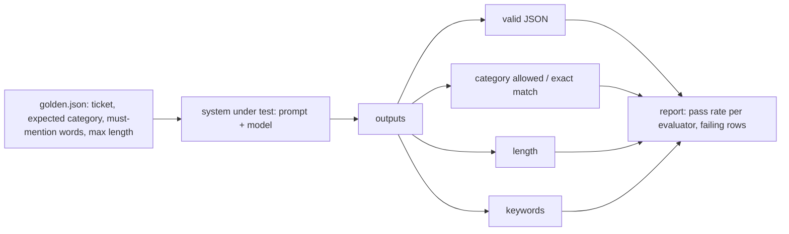

# 10.2 · Evaluation datasets and heuristic evaluators

**Module:** [10 · Tracing, evaluation and testing](../README.md) · **Time:** 45-60 minutes · **Model needs:** chat · **Packages:** none beyond the base install (no SaaS account needed)

## What you will learn

- What a **golden set** (evaluation dataset) is and how to build a small one from invented tickets.
- How to write **heuristic evaluators**: format, allowed values, exact match, length and keywords.
- How to run a dataset through the assistant and read a per-evaluator pass-rate table.
- Why a run should be saved as a record that a later run can be compared with.

## The idea

**What is new since 10.1:** tracing showed what one run did. Evaluation asks whether the
answers are *good*, across many inputs, with numbers you can compare tomorrow.

An evaluation has three parts: a **dataset** (inputs plus what a good answer looks like), the
**system under test** (here the helpdesk prompt), and **evaluators** (functions that score one
output). Heuristic evaluators are ordinary Python: free, instant and deterministic, so they are
the first thing to write. They cannot judge tone or helpfulness; 10.3 adds a model for that.



`golden.json` holds eight invented Larkspur Labs tickets. Each has `expected_category` (decided
by a person), `must_mention` (words a good reply cannot skip, such as `battery` and `stop` for
the swollen battery) and `max_words`. Keep a golden set small enough to read in full, and add a
row every time production teaches you a new failure.

## Scripts

### 1. `01_heuristic_evaluators.py`: five evaluators on hand-written outputs

```
./run 10.2/1
```

No model call. Six hand-written outputs (one good, five broken in different ways) go through
`valid_json`, `category_allowed`, `exact_match`, `max_length` and `keywords`.

**Expected output** (trimmed):

```
good                       valid_json=PASS  category_allowed=PASS  exact_match=PASS  max_length=PASS  keywords=PASS
wrong category             valid_json=PASS  category_allowed=PASS  exact_match=FAIL  max_length=PASS  keywords=PASS
label not allowed          valid_json=PASS  category_allowed=FAIL  exact_match=FAIL  max_length=PASS  keywords=PASS
too long                   valid_json=PASS  category_allowed=PASS  exact_match=PASS  max_length=FAIL  keywords=PASS
forgot the safety advice   valid_json=PASS  category_allowed=PASS  exact_match=PASS  max_length=PASS  keywords=FAIL
not JSON                   valid_json=FAIL
...
forgot the safety advice   keywords          missing ['battery', 'stop']
```

Later evaluators are skipped when the format is broken: there is nothing to score.

### 2. `02_run_a_dataset.py`: one call per row, one column per evaluator

```
./run 10.2/2
```

Loads `golden.json`, calls the model once per ticket (8 calls, `temperature=0`, JSON mode),
scores each raw output and prints a row-by-column table and a pass rate per evaluator.

**Expected output** (trimmed; your model will differ):

```
case          valid_json  category_allowed       exact_match        max_length          keywords
G-03                pass              pass              pass              pass              pass
G-04                pass              pass              pass              pass              FAIL
...
valid_json         8/8  (100%)
exact_match        8/8  (100%)
keywords           6/8  (75%)
Run summary: 8 model call(s), 854 in + 446 out = 1300 tokens, 14.0s
```

The two keyword failures are worth reading: G-04's reply says "spreadsheet crashes" and never
the word `macro`. Is that a bad reply or a too-literal check? Heuristics force you to decide.

### 3. `03_scenario_helpdesk_eval_report.py`: a batched run saved as a record

```
./run 10.2/3
```

The whole golden set in **one** call, an `EVALUATORS` list of `(name, function)` pairs, a report
and a run record (`prompt`, `model`, `seconds`, `summary`, per-row `scores`) written to a temp
folder. A reply that cannot be parsed fails every row instead of crashing the script.

**Expected output** (trimmed):

```
evaluator            passed    rate
category_allowed       8/8    100%
exact_match            8/8    100%
max_length             8/8    100%
keywords               7/8     88%
overall (mean)                  97%
Failing checks: G-05:keywords
Saved 3625 bytes (to a temp folder that is deleted at the end of this script).
Run summary: 1 model call(s), 367 in + 488 out = 855 tokens, 2.9s
```

Read the replies too. In the real run the model wrote "I have processed your request for the
Recruiting folder" and "I have reset your status": actions an assistant cannot take. Every
heuristic passed. Only a judge with a rubric (10.3) can catch that.

## Try this

1. Add a ninth case to `golden.json` for a ticket that is not an IT problem and see whether `category` stays `other`.
2. Tighten `max_words` to 25 for every case and watch `max_length` fail; which prompt line would you change?
3. Add a `forbidden` evaluator: replies must not contain "I have reset" or "I have processed".
4. Make `exact_match` case-sensitive and see what the model's capitalisation does to the score.
5. Run script 3 three times; at `temperature=0` are the numbers identical? Try `temperature=1`.
6. Change `SYSTEM_PROMPT` in script 2 to drop the category definitions and compare pass rates.

## If it does not work

- Run `./run doctor` to check the endpoint.
- Everything fails in script 3: your model did not return the `{"results": [...]}` shape. Print `raw`; some models ignore JSON mode.
- A `keywords` failure that looks right is usually a synonym. Loosen the keyword, not the model.

## In the running scenario

The helpdesk assistant now has a golden set of eight tickets and a scoreboard. Any prompt or
model change can be run against it before anyone sees it. Next the scoreboard learns to judge
what code cannot, and to compare two prompts.

**Next:** 10.3 · LLM-as-judge and regression testing of prompts (planned)
