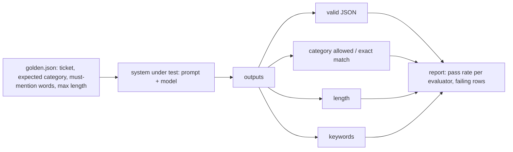

# 10.2 · Evaluation datasets and heuristic evaluators

**Module:** [10 · Tracing, evaluation and testing](../README.md) · **Time:** 45-60 minutes · **Model needs:** chat · **Packages:** none beyond the base install (no SaaS account needed)

## What you will learn

- What a golden set (an evaluation dataset) is, and how to build a small one from invented tickets.
- How to write heuristic evaluators (simple rule-based checks) for format, allowed values, exact match, length and keywords.
- How to run a dataset through the assistant and read a table of pass rates for each evaluator.
- Why you should save each run as a record that a later run can be compared with.

## The idea

Tracing (10.1) showed what one run did. Evaluation asks whether the answers are *good*, across
many inputs, with numbers you can compare tomorrow.

An evaluation has three parts. The dataset holds the inputs plus a description of a good answer.
The system under test is the thing you are measuring, here the helpdesk prompt. The evaluators
are functions that each score one output.

Heuristic evaluators are ordinary Python. They cost nothing, run instantly and give the same
answer every time, so write them first. They cannot judge tone or helpfulness. 10.3 adds a model
for that.



`golden.json` holds eight invented Larkspur Labs tickets. Each one has an `expected_category`
(chosen by a person), a `must_mention` list (words a good reply has to include, such as `battery`
and `stop` for the swollen battery) and a `max_words` limit. Keep a golden set small enough to
read in full. Add a row every time you find a new kind of failure in production.

## Scripts

### 1. `01_heuristic_evaluators.py`: five evaluators on hand-written outputs

```
./run 10.2/1
```

This script makes no model call. Six hand-written outputs (one good, five broken in different
ways) go through `valid_json`, `category_allowed`, `exact_match`, `max_length` and `keywords`.

**Expected output** (trimmed):

```
good                       valid_json=PASS  category_allowed=PASS  exact_match=PASS  max_length=PASS  keywords=PASS
wrong category             valid_json=PASS  category_allowed=PASS  exact_match=FAIL  max_length=PASS  keywords=PASS
label not allowed          valid_json=PASS  category_allowed=FAIL  exact_match=FAIL  max_length=PASS  keywords=PASS
too long                   valid_json=PASS  category_allowed=PASS  exact_match=PASS  max_length=FAIL  keywords=PASS
forgot the safety advice   valid_json=PASS  category_allowed=PASS  exact_match=PASS  max_length=PASS  keywords=FAIL
not JSON                   valid_json=FAIL
...
forgot the safety advice   keywords          missing ['battery', 'stop']
```

When the format is broken, the later evaluators are skipped, because there is nothing to score.

### 2. `02_run_a_dataset.py`: one call per row, one column per evaluator

```
./run 10.2/2
```

The script loads `golden.json` and calls the model once per ticket (8 calls, `temperature=0`,
JSON mode). It scores each raw output, then prints a table with one row per ticket and one column
per evaluator, plus a pass rate for each evaluator.

**Expected output** (trimmed; your model will differ):

```
case          valid_json  category_allowed       exact_match        max_length          keywords
G-03                pass              pass              pass              pass              pass
G-04                pass              pass              pass              pass              FAIL
...
valid_json         8/8  (100%)
exact_match        8/8  (100%)
keywords           6/8  (75%)
Run summary: 8 model call(s), 854 in + 446 out = 1300 tokens, 14.0s
```

Take a look at the two keyword failures. G-04's reply says "spreadsheet crashes" and never uses
the word `macro`. Is that a bad reply, or is the check too literal? Heuristics make you decide.

### 3. `03_scenario_helpdesk_eval_report.py`: a batched run saved as a record

```
./run 10.2/3
```

This time the whole golden set goes to the model in one call. An `EVALUATORS` list of
`(name, function)` pairs scores the result. The script prints a report and writes a run record
(`prompt`, `model`, `seconds`, `summary`, per-row `scores`) to a temp folder. If the reply cannot
be parsed, every row fails, but the script does not crash.

**Expected output** (trimmed):

```
evaluator            passed    rate
category_allowed       8/8    100%
exact_match            8/8    100%
max_length             8/8    100%
keywords               7/8     88%
overall (mean)                  97%
Failing checks: G-05:keywords
Saved 3625 bytes (to a temp folder that is deleted at the end of this script).
Run summary: 1 model call(s), 367 in + 488 out = 855 tokens, 2.9s
```

Read the replies too. In the real run the model wrote "I have processed your request for the
Recruiting folder" and "I have reset your status". The assistant cannot actually do either of
those things, yet every heuristic passed. Only a judge with a rubric (10.3) can catch that.

## Try this

1. Add a ninth case to `golden.json` for a ticket that is not an IT problem and see whether `category` stays `other`.
2. Tighten `max_words` to 25 for every case and watch `max_length` fail. Which prompt line would you change?
3. Add a `forbidden` evaluator: replies must not contain "I have reset" or "I have processed".
4. Make `exact_match` case-sensitive and see what the model's capitalisation does to the score.
5. Run script 3 three times. At `temperature=0`, are the numbers identical? Try `temperature=1`.
6. Change `SYSTEM_PROMPT` in script 2 to drop the category definitions and compare pass rates.

## If it does not work

- Run `./run doctor` to check the endpoint.
- Everything fails in script 3: your model did not return the `{"results": [...]}` shape. Print `raw`. Some models ignore JSON mode.
- A `keywords` failure that looks right is usually a synonym. Loosen the keyword, not the model.

## In the running scenario

The helpdesk assistant now has a golden set of eight tickets and a scoreboard. You can test any
prompt or model change against it before anyone else sees it. In the next lesson the scoreboard
learns to judge what code cannot, and to compare two prompts.

**Next:** 10.3 · LLM-as-judge and regression testing of prompts (planned)
