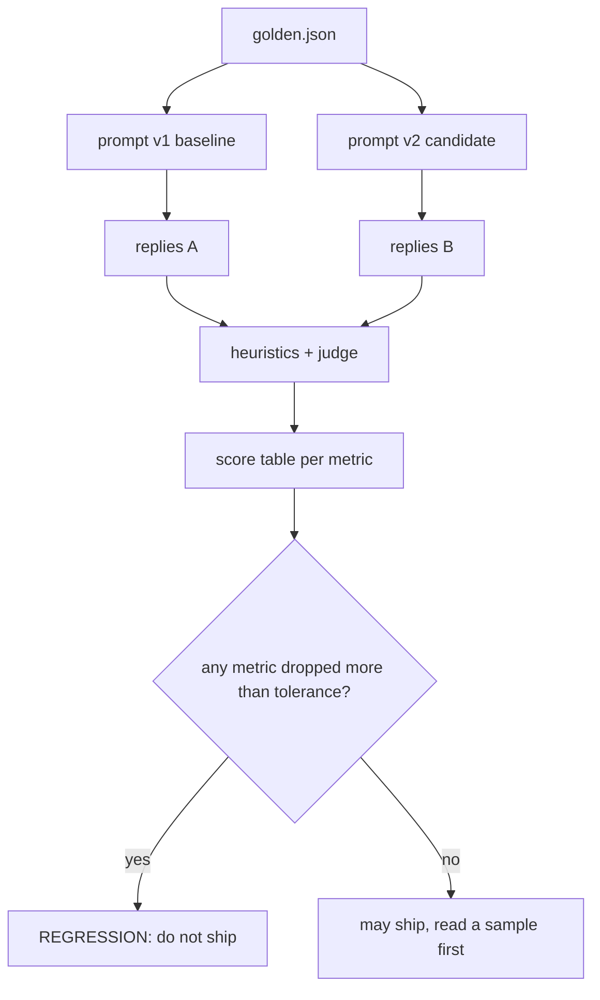

# 10.3 · LLM-as-judge and regression testing of prompts

**Module:** [10 · Tracing, evaluation and testing](../README.md) · **Time:** 45-60 minutes · **Model needs:** chat (JSON mode helps) · **Packages:** none beyond the base install (no SaaS account needed)

## What you will learn

- How an LLM judge works: a rubric prompt (a list of scoring questions), whole-number scores, JSON out, temperature 0.
- How to sanity-check a judge on replies you know are bad, and how to test whether its scores stay the same between runs.
- How to compare two prompt versions on the same dataset with a side-by-side score table.
- How a regression test (a check that nothing got worse) stores a baseline and flags metrics that drop by more than a set tolerance.

## The idea

The heuristics in 10.2 check what code can see. Helpfulness, honesty and tone need a reader, so a
second model call reads each reply against a rubric and scores it. Now you have two kinds of
metric: cheap exact ones and judged ones. Together they let you answer the question that matters:
*did this prompt change make things better or worse?*



A judge is only as good as its rubric. Ask specific questions ("does the reply claim an action
it cannot perform?") rather than a vague "quality 1-10". Use small whole-number scales, ask for a
short reason, and send several replies per call to save money.

A judge is also a model. It can be too generous, give different scores on different runs, and
prefer replies written in its own style. Before you trust it, test it on replies you know are bad.

## Scripts

### 1. `01_llm_as_judge.py`: a judge scores three hand-written replies

```
./run 10.3/1
```

There is one ticket (the swollen battery) and three replies written by hand: a good one, one that
claims "I have already ordered you a new laptop", and a curt one. The judge scores each from 1 to 5
on `no_invented_actions`, `actionable` and `tone`. A second, identical call checks whether the scores stay the same.

**Expected output** (trimmed):

```
reply                   no_invented_actions           actionable                 tone
R1 good                                   5                    5                    5
R2 invents an action                      1                    1                    3
R3 curt                                   5                    1                    1
R2 invents an action: The assistant claims to have performed an action it cannot verify or execute.
9 of 9 scores identical between the two runs.
Run summary: 2 model call(s), 670 in + 416 out = 1086 tokens, 3.2s
```

The judge passed the test. It told the good reply apart from both bad ones, and marked each bad one
down on the right criterion. R3 scores 5 on `no_invented_actions` because it is rude but claims nothing.

### 2. `02_compare_two_prompts.py`: v1 vs v2 on the same eight tickets

```
./run 10.3/2
```

The script makes four calls, each covering all eight tickets: replies for v1, replies for v2,
and a judge pass for each. It scores both with heuristics (`exact_match`, `max_length(40)`,
`keywords`) and three judged criteria, all scaled to 0..1.

**Expected output** (trimmed; your model will differ):

```
metric                            v1      v2   change
exact_match                     1.00    1.00    +0.00
max_length(40)                  1.00    1.00    +0.00
keywords                        0.88    0.88    +0.00
judge:no_invented_actions       0.88    0.90    +0.03
judge:actionable                1.00    1.00    +0.00
judge:tone                      1.00    1.00    +0.00
```

On this model, the five extra rules in v2 barely moved the numbers. The baseline prompt was
already good, and the judge is generous (it scored almost everything 5). A small dataset and a
generous judge cannot see small improvements.

Printing a pair of replies shows what the table hides. v1's G-03 reply promises "I will reset
your session", and v2's makes up a "30 minutes" lockout timer. Always read some of the replies.

### 3. `03_regression_check.py`: a candidate against a stored baseline

```
./run 10.3/3
```

The script scores the good prompt (v2) as the baseline and writes it to a temp `baseline.json`.
Then it scores a candidate (v3, "be extremely brief: at most 6 words") and compares the two metric
by metric, with a tolerance of 0.13 (one row out of eight is 0.125). A judge reply that cannot be
parsed scores 0.

**Expected output** (trimmed):

```
metric                  baseline  candidate   delta  status
exact_match                 1.00       1.00   +0.00  ok
keywords                    0.88       0.38   -0.50  REGRESSED
judge:actionable            0.95       0.88   -0.07  ok
judge:safety_first          1.00       1.00   +0.00  ok
REGRESSION in keywords: do not ship the candidate. (10.4 turns this into a failing exit code.)
```

The cheap heuristic caught what the judge missed. The six-word replies lost the keywords, yet
the generous judge still gave `actionable` 0.88. This is why a suite uses both kinds of metric.

## Try this

1. In script 1, add a fourth reply that is correct but rude, and see which criteria drop.
2. Make the judge stricter ("a score of 5 is rare") and see how the v1/v2 table changes.
3. In script 2, add a v3 of your own to `PROMPTS` and compare three versions.
4. In script 3, set `TOLERANCE = 0.0`, run it twice comparing the good prompt with itself, and see whether random variation alone raises false alarms.
5. Swap the candidate for "be extremely brief" with a keyword-friendly rule ("always name the device") and see whether the regression goes away.
6. If you have a second model, change `model=` for the judge only and compare its scores.

## If it does not work

- Run `./run doctor` to check the endpoint.
- Judge columns show `-` or `0.00`: the judge did not return the requested JSON. Script 1 prints the raw reply; try a model that supports JSON mode.
- Your numbers differ from the README: that is expected. Model output varies. Compare which metric moved, not the exact digits.

## In the running scenario

The helpdesk team can now change its system prompt on a Friday afternoon and know the same
afternoon whether replies got worse, instead of hearing about it from employees on Monday. The
capstone packages this as a suite whose exit code fails the build.

**Next:** 10.4 · Capstone: an evaluation suite for the helpdesk assistant (planned)
