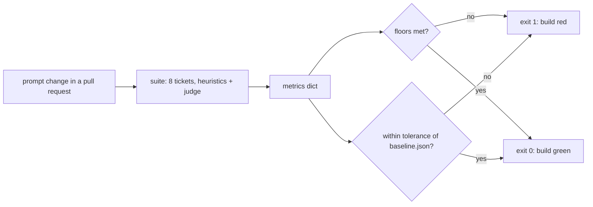

# 10.4 · Capstone: an evaluation suite for the helpdesk assistant

**Module:** [10 · Tracing, evaluation and testing](../README.md) · **Time:** 60-90 minutes · **Model needs:** chat (JSON mode helps) · **Packages:** none beyond the base install (no SaaS account needed)

## What you will learn

- How to combine a golden set, heuristic evaluators and an LLM judge into one **suite**: prompt in, metrics out.
- How to keep a **baseline** in version control and flag regressions against it.
- How to set absolute **floors** and turn the verdict into an **exit code** that fails a build.

## The idea

**What is new since 10.3:** nothing new in the model calls. This lesson is a capstone: it
packages 10.2 and 10.3 into something a team can run on every pull request, and adds the one
missing piece, an **exit code**. CI systems only understand 0 (green) and non-zero (red).

## The brief

Larkspur Labs' IT team edits the helpdesk system prompt every few weeks. Twice a "small
tidy-up" made replies worse and nobody noticed for days. Build a suite that blocks a prompt
change which makes replies worse, runs in under a minute and costs a few cents.

**Acceptance criteria**

1. One function takes a system prompt and returns a dict of metrics between 0 and 1.
2. The metrics include at least three heuristic checks and one LLM-judged criterion.
3. A committed `baseline.json` holds the scores of the shipped prompt; `thresholds.json` holds the floors and the allowed drop.
4. `03_ci_gate.py --ci` exits 0 for the current prompt and 1 for a deliberately degraded one.
5. A judge that returns nothing, or an unparseable reply, makes the suite fail rather than pass.

**Stretch goals**

- Add a `forbidden` evaluator (replies must not contain "I have reset" or "I have already").
- Grow `golden.json` to 20 tickets, including two nasty ones (angry employee, ticket mixing two problems) and re-measure the noise.
- Judge with a different model than the one under test.
- Run each prompt three times and gate on the mean, so a lucky or unlucky run does not decide.
- Write the GitHub Actions job that runs the gate only when files under `prompts/` change.



## Scripts

### 1. `01_build_the_suite.py`: the suite and one report

```
./run 10.4/1
```

Defines the dataset, evaluators, judge rubric and `run_suite(ctx, prompt, cases)`; scores the
current prompt (2 model calls) and prints a bar per metric, then the metrics as JSON.
`baseline.json` was produced from this output.

**Expected output** (trimmed):

```
exact_match                   1.00  ####################
max_length                    1.00  ####################
keywords                      0.88  ##################
judge_no_invented_actions     0.90  ##################
judge_actionable              1.00  ####################
judge_tone                    1.00  ####################
Run summary: 2 model call(s), 1226 in + 910 out = 2136 tokens, 1.4s
```

### 2. `02_prompt_regression.py`: candidate vs the committed baseline

```
./run 10.4/2
./run 10.4/2 --degrade
```

Compares the candidate's metrics with `baseline.json`; a metric that drops by more than
`max_drop_from_baseline` is `REGRESSED`. `--degrade` swaps in a "6 words, no advice" prompt.

**Expected output** (with `--degrade`, trimmed):

```
metric                       baseline  candidate   delta  status
keywords                         0.88       0.38   -0.50  REGRESSED
judge_no_invented_actions        0.90       0.60   -0.30  REGRESSED
judge_actionable                 1.00       0.82   -0.18  REGRESSED
judge_tone                       1.00       0.60   -0.40  REGRESSED
G-04: Rolling back update for you.
```

Without the flag every status is `ok` and the script says "No regression against the baseline."
Notice the degraded reply: six words, and it still claims an action ("Rolling back update").
This time the judge noticed; in 10.3 it was more lenient on a similar prompt. Judges vary.

### 3. `03_ci_gate.py`: floors, baseline and an exit code

```
./run 10.4/3                      # demonstration: gates both prompts, always exits 0
./run 10.4/3 --ci                 # the real gate: exits 1 if the current prompt fails
./run 10.4/3 --ci --degrade       # sabotaged prompt: exits 1
```

`gate(metrics, baseline, thresholds)` returns a list of failure messages; empty means green.
In `--ci` mode a non-empty list becomes `SystemExit(1)` after the lesson summary has printed.

**Expected output** (demonstration, trimmed):

```
current prompt : exit code 0 (green)
degraded prompt: exact_match=1.00  max_length=1.00  keywords=0.38  judge_no_invented_actions=0.60 ...
  FAIL  keywords 0.38 is below the floor 0.70
  FAIL  judge_tone dropped 0.40 from the baseline 1.00
degraded prompt: exit code 1 (RED)
```

Check it yourself: `./run 10.4/3 --ci --degrade; echo $?` prints 1 (in PowerShell,
`$LASTEXITCODE`). The suite also fails (non-zero) when the endpoint is unreachable, which is
what you want: a gate that cannot measure must not pass.

## Try this

1. Lower a floor in `thresholds.json` until the degraded prompt passes the floors; the baseline rule still catches it. Why keep both?
2. Add a `forbidden` evaluator to `run_suite` and a floor for it.
3. Set `max_drop_from_baseline` to 0 and run `./run 10.4/2` three times: how often does noise alone fail?
4. Add four more tickets to `golden.json`; baseline and thresholds then need re-checking. When should you regenerate `baseline.json`?
5. Write a subtle bad prompt (for example "never mention the IT desk") and see which metric, if any, notices.
6. Use `--raw` to see the judge request and check that the reply text, not the expected answers, is all it receives.

## If it does not work

- Run `./run doctor` to check the endpoint.
- Every judge metric is 0.00: the judge reply was not valid JSON. Try a model with JSON mode, or print the raw reply from `call_json`.
- `--ci` always fails: the floors may be higher than your model can reach. Measure with script 1, then set floors a little below.

## In the running scenario

The helpdesk assistant now has a safety net: a golden set, a rubric, a committed baseline and a
gate. Prompt changes can be proposed freely because bad ones are rejected by a machine in under
a minute. That completes the module: you can trace what the assistant did (10.1) and measure
whether it did well (10.2-10.4).

**Next:** 11.1 · MCP architecture: hosts, clients, servers, primitives (module 11, MCP: architecture and custom servers)
